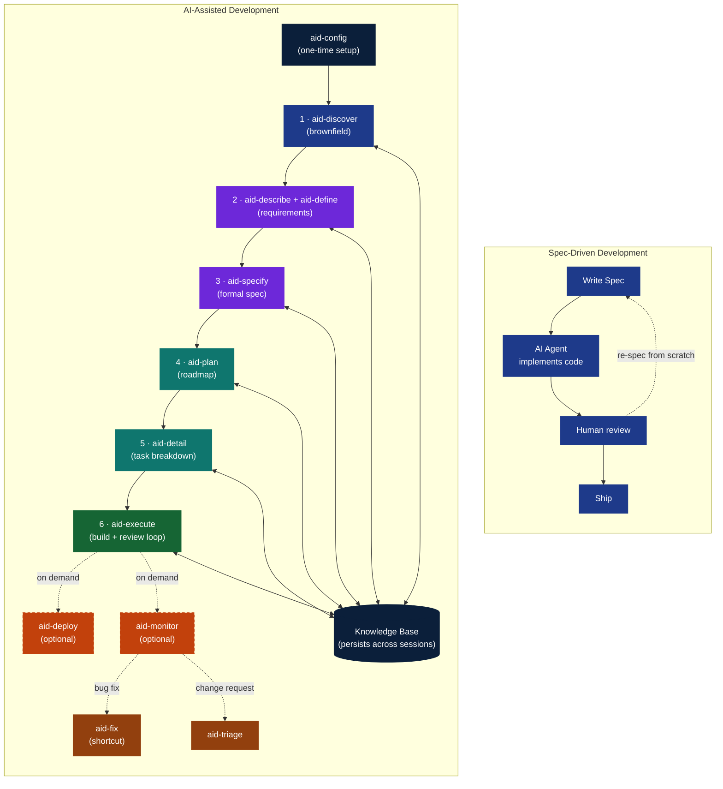

## 9. Comparison with SDD

### Where We Overlap

Both AID and SDD:
- Use specifications as the central development artifact.
- Employ AI agents for code implementation.
- Rely on tests as contracts between spec and code.
- Require human review of agent output.
- Use markdown as the specification format.

### Where We Diverge

*Left: SDD starts from a written spec and loops back to re-spec from scratch on changes. Right: AID begins with Discovery and a persistent Knowledge Base, uses two-level planning, eleven formal feedback loops, and the optional Deploy/Monitor shortcut paths that route post-production changes out to the shortcut/triage entry layer rather than back into the numbered pipeline.*

| **Dimension** | SDD | AID |
|--------------|-----|-----|
| **Starting point** | A spec | Understanding (Discovery) |
| **Brownfield support** | Gap acknowledged | First-class Discovery phase with a 14-document KB (project-configurable) |
| **Spec philosophy** | Spec is source of truth | Spec is hypothesis — revised by formal protocol |
| **Requirements** | Assumed to exist | Gathered through adaptive interview |
| **Planning depth** | Single spec | Two-level: Plan (strategy) → Detail (tactics) |
| **Feedback loops** | Rebuild spec from scratch | Eleven formal loops (8 development + 2 post-production + 1 cross-cutting) |
| **Testing** | Not addressed as separate phase | TEST is a first-class task type inside Execute; Deploy runs a full final-verification gate |
| **Quality gates** | Generic conformance tests | One universal severity rubric (deterministic — computed, not judged) plus project-defined quality checks |
| **Agent model** | One agent per spec | 9 specialist agents across 3 tiers; reviewer tier ≥ executor tier invariant |
| **Delivery model** | Spec → code → done | Discover → specify → plan → detail → execute → optional deploy/monitor |
| **Memory** | Stateless | Knowledge Base persists across sessions |
| **Post-delivery** | Not addressed | Monitor routes bugs to `/aid-fix`, change requests to `/aid-triage` |
| **Scope** | Code generation | Full lifecycle: discovery through production maintenance |
| **Human role** | Spec writer, reviewer | Co-pilot across all phases |
| **Scale options** | One path | Full path (`/aid-describe`) + a lite path via 34 direct-entry shortcuts, with `/aid-triage` to route when unsure, or `/aid-ask` for a plain question |

### The Core Argument

SDD says: "Write better specs, get better code."

AID says: "Understand the system first. Then write specs grounded in that understanding. Then plan the roadmap. Then detail the execution. Then build, review, and test it inside Execute's graded loop. Then ship when the delivery model requires it. And when any of that reveals you were wrong — revise formally, don't hack around it."

SDD is not wrong. It is incomplete. AID is SDD + Discovery + Feedback Loops + Two-Level Planning + a Built-in Review Loop + Institutional Memory + Production Lifecycle + a Lite Path for small work.
