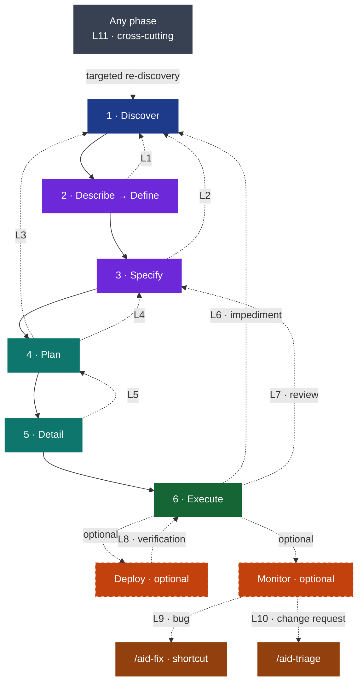

## 6. Feedback Loops



*Eleven formal feedback loops — eight within development, two from production out to the shortcut/triage entry layer, one cross-cutting from any phase. Each dashed arrow is a formal protocol that produces a Q&A entry in a STATE file, an IMPEDIMENT file, or an aid-monitor finding.*

The development pipeline (Discover through Execute) is sequential by default; the optional Deploy and Monitor shortcut paths (Definition group) are separate, on-demand paths, not a continuation of it. But real engineering is not linear. Assumptions break. Gaps appear. Production reveals truths that development couldn't anticipate. AID defines **eleven formal feedback loops** — eight within development, two connecting production back to development, and one cross-cutting re-entry available from any phase.

### The Eleven Loops

| **Loop** | From | To | Trigger condition |
|---------|------|-----|------------------|
| L1 | Describe/Define | Discover | A human's answer reveals the KB is wrong or incomplete |
| L2 | Specify | Discover | Writing the spec exposes insufficient understanding of a subsystem |
| L3 | Plan | Discover | Planning reveals the codebase is more complex than the KB captured |
| L4 | Plan | Specify | The KB is complete, but a SPEC is ambiguous or contradictory |
| L5 | Detail | Plan | The plan is too vague to decompose into tasks |
| L6 | Execute | Discover / Specify / Detail | Agent discovers an assumption doesn't hold (`IMPEDIMENT-task-NNN.md`) |
| L7 | Execute Review | Any upstream phase | Reviewer finds issues traced to the task, spec, or KB — not just code quality |
| L8 | Deploy | Execute | Final verification (build + tests + lint) fails before the delivery ships |
| L9 | Monitor | `/aid-fix` (shortcut) | Monitor classifies a finding as BUG |
| L10 | Monitor | `/aid-triage` | Monitor classifies a finding as Change Request |
| L11 | Any phase | Discover | Any phase finds the KB wrong, incomplete, or stale |

#### Development Loops (1–8)

**Loop 1: Describe/Define → Discovery.** During the interview, a human's answer reveals the KB is wrong or incomplete. Describe/Define writes a Q&A entry to the discovery-area `STATE.md` → targeted discovery on the specific area → KB updated → interview resumes with corrected understanding.

**Loop 2: Specify → Discovery.** Writing the spec exposes insufficient understanding of a subsystem. Specify pauses → writes a Q&A entry to the discovery-area `STATE.md` → targeted discovery → KB updated → Specify resumes.

**Loop 3: Plan → Discovery.** Planning reveals the codebase is more complex than the KB captured. Plan writes a Q&A entry → targeted discovery → KB updated → planning resumes.

**Loop 4: Plan → Specify.** The KB is complete, but the SPEC is ambiguous or contradictory. Plan writes a Q&A entry to the feature's `STATE.md` → spec revision (possibly with a targeted interview) → planning resumes.

**Loop 5: Detail → Plan.** The plan is too vague to decompose into tasks. Deliverables are too broad, module boundaries unclear, or test scenarios don't map to features. Detail flags the under-specified deliverable → Plan revises it → Detail resumes.

**Loop 6: Execute → Discovery / Specify / Detail.** While executing a task, the agent discovers an assumption doesn't hold in the actual codebase. `IMPEDIMENT-task-NNN.md` is written, then routed by type — `kb-gap` → targeted discovery; `architecture-conflict` → Specify; `missing-dependency` → Detail; `wrong-assumption` → update the task or SPEC. The agent never silently works around the problem.

**Loop 7: Execute Review → Any Upstream Phase.** The reviewer step inside Execute finds issues that trace to the task, the spec, or the KB — not just code quality. Issues are tagged by source (CODE / TASK / SPEC / KB). CODE issues are auto-fixed inside the Execute loop with the user's approval. A TASK issue routes to a task update; SPEC and KB issues escalate to Specify and Discovery respectively.

**Loop 8: Deploy → Execute.** (Applies only when Deploy is run.) Deploy's final verification — a full build, the complete test suite, and the lint/format check — fails before the delivery ships. Failures are documented → routed back to `/aid-execute` for the fix → Deploy's verification re-runs.

#### Post-Production Loops (9–10)

These loops apply only when Monitor is run.

**Loop 9: Monitor → `/aid-fix` (Bug Path).** Monitor classifies a finding as BUG. Monitor performs root cause analysis and routes the bug to `/aid-fix`, the direct-entry shortcut that scaffolds and implements the fix through the shortcut engine → `/aid-execute` (→ optional `/aid-deploy`). The short path.

**Loop 10: Monitor → `/aid-triage` (Change Request Path).** Monitor classifies a finding as Change Request. Monitor routes the change request to `/aid-triage`, which suggests the right entry — a matching shortcut for a well-scoped change, or the full path (`/aid-describe`) as new/changed requirements for anything broad; a large-enough CR spins up a new work.

#### Cross-Cutting Loop (11)

**Loop 11: Any Phase → Discovery (Targeted Re-Discovery).** Any phase finds the Knowledge Base wrong, incomplete, or stale for the work at hand. A targeted discovery run updates the specific KB document(s) — never a full re-discovery — and the calling phase resumes with corrected understanding. This is the loop that makes the Knowledge Base the gravitational center in practice, not just in principle.

### The Revision Trail

No artifact carries an in-document history section. There is no `## Change Log` and no `## Revision History` table: git already records every edit with author, date and diff, and a hand-maintained table drifts from it the moment someone forgets a row.

To understand *why* an artifact changed, read its history where that history is authoritative:

```bash
git log --follow -p .aid/works/work-001-example/REQUIREMENTS.md
```

What git cannot answer — where the work stands in the pipeline — lives in the area's `STATE` file, which is why that file exists and an in-document history table does not.
Git gives author, timestamp, and the exact diff for every change, and it cannot drift from the file it describes — a hand-maintained table can, and does. The commit message carries the *why*: which loop fired, and what it corrected.
The revision trail still matters for the same reason it always did — when a spec contradicts the Knowledge Base, you need to know which revision introduced the divergence. `git log -S'<the contradicting claim>'` answers that directly, and answers it for content a summary table would never have mentioned.


### Feedback Loop Artifacts

The design-phase loops record the gap as a **Q&A entry appended to the relevant area's `STATE.md`** — the discovery-area `STATE.md` (`.aid/knowledge/STATE.md`) for a KB gap, the work-area `STATE.md` for a requirements gap. The next run of the owning phase detects the pending entry and resolves it in its Q&A mode:

```markdown
### Q{N}

- **Category:** {category, e.g., Architecture, Requirements, Security}
- **Impact:** {High|Medium|Low|Required}
- **Status:** Pending
- **Context:** {why — what the calling phase found; surfaced by {calling phase, e.g. /aid-plan work-001}}
- **Suggested:** {answer if inferrable, or —}
```

The one feedback loop with its own dedicated file is **`IMPEDIMENT-task-NNN.md`** — written by Execute to `.aid/works/{work}/` when a task hits a contradiction it cannot resolve within scope:

```markdown
# Impediment — task-NNN
> Generated by: aid-execute · Status: Open

## Summary
{one sentence — what the agent found that contradicts its instructions}

## Type
wrong-assumption | missing-dependency | architecture-conflict | kb-gap

## Options
{Option A / B / C — each with approach, effort, and risk}

## Recommendation
{which option the agent recommends, and why — the human decides}
```
