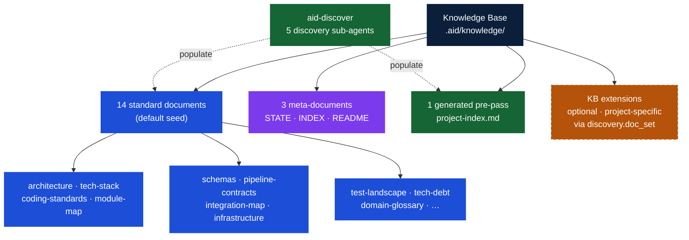
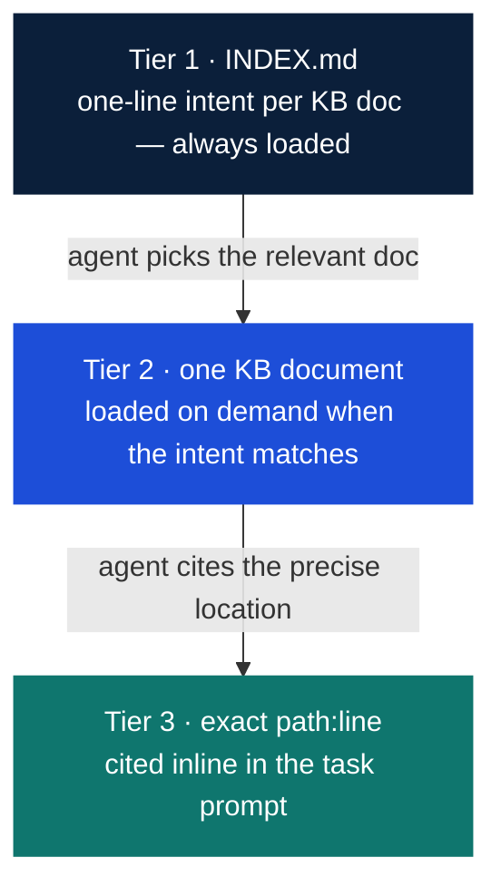

## 3. The Knowledge Base



*The Knowledge Base is the gravitational center of the entire methodology. Every phase reads from it. Any phase can trigger updates to it.*

The Knowledge Base (`.aid/knowledge/`) is institutional memory — it outlives any individual session, sprint, or team member.

### Structure

The Knowledge Base is divided into four categories: **standard** documents (the 14-document default seed), **meta** documents (INDEX, STATE, README — navigation and tracking), a **generated** pre-pass artifact (`project-index.md` in `.aid/generated/`), and optional **extensions** declared via `discovery.doc_set` in `.aid/settings.yml`. The diagram below shows these relationships.

### The Declared Doc-Set

The 14-document standard set is the **configurable default seed** — the set synthesized from `canonical/aid/templates/knowledge-base/` when no project-specific override is configured. The doc-set is **project-configurable** via `discovery.doc_set` in `.aid/settings.yml`.

Before dispatching discovery sub-agents, the GENERATE state runs a **propose→confirm checkpoint** (Step 0d): the orchestrator infers a proposed doc-set from the project's file inventory (as a diff against the default seed) and presents it to the user for confirmation or editing. Custom documents can be added; irrelevant standard ones can be dropped. The confirmed set is written to `.aid/settings.yml` and drives all subsequent discovery dispatches.

In practice: a simple CLI tool needs a handful of documents at depth; the rest stay thin. An enterprise monorepo fills all 14 and adds custom extensions. A greenfield project populates `technology-stack.md`, `coding-standards.md`, and `domain-glossary.md` from the interview and leaves the rest to grow. The shape is fixed even when a document is sparse, so the index and navigation remain consistent.

<details>
<summary>Full 14-document default seed listing</summary>

```
.aid/knowledge/
├── INDEX.md               # Meta: 2-3 line summary of every KB document (the navigation map)
├── README.md              # Meta: completeness status per document
├── STATE.md               # Meta: discovery-area state — grade, Q&A entries, review & summarization history
├── project-index.md       # Generated: a file-inventory pre-pass for the discovery sub-agents
│
├── project-structure.md   # Repository layout and file inventory
├── external-sources.md    # Vendor docs and references registered for discovery
├── architecture.md        # Patterns, layers, module boundaries, data flow
├── technology-stack.md    # Languages, frameworks, versions, build tools, runtime
├── module-map.md          # Every module: purpose, dependencies, size, test coverage
├── coding-standards.md    # Naming conventions, formatting, error handling patterns
├── schemas.md             # Database schema, entities, relationships, migrations
├── pipeline-contracts.md  # Pipelines/APIs consumed and exposed: auth models, rate limits
├── integration-map.md     # Message queues, caches, third-party services, webhooks
├── domain-glossary.md     # Business terms, domain language, entity definitions
├── test-landscape.md      # Test frameworks, coverage, test types, CI/CD pipeline
├── tech-debt.md           # Known debt items with file refs, risk ratings, remediation
├── infrastructure.md      # Hosting, networking, environments, deployment model
└── feature-inventory.md   # Canonical feature list, mapped to modules/endpoints/data
```

</details>

The fixed shape has a purpose: downstream skills always know exactly where to look. `schemas.md` always holds schemas. `tech-debt.md` always holds debt. Convention beats search.

### Completeness Is Tracked

The `README.md` at the root of the Knowledge Base tracks what exists and what is missing:

```markdown
# Knowledge Base — {Project Name}

| Document | Status | Last Updated | Source |
|----------|--------|-------------|--------|
| architecture.md | ✅ Complete | Mar 16 | aid-discover |
| coding-standards.md | ⚠️ Partial | Mar 16 | aid-discover (inferred) |
| domain-glossary.md | ❌ Missing | — | Needs interview |
| tech-debt.md | ❌ Missing | — | Needs interview |
```

Partial and missing documents are not failure states — they are the honest acknowledgment of what isn't known yet. A partial `coding-standards.md` is better than a confident but wrong one. The KB grows as understanding accumulates.

### Context Feeding Strategy — RAG by Convention

The Knowledge Base is the project's memory. But memory only works if agents know where to look.

A common failure mode: an agent receives a task spec and the project spec, implements something technically correct — and violates a convention documented in `coding-standards.md` that it never saw. The agent didn't know the document existed. The fix goes through review, gets rejected, comes back, gets redone. Waste.

**AID solves this with the KB Index — a lightweight map of the entire Knowledge Base.**

`aid-config` creates `.aid/knowledge/INDEX.md` at setup with placeholder rows; Discovery regenerates it with real content as its final step (and on the greenfield path, which skips Discovery, `aid-describe` updates it where applicable). This file contains a 2-3 line summary of each KB document — what it covers, when to consult it. It costs almost nothing to include in an agent's context, but it gives the agent the ability to self-serve.

```markdown
# Knowledge Base Index — {Project Name}

Use this index to find the right document before making assumptions.
If your task touches an area covered here, read the relevant document first.

| Document | Summary |
|----------|---------|
| architecture.md | MVVM + Clean Architecture layers. Service registration in ServiceCollectionExtensions.cs. Navigation via INavigationService. |
| coding-standards.md | PascalCase for public, _camelCase for fields. Result<T> for error handling. No exceptions for flow control. Async suffix on all async methods. |
| schemas.md | SQLite via EF Core. 8 entities. Soft deletes on Recording and Transcript. Migrations in /Migrations. |
| module-map.md | 12 modules. Core (services), UI (views/viewmodels), Infrastructure (data access), Tests. Module dependency diagram. |
| ... | ... |
```

**The feeding protocol:**

1. **Every task receives `INDEX.md`.** Always. It is the map. Cost: approximately 200–500 tokens. Value: the agent knows where to look.
2. **The orchestrator selects 2–4 relevant KB docs** based on the task's domain (data work → `schemas.md`, pipeline/API work → `pipeline-contracts.md`).
3. **The task template includes a search instruction:** "If you need context not provided, consult `.aid/knowledge/INDEX.md` and read the relevant document before making assumptions."
4. **Review validates context usage.** One review criterion: did the agent use available KB context, or did it guess?

This is **RAG by convention** — not embeddings and vector databases, but predictable file structure and an index that agents navigate. Retrieval happens in three tiers, cheapest first:



1. **Tier 1 — `INDEX.md`, always loaded.** Every task prompt carries the index (~200–500 tokens total). The agent always knows *what knowledge exists and which file holds it*, at negligible context cost.
2. **Tier 2 — one KB document, on demand.** From an INDEX entry the agent reads the single document a task needs. The fixed-shape directory makes this deterministic — `schemas.md` always holds schemas, `tech-debt.md` always holds debt — so the agent navigates by convention, never by search.
3. **Tier 3 — an exact repository location, via citation.** Every factual claim in a KB document carries an inline `path:line` citation. From a KB doc the agent jumps straight to the precise file and line — never globbing, never bulk-loading unrelated source.

The agent pays a few hundred tokens to know where everything is, then spends its context budget only on the one document and the specific lines a task genuinely needs.

**Why not a vector database?** Because the KB is small enough (14 standard documents, each a short markdown file) that convention beats infrastructure. The bottleneck is not retrieval speed — it is knowing what exists. The INDEX solves that at a fraction of the operational complexity.

**When does the INDEX update?** `aid-config` seeds it at setup; thereafter it is regenerated every time Discovery runs (full or targeted), and `aid-describe` updates it where applicable as requirements evolve. It is always rebuilt from the current state of the KB — never manually maintained.

### The KB Outlives the Project

The Knowledge Base is institutional memory. It outlives any individual session, sprint, or developer. When a new team member joins — human or AI — they read the KB and have the project's full context. When a feature request arrives six months later, the KB tells you what the system looks like now, not what the spec said it should look like.

This is the third conviction underlying AID: the Knowledge Base is the gravitational center. Not the spec. Not the code. The accumulated understanding of the project — architecture, conventions, domain language, tech debt — persists across phases, sprints, and team changes. The code is the output. The KB is the understanding that produces it.
