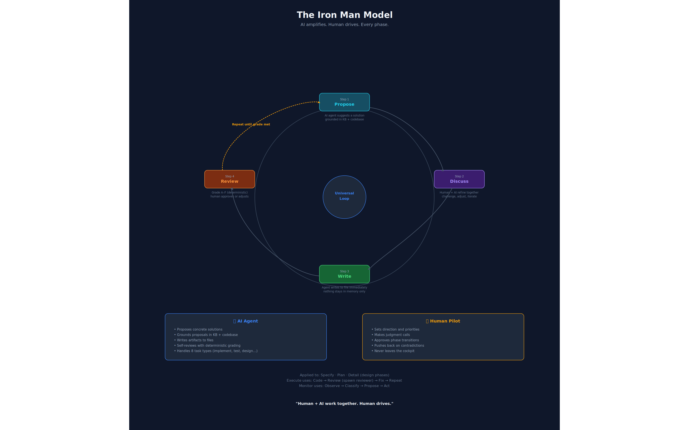

**A Complete Methodology for AI Integrated Software Development**

*Version 3.2 — June 2026*

AID — **AI Integrated Development** — is a methodology for software development where human and AI co-execute every phase. The human is the pilot, the AI is the suit. The ideas behind it are explained on these pages, one question each. Read them to understand the design before you look up facts in the [Reference](/reference/overview/) section.

- [The pipeline](/concepts/pipeline/): the phases, the three doors in, and what each phase produces.
- [Knowledge Base](/concepts/knowledge-base/): the living specification that makes every later task faster.
- [Agents](/concepts/agents/): the agent model, its tiers, and how skills dispatch agents.
- [Feedback loops](/concepts/feedback-loops/): the formal pathways for upstream revision.
- [Case studies](/concepts/case-studies/): greenfield, brownfield full path, brownfield lite path.
- [AID and spec-driven development](/concepts/aid-and-sdd/): where AID subsumes spec-driven development and where it diverges.
- [FAQ](/concepts/faq/): common questions about adoption, tooling and the lite path.

The philosophy behind all of it follows on this page.

---

## 2. Philosophy

### Waterfall + AI — and That Is the Point

Understand → Specify → Plan → Build → Verify → Ship.

This is the Waterfall sequence. AID embraces it deliberately.

Waterfall failed not because the sequence was wrong, but because humans couldn't execute it fast enough to afford iteration. When discovery takes weeks and specs take days, going back to fix a wrong assumption costs a sprint. Teams learned to skip forward, hack around problems, and call it "agile."

AI changes the economics:

- **Discovery** that took weeks takes hours. An agent can scan a 21 GB codebase, map its architecture, catalog its conventions, and produce a structured Knowledge Base in a single session.
- **Specification** that took days takes minutes. With a Knowledge Base as context, generating a grounded spec is a single prompt, not a week of meetings.
- **Iteration is cheap.** Feedback loops cost tokens, not sprints. Going back to Discovery to fill a knowledge gap costs pennies, not calendar weeks.
- **Documents don't rot.** The same agents that write code maintain the Knowledge Base and specs. Keeping them current is nearly free when the overhead is tokens rather than meeting time.

Agile was the right answer to Waterfall's execution problem. AI is the right answer to Agile's rigor problem. AID is Waterfall with AI execution and formal feedback loops — the methodology that finally works because the bottleneck shifted from "humans are slow" to "humans set direction."

This is not anti-Agile. Sprints, backlogs, and retrospectives can coexist with AID phases. What AID replaces is the *missing structure* inside Agile iterations — the skip from "good idea" straight to implementation because discovery and specification felt too slow to be worth doing.

### The Iron Man Model: Human-in-the-Middle

*The Iron Man Model. Every design phase on the full path follows the same loop: AI proposes (grounded in KB and codebase), human and AI discuss, AI writes, AI reviews — and the loop repeats until the output meets the bar. Human approves advancement. Human never leaves the cockpit.*

Every phase is co-executed by human and AI. Not "AI executes, human rubber-stamps." Not "human does the thinking, AI does the typing." The human and AI work together within each phase, with the AI amplifying the human's capabilities.

**Between phases, the human gives the OK to advance.** The pipeline never auto-advances. The human reviews the phase output, decides whether it is good enough, and greenlights the next phase. This is the checkpoint that keeps the human in control without slowing the work to human speed.

**A note on universality.** The Propose → Discuss → Write → Review loop is universal across the full path — Specify, Plan, Detail, and Execute each follow it. The lite path is different: a direct-entry shortcut runs the shared shortcut engine's CAPTURE/SPEC/PLAN/DETAIL states without a per-state human checkpoint — the only interactive moments are a rare CAPTURE gap-question and the terminal approval halt — then GATE grades every document mechanically before that halt. The Iron Man loop shapes every full-path phase; the lite path is a faster, narrower, mostly-autonomous variant designed for proportionate scope, with quality enforced once, mechanically, rather than at every step.

### Three Core Principles

**1. Knowledge Before Specification**

Every methodology tells you to "write good specs." None tells you how to understand a system well enough to write them. AID does. The Discovery phase produces a Knowledge Base — a structured collection of documents covering architecture, conventions, data models, integrations, tech debt, and domain language. The spec is then written *against* this knowledge, not from imagination.

The contrast with greenfield projects is instructive. On greenfield, you skip Discovery — there is no existing system to understand. But understanding still precedes specification. `aid-describe`'s DESCRIBE-SEED state forward-authors a five-element Knowledge Base seed from intent — domain language, intended architecture, conventions, technology stack, and key decisions — before a single line of code exists. This inverts the brownfield direction: the design documents are the source of truth (stamped `source: forward-authored`), and the code is built to conform to them. When code later exists, `aid-housekeep`'s conformance lane checks for divergence and surfaces any gap for human reconciliation, never overwriting the design automatically.

**2. Specs Are Living Documents**

A spec written before implementation is a hypothesis. A spec revised after implementation is knowledge. AID treats specs as living artifacts with formal revision protocols. Every change is tracked, justified, and approved. This is not chaos — it is controlled evolution with a full audit trail.

This matters enormously in brownfield projects. The codebase was built by people who are no longer here, against requirements that have since changed, using patterns that were conventional five years ago. Any spec you write will be partially wrong. The question is not whether you will revise — it is whether you will do so formally (with a traceable revision history) or informally (with silent workarounds and hidden debt).

**3. Feedback Over Forward-Only**

The pipeline is sequential by default, but any phase can trigger upstream revision through structured protocols. Discovery can be re-entered from any phase. Specs can be revised during planning. Tasks can be amended during implementation. The revision trail provides audit transparency while keeping the project moving.

AID defines eleven named feedback loops (see §6). The loops are not a failure mode — they are the design. The pipeline is sequential because that is the right default; the loops are formal because reality is not sequential.

### What AID Removes

Hand a capable coding agent a vague task and a large repository, and you get predictable failure modes. AID removes each one structurally — through process, not prompt-tuning.

| **Failure mode** | What it looks like | How AID removes it |
|------------------|--------------------|---------------------|
| **Knowledge gaps** | The agent doesn't understand the existing system and invents how it works. | Discovery builds the Knowledge Base *before* any spec is written. Understanding precedes specification. |
| **Hallucination** | The agent states things about the code that aren't true. | Every KB claim carries an inline `path:line` citation — facts are anchored to source, not guessed. |
| **Drift** | The implementation quietly diverges from intent; the spec rots. | Spec-as-hypothesis plus eleven formal feedback loops — upstream artifacts are revised with a traceable history, never silently worked around. |
| **Overengineering** | The agent adds abstractions, options, and scope nobody asked for. | Typed, PR-sized tasks with explicit acceptance criteria; the reviewer grades against the spec and against the criteria declared for that file — global, per-document-type, and any the file adds itself — not against taste. |
| **Oversights** | Bugs, missed edge cases, and untested paths slip through. | A separate adversarial reviewer — the agent that writes never grades its own work — loops until the grade clears the bar, and every finding names the criterion it violates. |
| **Context exhaustion** | Loading the whole repository into the context window — slow, costly, lossy. | A 3-tier context economy (see §3, *Context Feeding Strategy*): an always-loaded index, then one KB document on demand, then an exact `path:line`. |

### Honest Assessment

AID is not a silver bullet. It is a deliberate trade-off.

| **AID wins** | **AID is heavier** |
|-------------|---------------------|
| Brownfield projects with accumulated complexity and missing documentation | Pure greenfield MVPs where the risk of knowledge gaps is low and the cost of discovery is real |
| Regulated environments where audit trails and traceability are requirements, not niceties | Teams with deep existing knowledge of the codebase who would be documenting what they already know |
| Long-running projects where institutional memory loss is a real cost | When "move fast and break things" is the genuine strategy and its costs are accepted |
| Teams new to AI-assisted development who need process guardrails to avoid the failure modes listed above | — |
| Situations where "move fast and break things" has already produced a pile of broken things | — |

**The routing insight:** AID does not make you weigh the cost of its full pipeline against the value of a change. That weighing is automated across three doors. Small, well-scoped work goes straight through a direct-entry shortcut into the shortcut engine. Broad or ambiguous work goes to `/aid-describe` and the full pipeline. Not sure which? `/aid-triage` looks at a one-sentence description and tells you — it suggests, it never runs anything itself. You don't configure this; you name the change, or describe it, and the methodology routes you.

**The honest cost:** AID adds process on the full path. Discovery takes time. Describe → Define takes time. Specify, Plan, and Detail add overhead before a single line of code is written. The payoff is that what gets written is the *right* code, grounded in real understanding, with a spec that won't surprise you mid-implementation. The cost is real; so is the payoff. For small work, a direct-entry shortcut keeps the cost commensurate with scope.

---

*AID V3.2 — June 2026*
*Built from practice, not theory. Every phase, every template, every feedback loop was born from real projects.*
