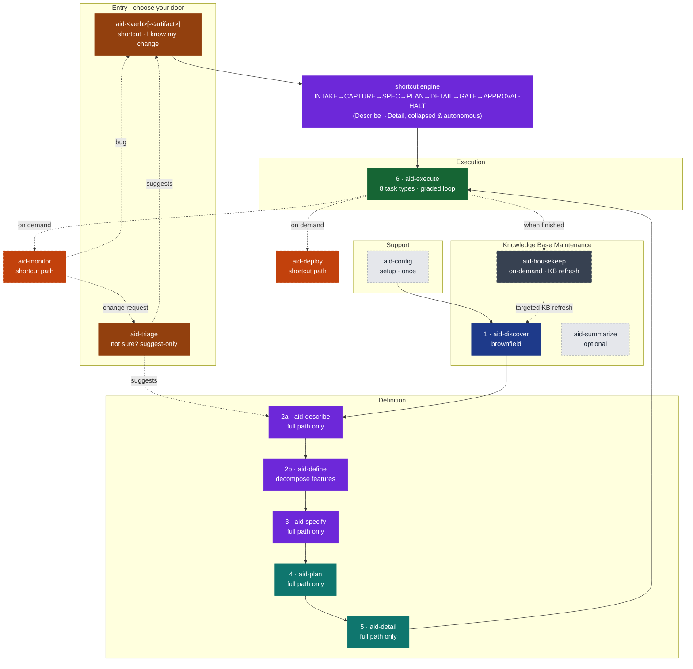
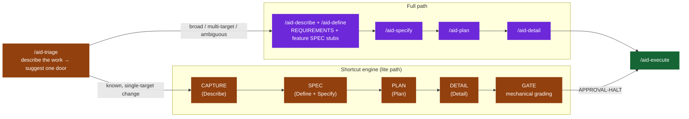

## 1. The Pipeline



*37 skill directories, four skill groups plus a direct-entry shortcut layer. Three doors in: a **shortcut** (`aid-<verb> [<kind>]`) when you already know the kind of change; **`/aid-triage`** when you don't — it suggests, never runs, either a shortcut, the full path, or `/aid-ask` when your input is a question rather than a change; or **`/aid-describe`** directly for broad or new-project work. The six numbered phases (Discover through Execute) form the mandatory sequential pipeline for the full path — brownfield enters at Discover, greenfield at Describe (Phase 2a). A shortcut instead drives the shared shortcut engine, which collapses Describe through Detail into one autonomous run and hands off straight to Execute. Deploy and Monitor are optional shortcut paths in the Definition group. `aid-housekeep` is a Knowledge Base Maintenance skill that runs off the pipeline on demand. `/aid-ask` answers project questions on demand and captures knowledge gaps. `/aid-update-kb` applies targeted KB updates through the review gate.*

### The Full Path

Brownfield projects enter at Discover and proceed through every numbered phase: Discover → Describe/Define (2a/2b) → Specify → Plan → Detail → Execute. Each phase is gated — the human approves the output before the next phase begins. The pipeline never auto-advances.

Greenfield projects skip Discover (no existing system to understand) and enter at Describe (Phase 2a). On the full path, `aid-describe` forward-authors a Knowledge Base seed from intent before any code exists — the design documents are the source of truth, and code is built to conform to them.

### Three Doors In

AID does not make you weigh the cost of the full pipeline against the size of a change — that weighing is automated across three entry points:

- **A direct-entry shortcut** (`/aid-fix`, `/aid-create api`, `/aid-update cli`, …) — you already know what kind of change this is. 34 verb-first shortcuts, from a 94-row catalog, each run through a thin doorway into a shared **shortcut engine** that collapses Describe → Define → Specify → Plan → Detail into one fast, mostly-autonomous run and produces the full flattened Lite artifact set. Each shortcut binds to one fixed `{verb, artifact}` pair, so the engine already knows the shape of the work before CAPTURE even starts. (The catalog's other 60 rows are hand-authored `repurpose` skills and their kinds — review, research, report, document, test, prototype, design, and the re-registered `aid-deploy` / `aid-monitor` / `aid-ask` — not thin engine doorways.)
- **`/aid-triage`** — you don't know which door fits. A stateless, write-free, suggest-only router: describe the work in one sentence and it suggests either the matching shortcut, the full path (`/aid-describe`), or — when your input reads as a question rather than a change — `/aid-ask`. It never runs anything on your behalf.
- **`/aid-describe`** — broad, multi-activity, or new-project work. Enters the full path directly; it no longer triages or produces lite work itself.

There's also a non-routing path for when you're not proposing a change at all: **`/aid-ask`** answers a question about the project directly, on demand — a read-only, cited, gap-capturing Q&A skill in the shortcut catalog's `repurpose` set (see §1, *Skill Inventory*, table C).

The shortcut path is not a fallback — it is the default entry for the majority of individual tasks. See §4, *The Lite Path: Direct-Entry Shortcuts*, for the shortcut engine's state machine, the family catalog, and the flattened workspace it produces.

### Skill Inventory

*37 skill directories in total — 18 curated pipeline / on-demand / router skills plus the 19 skills that own a row of the 94-row shortcut catalog (8 generated shortcut doorways + 11 hand-authored `repurpose` skills). The catalog's other 75 rows are kinds, invoked through their family as `/aid-<verb> <kind>`. Unchanged: 9 agents, 14 KB doc types.*

**A. The 18 curated skills** — the pipeline phases plus the on-demand and router skills that are *not* in the shortcut catalog; their groups, phase numbers, and mandatory pipeline membership. (`aid-deploy` and `aid-monitor` are catalog `repurpose` rows — see table D; `/aid-ask`, also a `repurpose` row, is covered in table C.)

| **Skill** | Group | Phase | Mandatory pipeline? |
|-----------|-------|-------|---------------------|
| `aid-config` | Support | — (bootstrap) | Run once before pipeline; not a numbered phase |
| `aid-discover` | Knowledge Base Maintenance | 1 | Mandatory for brownfield; skipped for greenfield |
| `aid-summarize` | Knowledge Base Maintenance | — (optional viewer) | On demand; not a numbered phase |
| `aid-describe` | Definition | 2a | Yes — full path only; no longer triages or produces lite work |
| `aid-define` | Definition | 2b | Full path only — decompose approved requirements into features |
| `aid-specify` | Definition | 3 | Full path only |
| `aid-plan` | Definition | 4 | Full path only |
| `aid-detail` | Definition | 5 | Full path only |
| `aid-execute` | Execution | 6 | Yes |
| `aid-housekeep` | Knowledge Base Maintenance | — | On demand; off the numbered pipeline |
| `aid-update-kb` | Knowledge Base Maintenance | — | On demand; targeted KB update through review gate; human-gated |
| `aid-set-connector` | Support | — | On demand; create or update a connector descriptor for an external tool |
| `aid-unset-connector` | Support | — | On demand; remove a connector descriptor and purge its secret |
| `aid-read-ticket` | Support | — | On demand; non-destructive fetch and display of one ticket via the connector-resolution ladder |
| `aid-create-ticket` | Support | — | On demand; preview + confirm before filing a new ticket via the connector-resolution ladder |
| `aid-update-ticket` | Support | — | On demand; preview + confirm before mutating one part (description/comment/status) of an existing ticket |
| `aid-triage` | Definition | — (router) | On demand; stateless suggest-only router — writes nothing |

**B. `/aid-triage`** — the suggest-only router. Not a pipeline phase and not a shortcut itself: one stateless skill (`INTAKE → CLASSIFY → SUGGEST → HALT`) that reads the shortcut catalog and points at a shortcut, the full path, or — when the input reads as a question rather than a change — `/aid-ask` (below). It writes nothing — no interview, no scaffold, no work folder, no `STATE.md`.

**C. `/aid-ask`** — the project's read-only Q&A skill. A first-class `repurpose` row in the shortcut catalog (table D below; `verb: query`, `alias_of: null`, `group: G11`): cited, gap-capturing answers to a question about the project — reachable directly, or suggested by `/aid-triage` when your input reads as a question rather than a change. Hand-authored, not generated by the shortcut build helper.

**D. The 94 shortcut-catalog rows**, by family. The catalog (`canonical/aid/templates/shortcut-catalog.yml`) has 94 rows, one canonical name each — there is no alias mechanism, no synonym data, and no redirect; a name that is not a row is not invocable at all. 19 rows own a `canonical/skills/<name>/` directory: 8 thin doorways the build helper (`build-shortcut-skills.py`) generates, and 11 `repurpose: true` hand-authored skills the helper never generates or overwrites. The other 75 rows are kinds (`kind_of: <family>`): you type `/aid-create api`, and the family runs the engine for an engine-run kind or follows `references/<kind>.md` for a hand-authored one. 34 rows run the shortcut engine; 60 are `repurpose`.

| **Family** | **Rows** | **Count** |
|-----------|---------------|-----------|
| create | `aid-create`; kinds `roadmap`, `backlog`, `mvp`, `architecture`, `stack`, `testing-strategy`, `cicd`, `api`, `cli`, `config`, `data-model`, `data-pipeline`, `infra`, `integration`, `job`, `messaging`, `theme`, `ui` | 19 |
| update | `aid-update`; the same 18 kinds | 19 |
| fix | `aid-fix` | 1 |
| refactor | `aid-refactor` | 1 |
| remove | `aid-remove` | 1 |
| deprecate | `aid-deprecate` | 1 |
| migrate | `aid-migrate` | 1 |
| test + experiment | `aid-create test` / `aid-update test`; `aid-test` (+ kinds `security` / `performance` / `data-quality`, `repurpose`); `aid-experiment` | 7 |
| prototype | `aid-prototype`, `aid-prototype ui` (both `repurpose`) | 2 |
| design | `aid-design` (catch-all) + kinds `roadmap`, `backlog`, `mvp`, `architecture`, `stack`, `testing-strategy`, `cicd`, and the 14 grid artifacts `api`, `ui`, `theme`, `cli`, `data-model`, `data-pipeline`, `messaging`, `integration`, `job`, `config`, `infra`, `test`, `document`, `dashboard` (all `repurpose`) | 22 |
| brainstorm | `aid-brainstorm` (`repurpose`) | 1 |
| document | `aid-create document` / `aid-update document`; `aid-create diagram`; `aid-document` (+ 7 genre kinds: `decision`, `architecture`, `guideline`, `standard`, `runbook`, `tutorial`, `changelog`) — all `repurpose` | 11 |
| report + dashboard | `aid-report` (`repurpose`); `aid-create dashboard`, `aid-update dashboard` | 3 |
| review | `aid-review` (`repurpose`) | 1 |
| research | `aid-research` (`repurpose`) | 1 |
| deploy + monitor | `aid-deploy`, `aid-monitor` (both `repurpose`) | 2 |
| query | `aid-ask` (`repurpose`) | 1 |
| **Total** | | **94** |

## 4. The Phases

*The skill-to-phase mapping in one scan, before the deep-dives.*

| **Skill** | Group | Phase | Output |
|-----------|-------|-------|--------|
| `aid-config` | Support | — (bootstrap) | `.aid/` scaffold · KB placeholders (14 templates + meta) · context file · `STATE.md` seeds |
| `aid-discover` | Knowledge Base Maintenance | 1 | 14-document Knowledge Base · `project-index.md` pre-pass · `STATE.md` discovery grade/Q&A |
| `aid-summarize` | Knowledge Base Maintenance | — (optional viewer) | `knowledge-summary.html` — offline KB viewer |
| `aid-describe` | Definition | 2a | `REQUIREMENTS.md` — full path only |
| `aid-define` | Definition | 2b | Feature decomposition into `REQUIREMENTS.md § 11` sections (full path only) |
| `aid-specify` | Definition | 3 | Technical spec added to each feature's `§ 11` section |
| `aid-plan` | Definition | 4 | `PLAN.md` (one `### delivery-NNN` stanza per delivery) + `STATE.yml` |
| `aid-detail` | Definition | 5 | Typed, PR-sized `deliveries/delivery-NNN/tasks/task-NNN/DETAIL.md` files + execution graph |
| `aid-execute` | Execution | 6 | Implemented + reviewed code to grade ≥ minimum; 8 task types |
| `aid-deploy` | Definition (shortcut path) | — (optional) | Release package · `package-NNN.md` · `DEPLOYMENT-STATE.md` |
| `aid-monitor` | Definition (shortcut path) | — (optional) | classified findings → `/aid-fix` (bugs) or `/aid-triage` (change requests); observation log kept in-memory (persistent `MONITOR-STATE.md` deferred) |
| `aid-housekeep` | Knowledge Base Maintenance | — | KB-DELTA refresh · SUMMARY-DELTA · workspace CLEANUP |
| `aid-triage` | Definition | — | A suggested next command (shortcut, `/aid-describe`, or `/aid-ask` for a plain question); writes nothing |
| `aid-<verb> [<kind>]` (34 shortcuts) | Definition | — | The flattened artifact set (`REQUIREMENTS.md`, `tasks/task-NNN/DETAIL.md`) via the shared shortcut engine |

AID organizes its skills into four groups — **Support**, **Knowledge Base Maintenance**, **Definition**, and **Execution**. Groups are a non-sequential way to organize the skills, not a running order. The six numbered development phases (Discover through Execute) still form the mandatory sequential pipeline: Discover sits in Knowledge Base Maintenance, Describe through Detail sit in Definition, and Execute is the sole Execution skill. `aid-deploy` and `aid-monitor` are **optional** shortcut paths in the Definition group, invoked on demand rather than as required phases. The pipeline is linear with feedback loops.

`aid-config` (bootstrap, run once) is the sole **Support** skill. **Knowledge Base Maintenance** additionally holds the on-demand KB skills: `aid-summarize` (optional KB viewer), `aid-housekeep` (KB drift maintenance between discovery cycles), `aid-update-kb` (targeted KB updates through the review gate), and `aid-ask` (Q&A). None of these are numbered phases; they do not participate in phase gates. `/aid-triage` — a stateless suggest-only router that also recognizes a plain question and points it at `/aid-ask` — and the 34 direct-entry shortcuts belong to the **Definition** group; each shortcut is a thin doorway into the shared shortcut engine that collapses Describe through Detail into one autonomous run. See below, *The Lite Path: Direct-Entry Shortcuts*, for the deep dive.

---

### Support

*Set up the workspace, once, before the pipeline begins.*

---

#### `aid-config` — Bootstrap (not a numbered phase)

**Purpose:** Initialize the AID workspace. Run once per project before the pipeline begins.

`aid-config` collects project metadata (greenfield or brownfield, project name, description, minimum grade threshold), scaffolds `.aid/knowledge/` with the KB document templates (14 standard templates from the default seed plus the meta-documents), and asks whether the `.aid/` workspace should be committed to Git.

The scaffold is the blank canvas. After `aid-config`, the KB directory exists with empty placeholders; Discovery fills it.

---

### Knowledge Base Maintenance

*Build and keep current the team's understanding of the existing system.*

This group's deep-dives below cover Discover (Phase 1), and `aid-summarize`. `aid-housekeep` (deep-dive further down, under *Off-Pipeline*), `aid-update-kb`, and `aid-ask` also belong to this group — see §1, *Skill Inventory*, table A, for their group membership and table C for `aid-ask` detail.

---

#### Phase 1: Discover (`aid-discover`)

**Purpose:** Understand the existing system. Produce the Knowledge Base.

**When to skip:** Pure greenfield projects with no existing code. Describe and Specify populate a minimal KB instead.

**When to re-enter:** Any downstream phase finds the KB wrong or incomplete. Re-entry is always *targeted* — fill the specific gap, not redo full discovery.

> [!WARNING]
> Skipping Discovery on a brownfield project means agents will work without understanding the existing architecture. The result is technically plausible but architecturally wrong code. The 40-minute Discovery investment eliminates hours of review-reject-redo cycles.

**Why this phase exists:** Every other methodology skips it. They assume you already understand the system well enough to write requirements. In brownfield projects — the overwhelming majority of enterprise software work — this assumption is wrong. The developer who built the system is gone; the documentation is stale; the architecture has drifted from whatever was originally designed. Dropping an AI agent into this without a KB produces hallucination: technically plausible but architecturally wrong code. Discovery is the fix.

**Process:**

Discover runs as a state machine: ELICIT → GENERATE → REVIEW → Q-AND-A → FIX → APPROVAL → DONE. One invocation per state. No auto-advance.

The **ELICIT** state runs first and captures the project's external sources and tool integrations before GENERATE runs. The GENERATE state then opens with a fast deterministic **pre-pass** that writes `.aid/generated/project-index.md` — a shared file inventory that all discovery sub-agents read instead of re-scanning the repository independently. This eliminates redundant I/O and ensures sub-agents work from a consistent snapshot.

Before dispatching sub-agents, Discover runs the **declared doc-set propose→confirm** (Step 0d, described in §3). The confirmed doc-set drives which agents are dispatched and what filenames they produce.

Discover then dispatches its sub-agents:

- **`aid-researcher`** (pre-scan, alone, sequential): Writes `project-structure.md` and `external-sources.md` from the project index.
- **`aid-researcher` instances** (in parallel, one per confirmed doc-set scope): Cover the remaining KB documents. Each instance's target list is drawn from the confirmed doc-set; an instance is not dispatched if its target list is empty. This pool of `aid-researcher` instances replaces the former five separate discovery-* agents (discovery-scout, discovery-architect, discovery-analyst, discovery-integrator, discovery-quality).
- **`aid-reviewer`** (after generation): Grades the result adversarially against the universal rubric. KB-doc review is a dispatch parameter — the generation agents never grade their own work.

Across the run, discovery covers:

1. **Structure scan** — Detect project type, map folder layout, list modules/packages.
2. **Architecture analysis** — Identify patterns, layers, boundaries, data flow.
3. **Stack inventory** — Languages, frameworks, versions, build tools, runtime.
4. **Convention mining** — Naming patterns, error handling, logging, config management (inferred from code).
5. **Module mapping** — Every module: purpose, dependencies, size, test coverage.
6. **Data model extraction** — Schema, entities, relationships, migrations.
7. **Integration surface** — External APIs, message queues, caches, third-party services.
8. **Test landscape** — Frameworks, coverage metrics, test types, CI/CD pipeline.
9. **Tech debt audit** — Large files, circular dependencies, missing tests, outdated packages.
10. **Gap identification** — What couldn't be determined from code alone → feeds into Describe.
11. **INDEX generation** — The orchestrator assembles `.aid/knowledge/INDEX.md` with a 2-3 line summary of every KB document produced.

**Output:** `.aid/knowledge/` — all documents in the confirmed doc-set, the generated `project-index.md` pre-pass, the `INDEX.md` and `README.md` meta-documents, and the grade and Q&A recorded into the discovery-area `STATE.md` (at `.aid/knowledge/STATE.md`). `feature-inventory.md` is scaffolded during the run and completed later in the Q&A → FIX cycle.

---

#### `aid-summarize` — Optional KB Viewer (not a numbered phase)

**Purpose:** Generate a single self-contained `knowledge-summary.html` from the approved Knowledge Base.

`aid-summarize` is an optional, read-only skill that produces an offline HTML viewer of the KB — light/dark theme, WCAG-AA accessible, with Mermaid diagrams rendered inline. It is idempotent: re-running it on an unchanged KB is a no-op. Run it after Discovery approval when you want a portable, shareable view of the project's understanding.

---

### Definition

*Gather requirements, specify the technical approach, sequence the roadmap, and decompose into executable tasks.*

---

#### Phase 2: Describe → Define (`aid-describe` → `aid-define`)

**Purpose:** Gather requirements and decompose them into features. Full path only. For a small, well-scoped change, use a direct-entry shortcut instead — see *The Lite Path: Direct-Entry Shortcuts*, right after Specify below — or run `/aid-triage` if you're not sure which door fits.

##### Full Path

**Full-path workspace:** Each interview creates a *work* — a self-contained unit of scope inside `.aid/`:

```
.aid/
  knowledge/                    ← shared KB (from Discovery)
  works/
    work-001-user-auth/           ← one work per interview
      STATE.yml                   ← work-area state — process tracking (section status, Q&A, grade)
      REQUIREMENTS.md             ← product (stakeholder requirements); § 11 carries one
                                  #  `### Feature NNN` section per feature — requirements
                                  #  side (Describe) + tech spec (Specify)
      PLAN.md                     ← delivery stanzas (each the delivery definition:
                                  #  objective, scope, gate criteria) + execution graph
      deliveries/
        delivery-001/
          STATE.yml                ← delivery lifecycle
          tasks/
            task-001/
              DETAIL.md             ← task definition (from Detail)
              STATE.md              ← task lifecycle
```

Multiple works can coexist — a client requests auth now, reporting later. Each work has its own requirements and features, sharing the same KB.

**Full-path process (seven states):**

**States 1–4: The conversational interview.** One question at a time — starting broad (Objective, Problem Statement) and getting specific (Constraints, Acceptance Criteria). State 1 opens the interview and State 3 continues it; **State 2** is a Q&A mode that resolves pending questions raised by a downstream-phase loopback, a cross-reference pass, or review findings; **State 4** is the completion-and-approval gate that finalizes REQUIREMENTS.md.

**The elicitation engine.** The interview is driven by a seasoned-analyst elicitation engine, not a fixed questionnaire. It opens with a single fixed D1 turn ("what do you want to build, and what outcome are you after?") and then runs a deterministic five-step next-move selector on every subsequent turn: stop-check, gap selection, move selection, calibration shaping, and envelope-and-emit. Every question is wrapped in the NFR-7 envelope: a concrete suggested answer plus a grounded rationale, so the user reacts to a concrete proposal rather than a blank prompt. The engine continuously reads the user's expertise level (Expert / Mixed / Novice / Unknown) and shapes question depth accordingly — an Expert session and a Novice session on the same topic read as genuinely different conversations. An expert-advisor stance governs every response: the engine recommends, explains trade-offs, teaches, and cordially disagrees with mistaken assumptions, but always returns the final decision to the user. An anti-anchoring guard prevents deferential users from converging on the analyst's framing: genuinely open, high-stakes questions are presented open-first for novice users. The engine applies to both brownfield and greenfield interviews.

When a KB exists (brownfield), suggested answers are additionally grounded in KB citations: `[From: .aid/knowledge/{source}.md]`. Nothing is silently inferred. This is what makes brownfield interviews short — the KB pre-fills technical context that the engine then uses as the basis for its proposals.

**On greenfield (DESCRIBE-SEED).** When no KB exists, `aid-describe` runs its DESCRIBE-SEED state immediately after the elicitation loop completes — before REQUIREMENTS.md is approved. The engine forward-authors a five-element KB seed from intent: concept-spine and ubiquitous language (`domain-glossary.md`), intended architecture (`architecture.md`), conventions (`coding-standards.md`), technology stack (`technology-stack.md`), and key decisions (`decisions.md`, when rationale-bearing choices emerge). Each document is stamped `source: forward-authored`. A layered coherence check validates internal consistency and ensures every load-bearing REQUIREMENTS term maps to a seed concept. A greenfield-mode review gate then grades the seed using the same universal rubric as Discovery, with intent-evidence substituted for code-evidence. On brownfield, the KB is extracted from existing code. On greenfield, the design documents are the source of truth, and code is built to conform — the inversion.

**State 5: Feature Decomposition.** After REQUIREMENTS.md is approved, the agent proposes a feature breakdown from §5 Functional Requirements. Each approved feature gets a `### Feature NNN` section under `REQUIREMENTS.md § 11`, citing the `§5 FR-N` it implements and the `§9 AC-N` it owns. The `#### Technical Specification` subsection is left empty — that is Specify's job.

**State 6: Cross-Reference.** Validates REQUIREMENTS.md against the full KB. Checks for contradictions, gaps, missing evidence, and staleness. Grades the findings with AID's universal rubric.

**State 7: Done.** REQUIREMENTS.md is approved and each `### Feature NNN` section under § 11 exists with its requirements side filled in — the work is ready for Specify.

**One grading rubric across the pipeline.** Every development phase that grades — Discover, Describe → Define, Specify, Plan, Detail, Execute — works the same way: the reviewer classifies each issue it finds by severity (`[CRITICAL]` / `[HIGH]` / `[MEDIUM]` / `[LOW]` / `[MINOR]`), and the letter grade is computed **deterministically** — the worst severity present dominates, and the count within that tier sets the modifier. A scale that runs A+ down to F, with an E band for critical-severity issues. The reviewer never hand-picks a grade. Each phase loops until its grade meets the project's minimum (set at `aid-config`). See §7 and `canonical/aid/templates/grading-rubric.md`.

**Output (full path):** `.aid/works/{work}/REQUIREMENTS.md`, with one `### Feature NNN` section per feature under § 11 (requirements side only).

##### The Lite Path: Direct-Entry Shortcuts

The lite path is no longer produced by `aid-describe` — it has its own entry. A direct-entry shortcut (`/aid-fix`, `/aid-create api`, `/aid-update cli`, …) is one of 34 verb-first shortcuts in a 94-row catalog (`canonical/aid/templates/shortcut-catalog.yml`), grouped into families: create, update, fix, refactor, remove, deprecate, migrate, test + experiment, prototype, design, document, report + dashboard, review, research. Binding a shortcut to one fixed `{verb, artifact}` pair pre-shapes CAPTURE, SPEC, and DETAIL for that specific shape of change, so the engine skips the generic elicitation a from-scratch interview would need — that specialization is what makes the lite path fast, not merely short. See §1, *Skill Inventory*, for the full family breakdown.

**Not sure which shortcut fits — or whether this needs the full path at all?** Run `/aid-triage` first. It is a stateless, write-free, suggest-only router (`INTAKE → CLASSIFY → SUGGEST → HALT`): describe the work in one sentence, and it infers the work-type and scope, then suggests exactly one next step — a matching canonical shortcut for a known, single-target change, or the full path (`/aid-describe`) for anything broad, multi-activity, or ambiguous — and stops. It writes nothing: no interview, no scaffold, no work folder, no `STATE.md`. The conservative default routes anything short of a confident single match to the full path.



*The three doors from §1, focused on what happens after you choose one. `/aid-triage` only ever suggests one of the two branches below — it never runs anything itself; you type the suggested command. A direct-entry shortcut skips both `/aid-triage` and `/aid-describe`, going straight into the shortcut engine's own INTAKE. Every engine state maps to one or more collapsed full-path phases; GATE is the sole quality checkpoint before the human approval halt — there is no per-phase Propose/Discuss/Write/Review loop on this side, and no recipe matching anywhere.*

**The shortcut engine.** Every shortcut is a thin doorway into one shared engine (`canonical/aid/templates/shortcut-engine.md`), which runs the state machine:

```
INTAKE → CAPTURE → SPEC → PLAN → DETAIL → GATE → APPROVAL-HALT
```

The engine **collapses** the five definition phases (Describe → Define → Specify → Plan → Detail) into one fast, mostly-autonomous run — it never *skips* a phase, it collapses the information capture within each. CAPTURE, SPEC, PLAN, and DETAIL run without a per-state human checkpoint, unlike the full path's Propose → Discuss → Write → Review loops — the only interactive moments are a rare CAPTURE gap-question and the terminal APPROVAL-HALT. **GATE** grades every generated document mechanically (A+ by default, or the project minimum) before halting. The engine **never executes** — `/aid-execute` is a separate, user-initiated run after approval. Each invocation allocates a brand-new `work-NNN`; there is no cross-session resume for an interrupted run.

**Flattened Lite workspace** — one delivery; no `deliveries/` folder, no `delivery-001/` folder:

```
.aid/
  works/
    work-NNN-name/
      STATE.yml                         ← work lifecycle; the sole delivery's gate + Q&A are
                                           promoted into it (delivery_lifecycle / delivery_gate)
      REQUIREMENTS.md                   ← § 11 carries the single feature section, technical
                                           specification included; § 9 carries the gate criteria
      tasks/
        task-NNN/
          DETAIL.md                     ← task definition (no per-task STATE.yml here); its
                                           **Depends on:** field IS the execution graph
```

The engine produces the flattened artifact set — `REQUIREMENTS.md` and the task `DETAIL.md` files, authored without a per-phase checkpoint. Two structural differences from the full path: there is **no per-task `STATE.yml`** (each task's mutable cells live in the work-root `STATE.yml` under `tasks_lifecycle`), and there is **no `PLAN.md`** — one feature and one delivery means no sequencing decision to record, and the execution graph is derived from each task's `**Depends on:**` field.

---

#### Phase 3: Specify (`aid-specify`)

**Purpose:** Technical refinement of a single feature through conversational collaboration with the developer. The agent acts as a tech lead — proposes concrete solutions grounded in the KB and codebase, discusses trade-offs, and writes the technical specification into the feature's `§ 11` section.

**Input:** A feature's `§ 11` section (requirements side, from Describe, Phase 2a) + the `§5`/`§9` slice it cites + `.aid/knowledge/` + the codebase.

**What this is:** Agile refinement for AI-augmented teams. Describe captured *what* the stakeholder wants. Specify determines *how* to build it — one feature at a time, through discussion with the developer.

The key distinction from generic spec generation: the agent does not ask "what technology do you want to use?" — it proposes based on what the KB and codebase already show. "I see you use Spring Boot with JPMS modules. Here is how this feature fits into the existing module structure." The developer validates, not dictates. This is grounded proposal, not open-ended brainstorming.

**The universal loop:** Each technical section follows the same cycle:

1. **Propose** — the agent proposes a concrete solution referencing specific files, classes, patterns, and conventions from the codebase.
2. **Discuss** — the developer validates, adjusts, or redirects. The agent pushes back on contradictions, presents trade-offs, adapts.
3. **Write** — the agreed section is written into the feature's `#### Technical Specification`.
4. **Review** — the agent verifies what was written against KB reality and other completed sections. Pass → next section. Fail → back to Propose with findings.

**Re-run = enter at step 4 with existing content.** Running `/aid-specify` on a completed feature reviews all sections against current reality (KB, codebase, requirements), grading each section with the universal rubric. The same loop handles both creation and maintenance.

**Process:** One feature per run. Determines applicable sections: 3 core (Data Model, Feature Flow, Layers & Components) always present, plus up to 19 conditional sections activated by context (API Contracts, UI Specs, Events, Security, Migration, etc.).

**Output:** `#### Technical Specification` subsection added to the feature's `### Feature NNN` section in `.aid/works/{work}/REQUIREMENTS.md § 11` — Data Model, Feature Flow, Layers & Components, plus activated conditional sections.

**Full path only:** Specify is skipped on the lite path — the shortcut engine's SPEC state collapses Define + Specify into one authoring step.

---

#### Phase 4: Plan (`aid-plan`)

**Purpose:** Sequence features into deliverables — each one a functional MVP that builds on the previous. Plan answers ONE question: *"In what order do we deliver, and does each delivery stand on its own?"*

**Input:** The feature SPECs whose per-feature state Specify has marked `Ready` + REQUIREMENTS.md + KB (architecture, module-map, tech-debt).

**The universal loop:** Each deliverable follows the same cycle as Specify — Propose, Discuss, Write, Review — applied at the delivery level rather than the feature level.

**What Plan does NOT do** (already covered by Specify): module mapping, test scenarios, per-feature risks and trade-offs, spikes, technical details. Plan only adds the *sequencing* dimension — which features go in which delivery and in what order.

**Why two-level planning matters:** In most methodologies there is one level of planning — a backlog, a sprint, a roadmap. AID separates strategy (Plan) from tactics (Detail). Plan answers "what goes in MVP vs. v2 vs. v3." Detail answers "how do we build MVP — what are the tasks, what are their dependencies." Mixing these levels is where planning sessions get bogged down in micro-decisions before the macro-structure is settled.

**Output:** `.aid/works/{work}/PLAN.md` — ordered deliverables (each a shippable MVP), optional cross-cutting risks, optional deferred features list — with one `### delivery-NNN` stanza per approved deliverable carrying its definition (objective, scope, gate criteria, dependencies), plus `deliveries/delivery-NNN/STATE.yml` (the delivery's own lifecycle, seeded `Pending-Spec`).

**Full path only:** Plan is skipped on the lite path — with one feature and one delivery there is no sequencing decision to record, so the shortcut engine writes no `PLAN.md` at all.

---

#### Phase 5: Detail (`aid-detail`)

**Purpose:** Break each deliverable into small, sequential, testable tasks. Each task = one agent session = one PR = one human review. The ultimate breakdown.

**Input:** `.aid/works/{work}/PLAN.md` + feature SPECs + KB (architecture, module-map, coding-standards).

**The universal loop:** Each deliverable follows Propose, Discuss, Write, Review — this time producing task files rather than specifications.

**Task format:** Six sections — Title, Type, Source, Depends on, Scope, Acceptance Criteria. Nothing else. The Type drives both how the executor works and how the reviewer evaluates the task. Every task except the first declares at least one `Depends on` entry; the first uses `— (none)`.

The eight task types are:

- **RESEARCH** — investigate, compare options, document findings
- **DESIGN** — mockups, wireframes, UI prototypes, interaction flows
- **IMPLEMENT** — write code + unit tests
- **TEST** — integration, E2E, UI, load tests
- **DOCUMENT** — ADRs, API docs, runbooks, diagrams
- **MIGRATE** — data migration scripts, schema changes
- **REFACTOR** — restructure code without changing behavior
- **CONFIGURE** — config files, CI/CD, environment setup

**Output:** `.aid/works/{work}/deliveries/delivery-NNN/tasks/task-NNN/DETAIL.md` files — each with its own sibling `STATE.md` for task lifecycle — plus an execution graph (dependency and parallel-wave tables) appended to `PLAN.md` under the corresponding delivery.

**Full path only:** Detail is skipped on the lite path — the shortcut engine's DETAIL state decides the task breakdown directly and emits `tasks/task-NNN/DETAIL.md` at the work root, with no per-task `STATE.md` (task mutable state lives in the work-root `STATE.md § ### Tasks lifecycle` table instead).

---

### Execution

*Execute every task to a graded bar — code, tests, research, design, docs, and more.*

---

#### Phase 6: Execute (`aid-execute`)

**Purpose:** Execute tasks based on their type. Not just coding — every task has a type that determines what the agent does and how the reviewer evaluates it.

**Input:** `task-NNN/DETAIL.md` (with Type field) + `PLAN.md` (delivery context + execution graph) + the feature's section in `REQUIREMENTS.md § 11` + `known-issues.md` (if present) + `.aid/knowledge/INDEX.md`.

**Process (universal loop, all types):**

1. Read task type and load relevant KB docs via INDEX.md.
2. Execute according to type-specific rules (code, tests, research, design, etc.).
3. Verify relevant gates pass (build, lint, tests — as applicable to the type).
4. Dispatch separate reviewer agent (clean context, tier ≥ executor tier) with type-specific review criteria.
5. Grade with the deterministic rubric and present all issues to the user.
6. If the grade meets the minimum, mark the task Done. Otherwise: with the user's approval, auto-fix CODE issues and route TASK/SPEC/KB issues as loopbacks.
7. Loop until the grade meets the minimum. Circuit breaker if the grade has not improved (same or worse) after 3 consecutive cycles.

> [!IMPORTANT]
> The reviewer's tier is always ≥ the executor's tier. The agent that writes never grades its own work. Do not lower the minimum grade threshold to skip review — the deterministic grade gate is the mechanism that catches spec, architecture, and convention issues that tests cannot detect.

**The two-tier review design:** Execute uses a two-tier review model. Within each task, a **quick-check** reviewer (Small tier) catches obvious issues without triggering a full grade loop. At the end of each delivery, a **delivery-gate** reviewer (tier matched to delivery complexity) runs a full review-fix-review loop with `grade.sh`. High findings from quick-checks accumulate for the delivery gate. The design means fast tasks stay fast while complex deliveries get the scrutiny they need.

**Parallel pool dispatch:** In delivery mode, Execute uses a continuous parallel pool (PD model) rather than a serial task loop. Up to `max_parallel_tasks` tasks (default 5, configured in `.aid/settings.yml`) run simultaneously. The pool is replenished as tasks complete; failed tasks block their transitive dependents (computed by `compute-block-radius.sh` via BFS). If the host does not support background dispatch, the pool degrades gracefully to sequential execution with a user-visible notice.

**Branch isolation:** One branch per delivery (`aid/{work}-delivery-NNN`). All tasks in a delivery share the branch. RESEARCH and DOCUMENT tasks that produce only `.aid/` artifacts may skip branching.

**Impediment protocol:** When the agent discovers assumptions don't hold, it generates an `IMPEDIMENT-task-NNN.md` rather than silently working around the problem. The impediment is typed (`kb-gap | architecture-conflict | missing-dependency | wrong-assumption`) and presented to the human with options and a recommendation. The human decides.

**Output:** Artifacts appropriate to the task type. Grade ≥ minimum. Full path: the grade and full review history are recorded in the task's own `deliveries/delivery-NNN/tasks/task-NNN/STATE.md` `## Task State` section, and the delivery's `deliveries/delivery-NNN/STATE.md` `## Delivery Lifecycle` advances (Executing → Gated → Done, or Blocked). Lite path: both live in the work-root `STATE.md` — the `### Tasks lifecycle` row for the task, and the promoted `## Delivery Lifecycle` section for the sole delivery.

---

### Optional Deliver Paths

*Optionally ship, monitor, and classify issues.*

`aid-deploy` and `aid-monitor` are not their own group — they are **optional shortcut paths in the Definition group**, invoked on demand rather than as required phases. Both are **optional, on-demand skills, not numbered pipeline phases.** The numbered pipeline ends at Execute; each is a **separate, independently-invoked path** (`/aid-deploy` and `/aid-monitor` each have their own direct entry), not a continuation of the sequence — neither is required to complete a development cycle and neither runs as a step after Execute. A project may ship by other means, may run monitoring without using `aid-deploy`, or may skip both entirely. Run them when the project's delivery model calls for them.

This mirrors `aid-summarize` — an optional skill in the Knowledge Base Maintenance group — and `aid-housekeep`, the optional off-pipeline maintenance skill described below. The feedback loops they participate in (§6, Loops 8–10) apply only when these skills are run.

---

#### Deploy (`aid-deploy`) — optional

**Purpose:** Bundle one or more completed deliveries into a release package, verify it, and ship it to production.

**Process:**

1. **Package selection:** Choose which completed deliveries go into this release package.
2. **Final verification:** Full build + complete test suite + lint/format check. Zero failures, zero warnings.
3. **Package record:** Write `package-NNN-{slug}.md` — deliveries included, verification results, environment, and release notes.
4. **Packaging:** Produce the release artifact prescribed by `infrastructure.md` § Deployment — a pull request, a container image, a published package, an installer, or a static-site deploy.
5. **Documentation routing:** Route any KB-affecting discoveries to Discovery as Q&A entries in the discovery-area `STATE.md` (`.aid/knowledge/STATE.md`). Deploy never edits KB documents directly.
6. **Artifact status update:** Mark the package's deliveries and their tasks `Shipped`.

**Output:** `package-NNN-{slug}.md` + `DEPLOYMENT-STATE.md` + the release artifact prescribed by `infrastructure.md`.

---

#### Monitor (`aid-monitor`) — optional

**Purpose:** Observe production, classify findings, and route actions. Combines telemetry interpretation with triage in a single observe → classify → act cycle.

**The key distinction:** Monitor *interprets*, it does not just collect. A dashboard shows you a spike. Monitor tells you "error rate increased 340% after deploy #47, concentrated in the payment module, affecting ~2,000 users" — and then classifies it as a BUG with root cause analysis and patch scope.

**Bug vs. CR:** If the spec said "do X" and the code doesn't do X — bug. If users now need Y instead of X — CR, even if the code "works."

**Process:**

1. **Observe** — Pull from configured sources. Detect anomalies vs. baseline. Correlate signals across sources.
2. **Classify** — For each finding: BUG (spec right, code wrong), Change Request (spec needs change), Infrastructure (ops), or No Action (false positive).
3. **Analyze** — Root cause analysis for bugs: trace → fault → scope → test requirements.
4. **Propose** — Present findings with routing recommendations to the user.
5. **Act** — Route findings: bugs to `/aid-fix` (a direct-entry shortcut that scaffolds and implements the fix work); change requests to `/aid-triage` (routes to the right entry — a shortcut or the full path); escalate infrastructure findings.

**The short path:** BUG → `/aid-fix` (shortcut engine, scaffold + task) → `/aid-execute`. The short path skips specification and planning because the spec is already correct — only the code is wrong.

**Output:** an in-memory observation log — a last-run summary, active findings (each with classification, severity, evidence, and routing), and resolved findings. A persistent per-work `MONITOR-STATE.md` is deferred until the Monitor area matures.

---

### Off-Pipeline: `aid-housekeep`

**Purpose:** Reconcile Knowledge Base drift without running a full discovery cycle. An optional, on-demand skill with no phase gate — not in the mandatory numbered pipeline flow, though it belongs to the Knowledge Base Maintenance group.

As a project evolves, the codebase drifts from the KB. New dependencies appear. Modules are refactored. Integration patterns shift. The KB becomes stale without a discovery re-run to update it. `aid-housekeep` is the lightweight mechanism for catching and closing that drift without re-running full discovery.

`aid-housekeep` runs on a dedicated `aid/housekeep-*` branch (one commit per stage, never pushes) through a five-state machine:

- **PREFLIGHT** — checks preconditions (branch, workspace, settings).
- **KB-DELTA** — re-discovers KB docs that have drifted from the repo since the last KB approval. For brownfield docs, synthesizes an `**Impact:** Required` Q&A entry to drive `/aid-discover`'s targeted re-discovery. For greenfield forward-authored design docs (stamped `source: forward-authored`), runs a **Conformance Lane** instead: it checks whether as-built code diverges from the forward-authored design, classifies any divergence (`placeholder-resolved`, `code-ahead`, or `contradiction`), and surfaces the findings for human reconciliation. It never silently overwrites the design with as-built — authority stays design-to-code until the human explicitly chooses otherwise.
- **SUMMARY-DELTA** — regenerates the visual summary via `/aid-summarize` if the KB changed.
- **CLEANUP** — sweeps stale `.aid/` work-area artifacts (old work directories, resolved impediments, completed task state files).
- **DONE** — terminal state.

The skill is re-entrant: a stalled run resumes at the stalled stage.

`--cleanup-only` skips KB-DELTA and SUMMARY-DELTA and jumps directly to CLEANUP — useful when you want to tidy the workspace without triggering a discovery cycle.
