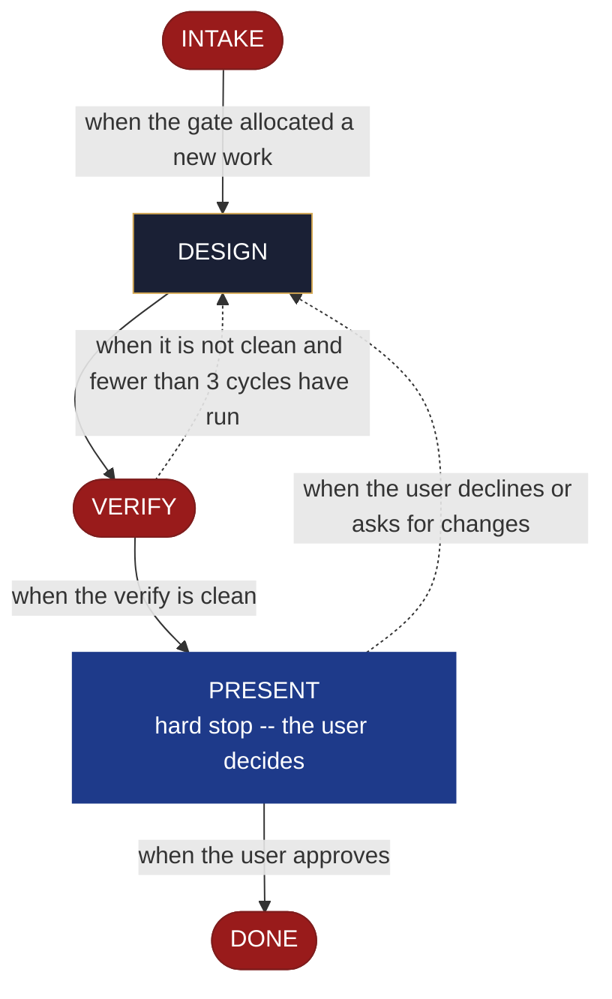

<!-- generated — do not edit; source: canonical/skills/aid-brainstorm/SKILL.md -->

## Frontmatter

- **`name`** — aid-brainstorm
- **`description`** — Shape an unformed idea into a design seed, a written note of framings and candidate directions. Use when the problem is still unclear and you need to explore it before committing to one direction.
- **`allowed-tools`** — Read Glob Grep Bash Shell Terminal Write Edit Agent
- **`argument-hint`** — &lt;subject> -- a fuzzy problem or theme to explore (not yet a formed question)

[Definition: `canonical/skills/aid-brainstorm/SKILL.md`](https://github.com/AndreVianna/aid-methodology/blob/master/canonical/skills/aid-brainstorm/SKILL.md)

## Flow

## Source fragments

Every node in the chart above, in chart order, with the exact `canonical/` text it was derived from.

**1 · `INTAKE`** · _exit_ · HALT

~~~~plaintext title="canonical/skills/aid-brainstorm/SKILL.md#L35-L39" wrap
## State: INTAKE

**State Detection.** Detection shapes the entry step of a fresh start and validates a saved step
on resume; it never routes. Which skill and step a work continues at come from its work record
(`.aid/runtime/templates/skill-steps.md`, § State Detection).
~~~~

[Source: `canonical/skills/aid-brainstorm/SKILL.md#L35-L39`](https://github.com/AndreVianna/aid-methodology/blob/master/canonical/skills/aid-brainstorm/SKILL.md#L35-L39) · [full step: `canonical/skills/aid-brainstorm/SKILL.md#L35-L56`](https://github.com/AndreVianna/aid-methodology/blob/master/canonical/skills/aid-brainstorm/SKILL.md#L35-L56)

**2 · `DESIGN`** · _step_

~~~~plaintext title="canonical/skills/aid-brainstorm/SKILL.md#L60-L68" wrap
## State: DESIGN

Dispatch **`aid-architect`** (clean context, tiered) to write or iterate
`.aid/design/<slug>.md` in the seed shape the contract fixes (`design-seed.md`;
feature-002 §4), grounded in `.aid/knowledge/` and the project source plus any prior seed.
It diverges -- framings, angles, prior art -- then converges to the candidate directions
worth pursuing. The seed's `## Destination` is **optional** here: brainstorm has no fixed
destination until the user promotes the seed. **Never writes `.aid/knowledge/` and never
writes production code** -- the `design` invariant (`design-lifecycle.md`).
~~~~

[Source: `canonical/skills/aid-brainstorm/SKILL.md#L60-L68`](https://github.com/AndreVianna/aid-methodology/blob/master/canonical/skills/aid-brainstorm/SKILL.md#L60-L68) · [full step: `canonical/skills/aid-brainstorm/SKILL.md#L60-L70`](https://github.com/AndreVianna/aid-methodology/blob/master/canonical/skills/aid-brainstorm/SKILL.md#L60-L70)

**3 · `VERIFY`** · _exit_ · HALT

~~~~plaintext title="canonical/skills/aid-brainstorm/SKILL.md#L74-L77" wrap
## State: VERIFY

**Full verify**, as `design-lifecycle.md` defines it. Not clean -> loop to DESIGN; the
3-cycle circuit breaker there escalates to IMPEDIMENT, and the lifecycle is set to `Blocked` through the writer.
~~~~

[Source: `canonical/skills/aid-brainstorm/SKILL.md#L74-L77`](https://github.com/AndreVianna/aid-methodology/blob/master/canonical/skills/aid-brainstorm/SKILL.md#L74-L77) · [full step: `canonical/skills/aid-brainstorm/SKILL.md#L74-L79`](https://github.com/AndreVianna/aid-methodology/blob/master/canonical/skills/aid-brainstorm/SKILL.md#L74-L79)

**4 · `PRESENT`** — hard stop -- the user decides · _loop-back_

~~~~plaintext title="canonical/skills/aid-brainstorm/SKILL.md#L83-L87" wrap
## State: PRESENT (hard stop -- the user decides)

Present the seed clearly. Assert no resolution --
the user iterates (declining the approval below changes the seed in place), promotes the seed into a `design` lifecycle
entry, or takes it forward however they choose.
~~~~

[Source: `canonical/skills/aid-brainstorm/SKILL.md#L83-L87`](https://github.com/AndreVianna/aid-methodology/blob/master/canonical/skills/aid-brainstorm/SKILL.md#L83-L87) · [full step: `canonical/skills/aid-brainstorm/SKILL.md#L83-L92`](https://github.com/AndreVianna/aid-methodology/blob/master/canonical/skills/aid-brainstorm/SKILL.md#L83-L92)

**5 · `DONE`** · _exit_ · UNSPECIFIED

~~~~plaintext title="canonical/skills/aid-brainstorm/SKILL.md#L96-L99" wrap
## State: DONE

Set the lifecycle to `Completed` through the writer. The seed
persists at `.aid/design/<slug>.md`; brainstorm has no `create` counterpart to consume it.
~~~~

[Source: `canonical/skills/aid-brainstorm/SKILL.md#L96-L99`](https://github.com/AndreVianna/aid-methodology/blob/master/canonical/skills/aid-brainstorm/SKILL.md#L96-L99) · [full step: `canonical/skills/aid-brainstorm/SKILL.md#L96-L99`](https://github.com/AndreVianna/aid-methodology/blob/master/canonical/skills/aid-brainstorm/SKILL.md#L96-L99)
