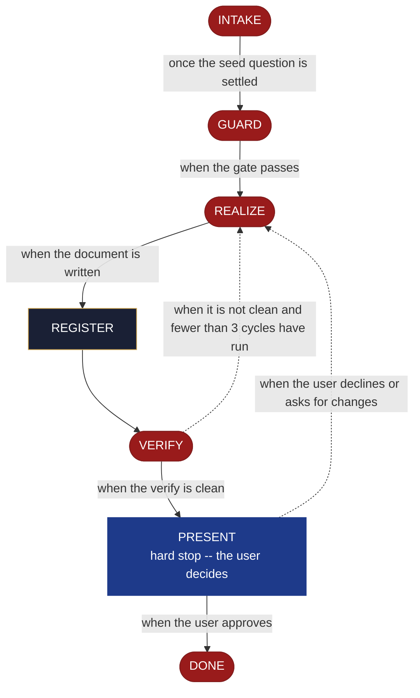

<!-- generated — do not edit; source: canonical/skills/aid-create-backlog/SKILL.md -->

## Frontmatter

- **`name`** — aid-create-backlog
- **`description`** — Realize a ready backlog seed into `.aid/knowledge/backlog.md` -- frontmatter, preamble, ## Contents index, ## Next Release, ## Prioritized, and ## Gotchas. Use this skill when a backlog seed is ready and the project needs its backlog document written for the first time. Moves accepted tech-debt.md items into backlog.md in the same run (id unchanged; row deleted from tech-debt.md). Registers the document in `.aid/settings.yml` and `.aid/knowledge/README.md` on first creation. Routes to `/aid-update-backlog` when the item sections already carry committed content.
- **`allowed-tools`** — Read Glob Grep Bash Shell Terminal Write Edit Agent
- **`argument-hint`** — [&lt;direction>] -- which items to accept and how to prioritize them (fills item sections from the seed)

[Definition: `canonical/skills/aid-create-backlog/SKILL.md`](https://github.com/AndreVianna/aid-methodology/blob/master/canonical/skills/aid-create-backlog/SKILL.md)

## Flow

## Source fragments

Every node in the chart above, in chart order, with the exact `canonical/` text it was derived from.

**1 · `INTAKE`** · _exit_ · HALT

~~~~plaintext title="canonical/skills/aid-create-backlog/SKILL.md#L46-L48" wrap
## State: INTAKE

Every question this step asks (the opening bootstrapping question) is asked before the work exists, so each is recorded in a design document, as the gate's "Recording the questions asked before a work exists" says (`.aid/runtime/templates/work-initiation-gate.md`): `bash .aid/runtime/scripts/execute/writeback-state.sh --ask --design <file> --category <category> --impact <High|Medium|Low> --context '<the question, as shown>' --suggested '<your recommendation>' --asked-by aid-create-backlog` before it is shown (it prints the question's id), then `--answer --design <file> --id <the printed id> --state Answered|Skipped|Assumed --value '<the reply>'` after the reply. `<file>` is `.aid/design/backlog.md` when that seed exists, otherwise `.aid/design/untitled-<YYYYMMDD-HHMMSS>.md`, stamped at the first question and reused for the whole run. A question recorded in the seed leaves the rest of the seed untouched.
~~~~

[Source: `canonical/skills/aid-create-backlog/SKILL.md#L46-L48`](https://github.com/AndreVianna/aid-methodology/blob/master/canonical/skills/aid-create-backlog/SKILL.md#L46-L48) · [full step: `canonical/skills/aid-create-backlog/SKILL.md#L46-L63`](https://github.com/AndreVianna/aid-methodology/blob/master/canonical/skills/aid-create-backlog/SKILL.md#L46-L63)

**2 · `GUARD`** · _exit_ · HALT

~~~~plaintext title="canonical/skills/aid-create-backlog/SKILL.md#L67-L70" wrap
## State: GUARD

**Readiness gate (class-1 contract, feature-002 §3b).** Inspect the seed for a non-empty
`## Open questions` section per `design-lifecycle.md`'s detection rule.
~~~~

[Source: `canonical/skills/aid-create-backlog/SKILL.md#L67-L70`](https://github.com/AndreVianna/aid-methodology/blob/master/canonical/skills/aid-create-backlog/SKILL.md#L67-L70) · [full step: `canonical/skills/aid-create-backlog/SKILL.md#L67-L77`](https://github.com/AndreVianna/aid-methodology/blob/master/canonical/skills/aid-create-backlog/SKILL.md#L67-L77)

**3 · `REALIZE`** · _exit_ · HALT

~~~~plaintext title="canonical/skills/aid-create-backlog/SKILL.md#L81-L86" wrap
## State: REALIZE

Dispatch **`aid-architect`** (clean context, tiered) to realize the seed. Apply the case
determined in INTAKE. The worker never asks the user: it returns the questions below
(the route question, each per-item confirm gate and any undetermined `Tag`) and the main
conversation asks them, through the question protocol.
~~~~

[Source: `canonical/skills/aid-create-backlog/SKILL.md#L81-L86`](https://github.com/AndreVianna/aid-methodology/blob/master/canonical/skills/aid-create-backlog/SKILL.md#L81-L86) · [full step: `canonical/skills/aid-create-backlog/SKILL.md#L81-L185`](https://github.com/AndreVianna/aid-methodology/blob/master/canonical/skills/aid-create-backlog/SKILL.md#L81-L185)

**4 · `REGISTER`** · _step_

~~~~plaintext title="canonical/skills/aid-create-backlog/SKILL.md#L189-L192" wrap
## State: REGISTER

**On creation only** (destination was absent in INTAKE). Write two surfaces atomically
in the same run, per `feature-003 §6b` (REQUIREMENTS CC-1, CC-2):
~~~~

[Source: `canonical/skills/aid-create-backlog/SKILL.md#L189-L192`](https://github.com/AndreVianna/aid-methodology/blob/master/canonical/skills/aid-create-backlog/SKILL.md#L189-L192) · [full step: `canonical/skills/aid-create-backlog/SKILL.md#L189-L204`](https://github.com/AndreVianna/aid-methodology/blob/master/canonical/skills/aid-create-backlog/SKILL.md#L189-L204)

**5 · `VERIFY`** · _exit_ · HALT

~~~~plaintext title="canonical/skills/aid-create-backlog/SKILL.md#L208-L212" wrap
## State: VERIFY

**Full verify** -- exactly as `design-lifecycle.md § Skill shape -- "Full verify"`
defines it. Not clean -> loop to REALIZE; the circuit-breaker there governs escalation
to IMPEDIMENT, and the lifecycle is set to `Blocked` through the writer.
~~~~

[Source: `canonical/skills/aid-create-backlog/SKILL.md#L208-L212`](https://github.com/AndreVianna/aid-methodology/blob/master/canonical/skills/aid-create-backlog/SKILL.md#L208-L212) · [full step: `canonical/skills/aid-create-backlog/SKILL.md#L208-L214`](https://github.com/AndreVianna/aid-methodology/blob/master/canonical/skills/aid-create-backlog/SKILL.md#L208-L214)

**6 · `PRESENT`** — hard stop -- the user decides · _loop-back_

~~~~plaintext title="canonical/skills/aid-create-backlog/SKILL.md#L218-L220" wrap
## State: PRESENT (hard stop -- the user decides)

Present the realized document clearly. Assert:
~~~~

[Source: `canonical/skills/aid-create-backlog/SKILL.md#L218-L220`](https://github.com/AndreVianna/aid-methodology/blob/master/canonical/skills/aid-create-backlog/SKILL.md#L218-L220) · [full step: `canonical/skills/aid-create-backlog/SKILL.md#L218-L230`](https://github.com/AndreVianna/aid-methodology/blob/master/canonical/skills/aid-create-backlog/SKILL.md#L218-L230)

**7 · `DONE`** · _exit_ · UNSPECIFIED

~~~~plaintext title="canonical/skills/aid-create-backlog/SKILL.md#L234-L236" wrap
## State: DONE

Set the lifecycle to `Completed` through the writer.
~~~~

[Source: `canonical/skills/aid-create-backlog/SKILL.md#L234-L236`](https://github.com/AndreVianna/aid-methodology/blob/master/canonical/skills/aid-create-backlog/SKILL.md#L234-L236) · [full step: `canonical/skills/aid-create-backlog/SKILL.md#L234-L236`](https://github.com/AndreVianna/aid-methodology/blob/master/canonical/skills/aid-create-backlog/SKILL.md#L234-L236)
