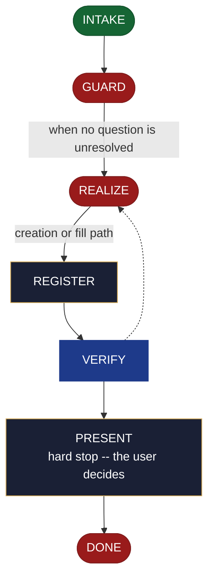

<!-- generated — do not edit; source: canonical/skills/aid-create-backlog/SKILL.md -->

## Frontmatter

- **`name`** — aid-create-backlog
- **`description`** — Realize a ready backlog seed into `.aid/knowledge/backlog.md` -- frontmatter, preamble, ## Contents index, ## Next Release, ## Prioritized, and ## Gotchas. Use this skill when a backlog seed is ready and the project needs its backlog document written for the first time. Moves accepted tech-debt.md items into backlog.md in the same run (id unchanged; row deleted from tech-debt.md). Registers the document in `.aid/settings.yml` and `.aid/knowledge/README.md` on first creation. Routes to `/aid-update-backlog` when the item sections already carry committed content.
- **`allowed-tools`** — Read Glob Grep Bash Shell Terminal Write Edit Agent
- **`argument-hint`** — [&lt;direction>] -- which items to accept and how to prioritize them (fills item sections from the seed)

[Definition: `canonical/skills/aid-create-backlog/SKILL.md`](https://github.com/AndreVianna/aid-methodology/blob/master/canonical/skills/aid-create-backlog/SKILL.md)

## Flow

## Source fragments

Every node in the chart above, in chart order, with the exact `canonical/` text it was derived from.

**1 · `INTAKE`** · _entry_

~~~~plaintext title="canonical/skills/aid-create-backlog/SKILL.md#L45-L58" wrap
## State: INTAKE

1. **Require a subject.** Empty argument -> ask one bootstrapping question ("What items do
   you want to accept into the backlog -- or run `/aid-design-backlog` first?") and wait.
2. **Allocate, exactly per `design-lifecycle.md § Skill shape -- Allocation`** -- the Work Initiation Gate, whose `--create` is given `--skill aid-create-backlog`, `--step INTAKE` and `--path lite`; the record starts `Running`. `phase` is not driven.
3. **Read the seed** at `.aid/design/backlog.md`. If no seed exists, inform the user and
   ask whether to proceed without one (items entered interactively) or to run
   `/aid-design-backlog` first; do not proceed silently. The question blocks the work: pause INTAKE on it, with its detail saying the work is allocated and the question is open, record it with `--ask`, set the lifecycle to `Paused-Awaiting-Input`, and then ask it. Once it is answered, INTAKE continues at step 4.
4. **Read the destination** at `.aid/knowledge/backlog.md` if it exists. Classify its
   state: absent | present-sections-empty | present-sections-populated.
5. **Read `tech-debt.md`** at `.aid/knowledge/tech-debt.md` if it exists. The seed may
   name candidate rows to promote; know their current state before the confirm gate runs.
6. **Classify complexity (model + effort)** for the `aid-architect` dispatch below;
   verifier tier >= producer tier (`agent-dispatch-tiering.md`).
~~~~

[Source: `canonical/skills/aid-create-backlog/SKILL.md#L45-L58`](https://github.com/AndreVianna/aid-methodology/blob/master/canonical/skills/aid-create-backlog/SKILL.md#L45-L58) · [full step: `canonical/skills/aid-create-backlog/SKILL.md#L45-L60`](https://github.com/AndreVianna/aid-methodology/blob/master/canonical/skills/aid-create-backlog/SKILL.md#L45-L60)

**2 · `GUARD`** · _exit_ · HALT

~~~~plaintext title="canonical/skills/aid-create-backlog/SKILL.md#L64-L67" wrap
## State: GUARD

**Readiness gate (class-1 contract, feature-002 §3b).** Inspect the seed for a non-empty
`## Open questions` section per `design-lifecycle.md`'s detection rule.
~~~~

[Source: `canonical/skills/aid-create-backlog/SKILL.md#L64-L67`](https://github.com/AndreVianna/aid-methodology/blob/master/canonical/skills/aid-create-backlog/SKILL.md#L64-L67) · [full step: `canonical/skills/aid-create-backlog/SKILL.md#L64-L74`](https://github.com/AndreVianna/aid-methodology/blob/master/canonical/skills/aid-create-backlog/SKILL.md#L64-L74)

**3 · `REALIZE`** · _exit_ · HALT

~~~~plaintext title="canonical/skills/aid-create-backlog/SKILL.md#L78-L81" wrap
## State: REALIZE

Dispatch **`aid-architect`** (clean context, tiered) to realize the seed. Apply the case
determined in INTAKE:
~~~~

[Source: `canonical/skills/aid-create-backlog/SKILL.md#L78-L81`](https://github.com/AndreVianna/aid-methodology/blob/master/canonical/skills/aid-create-backlog/SKILL.md#L78-L81) · [full step: `canonical/skills/aid-create-backlog/SKILL.md#L78-L177`](https://github.com/AndreVianna/aid-methodology/blob/master/canonical/skills/aid-create-backlog/SKILL.md#L78-L177)

**4 · `REGISTER`** · _step_

~~~~plaintext title="canonical/skills/aid-create-backlog/SKILL.md#L181-L184" wrap
## State: REGISTER

**On creation only** (destination was absent in INTAKE). Write two surfaces atomically
in the same run, per `feature-003 §6b` (REQUIREMENTS CC-1, CC-2):
~~~~

[Source: `canonical/skills/aid-create-backlog/SKILL.md#L181-L184`](https://github.com/AndreVianna/aid-methodology/blob/master/canonical/skills/aid-create-backlog/SKILL.md#L181-L184) · [full step: `canonical/skills/aid-create-backlog/SKILL.md#L181-L196`](https://github.com/AndreVianna/aid-methodology/blob/master/canonical/skills/aid-create-backlog/SKILL.md#L181-L196)

**5 · `VERIFY`** · _loop-back_

~~~~plaintext title="canonical/skills/aid-create-backlog/SKILL.md#L200-L204" wrap
## State: VERIFY

**Full verify** -- exactly as `design-lifecycle.md § Skill shape -- "Full verify"`
defines it. Not clean -> loop to REALIZE; the circuit-breaker there governs escalation
to IMPEDIMENT, and the lifecycle is set to `Blocked` through the writer.
~~~~

[Source: `canonical/skills/aid-create-backlog/SKILL.md#L200-L204`](https://github.com/AndreVianna/aid-methodology/blob/master/canonical/skills/aid-create-backlog/SKILL.md#L200-L204) · [full step: `canonical/skills/aid-create-backlog/SKILL.md#L200-L206`](https://github.com/AndreVianna/aid-methodology/blob/master/canonical/skills/aid-create-backlog/SKILL.md#L200-L206)

**6 · `PRESENT`** — hard stop -- the user decides · _step_

~~~~plaintext title="canonical/skills/aid-create-backlog/SKILL.md#L210-L212" wrap
## State: PRESENT (hard stop -- the user decides)

Set the lifecycle to `Paused-Awaiting-Input` through the writer. Present the realized document clearly. Assert:
~~~~

[Source: `canonical/skills/aid-create-backlog/SKILL.md#L210-L212`](https://github.com/AndreVianna/aid-methodology/blob/master/canonical/skills/aid-create-backlog/SKILL.md#L210-L212) · [full step: `canonical/skills/aid-create-backlog/SKILL.md#L210-L219`](https://github.com/AndreVianna/aid-methodology/blob/master/canonical/skills/aid-create-backlog/SKILL.md#L210-L219)

**7 · `DONE`** · _exit_ · UNSPECIFIED

~~~~plaintext title="canonical/skills/aid-create-backlog/SKILL.md#L223-L225" wrap
## State: DONE

Set the lifecycle to `Completed` through the writer, `updated` now, append a `## Lifecycle History` row.
~~~~

[Source: `canonical/skills/aid-create-backlog/SKILL.md#L223-L225`](https://github.com/AndreVianna/aid-methodology/blob/master/canonical/skills/aid-create-backlog/SKILL.md#L223-L225) · [full step: `canonical/skills/aid-create-backlog/SKILL.md#L223-L225`](https://github.com/AndreVianna/aid-methodology/blob/master/canonical/skills/aid-create-backlog/SKILL.md#L223-L225)
