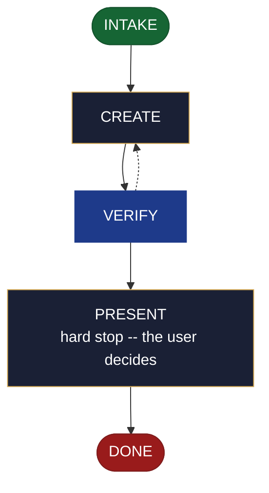

<!-- generated — do not edit; source: canonical/skills/aid-create-cicd/SKILL.md -->

## Frontmatter

- **`name`** — aid-create-cicd
- **`description`** — Write the CI/CD (shipping) KB document from a ready seed. Use when none exists yet.
- **`allowed-tools`** — Read Glob Grep Bash Shell Terminal Write Edit Agent
- **`argument-hint`** — [&lt;direction>] -- which parts of the CI/CD seed to realize

[Definition: `canonical/skills/aid-create-cicd/SKILL.md`](https://github.com/AndreVianna/aid-methodology/blob/master/canonical/skills/aid-create-cicd/SKILL.md)

## Flow

## Source fragments

Every node in the chart above, in chart order, with the exact `canonical/` text it was derived from.

**1 · `INTAKE`** · _entry_

~~~~plaintext title="canonical/skills/aid-create-cicd/SKILL.md#L31-L47" wrap
## State: INTAKE

1. **Allocate** through the Work Initiation Gate exactly as the contract's Allocation rule
   requires (`.agents/skills/aid-design/SKILL.md` INTAKE step 4 is the shape), with
   `initiator: aid-create-cicd`. `phase` is not driven.
2. **Read the seed** at `.aid/design/cicd.md`.
3. **Resolve the destination by concern, not filename.** This skill binds concern **C8**
   (shipping & operation, `.aid/runtime/templates/kb-authoring/concern-model.md`). The seed's
   `## Destination` names the resolved path; where it does not, resolve C8 against
   `.aid/settings.yml` `knowledge.doc_set`, falling back to the C8 row of
   `.aid/runtime/templates/kb-authoring/domain-doc-matrix.md`, and confirm with the user. An
   ambiguous realization is **asked**, never picked silently.
4. **Read the whole destination** if it exists, and note its `source:` field.
5. **Ask whether the user also wants production config this run.** Emitting a workflow file
   is **opt-in per run and never the default**; the KB record is what this skill writes
   unless the user asks in this run.
6. **Classify complexity** for the `aid-architect` dispatch (verifier tier >= producer).
~~~~

[Source: `canonical/skills/aid-create-cicd/SKILL.md#L31-L47`](https://github.com/AndreVianna/aid-methodology/blob/master/canonical/skills/aid-create-cicd/SKILL.md#L31-L47) · [full step: `canonical/skills/aid-create-cicd/SKILL.md#L31-L49`](https://github.com/AndreVianna/aid-methodology/blob/master/canonical/skills/aid-create-cicd/SKILL.md#L31-L49)

**2 · `CREATE`** · _step_

~~~~plaintext title="canonical/skills/aid-create-cicd/SKILL.md#L53-L55" wrap
## State: CREATE

**Exactly three conditions refuse. There is no fourth.**
~~~~

[Source: `canonical/skills/aid-create-cicd/SKILL.md#L53-L55`](https://github.com/AndreVianna/aid-methodology/blob/master/canonical/skills/aid-create-cicd/SKILL.md#L53-L55) · [full step: `canonical/skills/aid-create-cicd/SKILL.md#L53-L87`](https://github.com/AndreVianna/aid-methodology/blob/master/canonical/skills/aid-create-cicd/SKILL.md#L53-L87)

**3 · `VERIFY`** · _loop-back_

~~~~plaintext title="canonical/skills/aid-create-cicd/SKILL.md#L91-L94" wrap
## State: VERIFY

**Full verify**, as `design-lifecycle.md` defines it. Not clean -> loop to CREATE; the
3-cycle circuit breaker there escalates to IMPEDIMENT + `lifecycle: Blocked`.
~~~~

[Source: `canonical/skills/aid-create-cicd/SKILL.md#L91-L94`](https://github.com/AndreVianna/aid-methodology/blob/master/canonical/skills/aid-create-cicd/SKILL.md#L91-L94) · [full step: `canonical/skills/aid-create-cicd/SKILL.md#L91-L96`](https://github.com/AndreVianna/aid-methodology/blob/master/canonical/skills/aid-create-cicd/SKILL.md#L91-L96)

**4 · `PRESENT`** — hard stop -- the user decides · _step_

~~~~plaintext title="canonical/skills/aid-create-cicd/SKILL.md#L100-L104" wrap
## State: PRESENT (hard stop -- the user decides)

Set `lifecycle: Paused-Awaiting-Input`. Present the realized document and assert: whether a
workflow file was emitted and that it was asked for; on the creation path both registration
surfaces were written; and anything routed to `/aid-update-cicd` is named.
~~~~

[Source: `canonical/skills/aid-create-cicd/SKILL.md#L100-L104`](https://github.com/AndreVianna/aid-methodology/blob/master/canonical/skills/aid-create-cicd/SKILL.md#L100-L104) · [full step: `canonical/skills/aid-create-cicd/SKILL.md#L100-L106`](https://github.com/AndreVianna/aid-methodology/blob/master/canonical/skills/aid-create-cicd/SKILL.md#L100-L106)

**5 · `DONE`** · _exit_ · UNSPECIFIED

~~~~plaintext title="canonical/skills/aid-create-cicd/SKILL.md#L110-L112" wrap
## State: DONE

Set `lifecycle: Completed`, `updated` now, append a `## Lifecycle History` row.
~~~~

[Source: `canonical/skills/aid-create-cicd/SKILL.md#L110-L112`](https://github.com/AndreVianna/aid-methodology/blob/master/canonical/skills/aid-create-cicd/SKILL.md#L110-L112) · [full step: `canonical/skills/aid-create-cicd/SKILL.md#L110-L112`](https://github.com/AndreVianna/aid-methodology/blob/master/canonical/skills/aid-create-cicd/SKILL.md#L110-L112)
