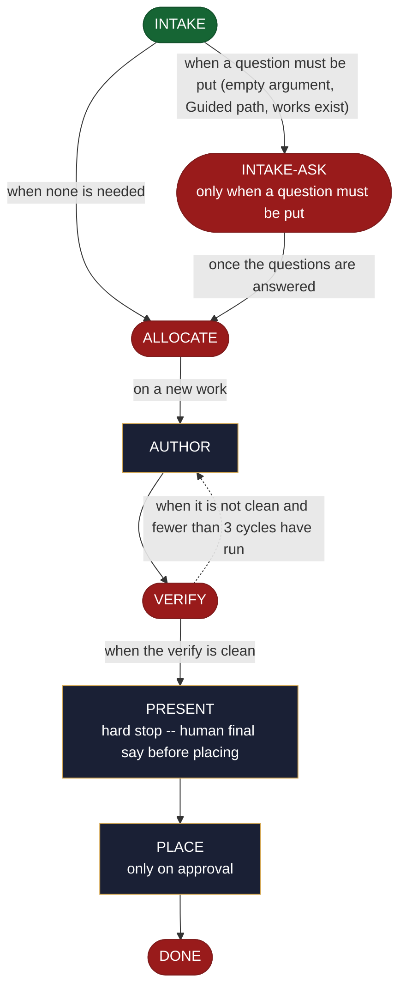

<!-- generated — do not edit; source: canonical/skills/aid-create-document/SKILL.md -->

## Frontmatter

- **`name`** — aid-create-document
- **`description`** — Create a document in one pass, working out both its format and its structure from what you ask for -- a how-to, a reference page, an ADR, an architecture write-up, a runbook, a tutorial, a changelog, a diagram, a table. Use this skill when you need a document written now and do not want to decide its genre first. It is grounded in, and accuracy-checked against, the Knowledge Base (`.aid/knowledge/`) and the project source; aid-tech-writer produces it and aid-reviewer verifies it. It resolves nothing: it drafts, you approve, and only then is the document placed. It never writes into `.aid/knowledge/` -- that is `/aid-update-kb`'s territory. The genre skills such as `/aid-document-decision`, and `/aid-create-diagram`, all delegate here. To settle a document's direction as a reusable design seed first, use `/aid-design-document`.
- **`allowed-tools`** — Read Glob Grep Bash Shell Terminal Write Edit Agent
- **`argument-hint`** — &lt;subject> -- what to document (optionally a kind: adr, runbook, tutorial, changelog, diagram, ...)

[Definition: `canonical/skills/aid-create-document/SKILL.md`](https://github.com/AndreVianna/aid-methodology/blob/master/canonical/skills/aid-create-document/SKILL.md)

## Flow

## Source fragments

Every node in the chart above, in chart order, with the exact `canonical/` text it was derived from.

**1 · `INTAKE`** · _entry_

~~~~plaintext title="canonical/skills/aid-create-document/SKILL.md#L48-L50" wrap
## State: INTAKE

INTAKE and INTAKE-ASK run before any work exists, so they save no steps (`skill-steps.md`, "Before a work exists"). Their questions are asked through the question protocol, and their answers go into the record when ALLOCATE creates it.
~~~~

[Source: `canonical/skills/aid-create-document/SKILL.md#L48-L50`](https://github.com/AndreVianna/aid-methodology/blob/master/canonical/skills/aid-create-document/SKILL.md#L48-L50) · [full step: `canonical/skills/aid-create-document/SKILL.md#L48-L66`](https://github.com/AndreVianna/aid-methodology/blob/master/canonical/skills/aid-create-document/SKILL.md#L48-L66)

**2 · `INTAKE-ASK`** — only when a question must be put · _exit_ · HALT

~~~~plaintext title="canonical/skills/aid-create-document/SKILL.md#L70-L72" wrap
## State: INTAKE-ASK  (only when a question must be put)

Ask one topic at a time, through the question protocol, in this order and only for what applies:
~~~~

[Source: `canonical/skills/aid-create-document/SKILL.md#L70-L72`](https://github.com/AndreVianna/aid-methodology/blob/master/canonical/skills/aid-create-document/SKILL.md#L70-L72) · [full step: `canonical/skills/aid-create-document/SKILL.md#L70-L79`](https://github.com/AndreVianna/aid-methodology/blob/master/canonical/skills/aid-create-document/SKILL.md#L70-L79)

**3 · `ALLOCATE`** · _exit_ · HALT

~~~~plaintext title="canonical/skills/aid-create-document/SKILL.md#L83-L86" wrap
## State: ALLOCATE

Allocate the work through the gate: the Work Initiation Gate
(`.aid/runtime/templates/work-initiation-gate.md`).
~~~~

[Source: `canonical/skills/aid-create-document/SKILL.md#L83-L86`](https://github.com/AndreVianna/aid-methodology/blob/master/canonical/skills/aid-create-document/SKILL.md#L83-L86) · [full step: `canonical/skills/aid-create-document/SKILL.md#L83-L108`](https://github.com/AndreVianna/aid-methodology/blob/master/canonical/skills/aid-create-document/SKILL.md#L83-L108)

**4 · `AUTHOR`** · _step_

~~~~plaintext title="canonical/skills/aid-create-document/SKILL.md#L112-L119" wrap
## State: AUTHOR

Dispatch **`aid-tech-writer`** (clean context, tiered) to write the document in the resolved
format + genre structure, **grounded in and accurate to** the KB + project source
(`task-type-rules.md ## DOCUMENT` -- verify accuracy against the current codebase and KB).
It drafts into the work folder (not yet placed). Text formats are produced natively
(markdown, mermaid, HTML, CSV/tables); for a format it cannot cleanly emit (native
`.pptx`/`.xlsx`), it produces the best text form and notes the conversion handoff.
~~~~

[Source: `canonical/skills/aid-create-document/SKILL.md#L112-L119`](https://github.com/AndreVianna/aid-methodology/blob/master/canonical/skills/aid-create-document/SKILL.md#L112-L119) · [full step: `canonical/skills/aid-create-document/SKILL.md#L112-L121`](https://github.com/AndreVianna/aid-methodology/blob/master/canonical/skills/aid-create-document/SKILL.md#L112-L121)

**5 · `VERIFY`** · _exit_ · HALT

~~~~plaintext title="canonical/skills/aid-create-document/SKILL.md#L125-L133" wrap
## State: VERIFY

1. **Mechanical grounding check** (no dispatch): claims about the project cite a KB doc or
   `file:line`; the genre's required structure is present.
2. **Adversarial verification** -- clean-context **`aid-reviewer`** checks the draft:
   accurate against KB + codebase, complete for its genre, no fabricated content. Writes a
   review-quality ledger to `.aid/.temp/review-pending/<work>-verify.md`.
3. **Grade:** `bash .aid/runtime/scripts/grade.sh --explain <ledger>`. Not clean -> loop
   to AUTHOR. Circuit-breaker: 3 cycles -> IMPEDIMENT, and the lifecycle set to `Blocked` through the writer.
~~~~

[Source: `canonical/skills/aid-create-document/SKILL.md#L125-L133`](https://github.com/AndreVianna/aid-methodology/blob/master/canonical/skills/aid-create-document/SKILL.md#L125-L133) · [full step: `canonical/skills/aid-create-document/SKILL.md#L125-L135`](https://github.com/AndreVianna/aid-methodology/blob/master/canonical/skills/aid-create-document/SKILL.md#L125-L135)

**6 · `PRESENT`** — hard stop -- human final say before placing · _step_

~~~~plaintext title="canonical/skills/aid-create-document/SKILL.md#L139-L143" wrap
## State: PRESENT  (hard stop -- human final say before placing)

The hard stop follows the ASK step of `skill-steps.md`. Present the drafted document **and the proposed
target location** (KB-informed: `docs/`, an ADR dir, `CHANGELOG.md`, a runbook path, ...).
Await approval. **Never writes `.aid/knowledge/`.**
~~~~

[Source: `canonical/skills/aid-create-document/SKILL.md#L139-L143`](https://github.com/AndreVianna/aid-methodology/blob/master/canonical/skills/aid-create-document/SKILL.md#L139-L143) · [full step: `canonical/skills/aid-create-document/SKILL.md#L139-L145`](https://github.com/AndreVianna/aid-methodology/blob/master/canonical/skills/aid-create-document/SKILL.md#L139-L145)

**7 · `PLACE`** — only on approval · _step_

~~~~plaintext title="canonical/skills/aid-create-document/SKILL.md#L149-L156" wrap
## State: PLACE  (only on approval)

If the user declined, place nothing: the draft stays in the work folder, and the step goes on to
DONE. Otherwise write the document to its approved target location. **Extra care on overwrite or on the
published `docs/` tree:** inspect the target first and show the diff -- never silently
overwrite an existing doc. Then optionally print handoffs the user may act on: `/aid-update-kb`
(if it belongs in the KB), `/aid-create*` (if it describes something not yet built),
`/aid-refactor` (an ADR mandating a refactor).
~~~~

[Source: `canonical/skills/aid-create-document/SKILL.md#L149-L156`](https://github.com/AndreVianna/aid-methodology/blob/master/canonical/skills/aid-create-document/SKILL.md#L149-L156) · [full step: `canonical/skills/aid-create-document/SKILL.md#L149-L158`](https://github.com/AndreVianna/aid-methodology/blob/master/canonical/skills/aid-create-document/SKILL.md#L149-L158)

**8 · `DONE`** · _exit_ · HALT

~~~~plaintext title="canonical/skills/aid-create-document/SKILL.md#L162-L164" wrap
## State: DONE

Finish through the writer: `bash .aid/runtime/scripts/execute/writeback-state.sh --pipeline --field Lifecycle --value Completed`, which also clears the saved skill and step. Keep the work folder (draft + verify ledger) as the audit record.
~~~~

[Source: `canonical/skills/aid-create-document/SKILL.md#L162-L164`](https://github.com/AndreVianna/aid-methodology/blob/master/canonical/skills/aid-create-document/SKILL.md#L162-L164) · [full step: `canonical/skills/aid-create-document/SKILL.md#L162-L166`](https://github.com/AndreVianna/aid-methodology/blob/master/canonical/skills/aid-create-document/SKILL.md#L162-L166)
