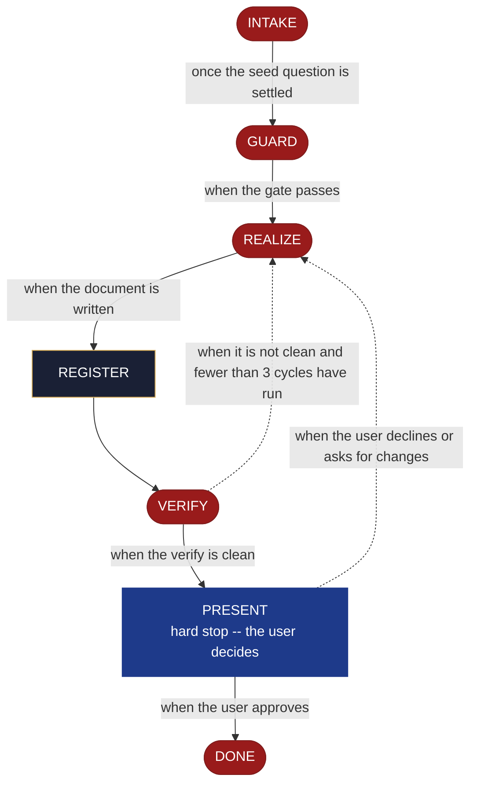

<!-- generated — do not edit; source: canonical/skills/aid-create-roadmap/SKILL.md -->

## Frontmatter

- **`name`** — aid-create-roadmap
- **`description`** — Realize a ready roadmap seed into `.aid/knowledge/roadmap.md` -- frontmatter, preamble, ## Contents index (including the forward ## MVP entry), and the three horizon sections ## Now, ## Next, ## Later. Use this skill when a roadmap seed is ready and the project needs its roadmap document written for the first time. Registers the document in `.aid/settings.yml` and `.aid/knowledge/README.md` on first creation. Routes to `/aid-update-roadmap` when the horizon sections already carry committed content. The ## MVP section belongs entirely to `/aid-create-mvp` -- this skill writes only its ## Contents index entry.
- **`allowed-tools`** — Read Glob Grep Bash Shell Terminal Write Edit Agent
- **`argument-hint`** — [&lt;direction>] -- what to realize (fills horizon sections from the seed)

[Definition: `canonical/skills/aid-create-roadmap/SKILL.md`](https://github.com/AndreVianna/aid-methodology/blob/master/canonical/skills/aid-create-roadmap/SKILL.md)

## Flow

## Source fragments

Every node in the chart above, in chart order, with the exact `canonical/` text it was derived from.

**1 · `INTAKE`** · _exit_ · HALT

~~~~plaintext title="canonical/skills/aid-create-roadmap/SKILL.md#L51-L62" wrap
## State: INTAKE

1. **Require a subject.** Empty argument -> ask one bootstrapping question ("What direction
   do you want to realize into roadmap.md -- or run `/aid-design-roadmap` first?") and wait.
2. **Allocate, exactly per `design-lifecycle.md § Skill shape -- Allocation`** -- the Work Initiation Gate, whose `--create` is given `--skill aid-create-roadmap`, `--step INTAKE` and `--path lite`, plus `--seed .aid/design/roadmap.md` when that seed exists (the gate adds it to the work's `sources:` and copies its `## Questions` into the work's record); the record starts `Running`. `phase` is not driven.
3. **Read the seed** at `.aid/design/roadmap.md`. If no seed exists, inform the user and
   ask whether to proceed without one (direction entered interactively) or to run
   `/aid-design-roadmap` first; do not proceed silently. The question blocks the work: pause INTAKE on it, with its detail saying the work is allocated and the question is open, record it with `--ask`, set the lifecycle to `Paused-Awaiting-Input` and the pause reason to the open question, and then ask it. Once it is answered, record the answer with `--answer` and set the lifecycle back to `Running` through the writer. If the user proceeds without a seed, INTAKE continues at step 4. If the user chooses to design the seed first, bring the detail up to date with `--step` (done: work allocated; waiting for the seed from `/aid-design-roadmap`), set the lifecycle to `Paused-Awaiting-Input` and the pause reason to 'Waiting for the seed: run /aid-design-roadmap, then resume' through the writer, name `/aid-design-roadmap` in one plain line, and end the step with the HALT case of the advance line below.
4. **Read the destination** at `.aid/knowledge/roadmap.md` if it exists. Classify its state:
   absent | present-horizon-empty | present-horizon-populated.
5. **Classify complexity (model + effort)** for the `aid-architect` dispatch below;
   verifier tier >= producer tier (`agent-dispatch-tiering.md`).
~~~~

[Source: `canonical/skills/aid-create-roadmap/SKILL.md#L51-L62`](https://github.com/AndreVianna/aid-methodology/blob/master/canonical/skills/aid-create-roadmap/SKILL.md#L51-L62) · [full step: `canonical/skills/aid-create-roadmap/SKILL.md#L51-L64`](https://github.com/AndreVianna/aid-methodology/blob/master/canonical/skills/aid-create-roadmap/SKILL.md#L51-L64)

**2 · `GUARD`** · _exit_ · HALT

~~~~plaintext title="canonical/skills/aid-create-roadmap/SKILL.md#L68-L71" wrap
## State: GUARD

**Readiness gate (class-1 contract, feature-002 §3b).** Inspect the seed for a non-empty
`## Open questions` section per `design-lifecycle.md`'s detection rule.
~~~~

[Source: `canonical/skills/aid-create-roadmap/SKILL.md#L68-L71`](https://github.com/AndreVianna/aid-methodology/blob/master/canonical/skills/aid-create-roadmap/SKILL.md#L68-L71) · [full step: `canonical/skills/aid-create-roadmap/SKILL.md#L68-L78`](https://github.com/AndreVianna/aid-methodology/blob/master/canonical/skills/aid-create-roadmap/SKILL.md#L68-L78)

**3 · `REALIZE`** · _exit_ · HALT

~~~~plaintext title="canonical/skills/aid-create-roadmap/SKILL.md#L82-L86" wrap
## State: REALIZE

Dispatch **`aid-architect`** (clean context, tiered) to realize the seed. Apply the case
determined in INTAKE. The worker never asks the user: the route question below is
asked by the main conversation.
~~~~

[Source: `canonical/skills/aid-create-roadmap/SKILL.md#L82-L86`](https://github.com/AndreVianna/aid-methodology/blob/master/canonical/skills/aid-create-roadmap/SKILL.md#L82-L86) · [full step: `canonical/skills/aid-create-roadmap/SKILL.md#L82-L140`](https://github.com/AndreVianna/aid-methodology/blob/master/canonical/skills/aid-create-roadmap/SKILL.md#L82-L140)

**4 · `REGISTER`** · _step_

~~~~plaintext title="canonical/skills/aid-create-roadmap/SKILL.md#L144-L147" wrap
## State: REGISTER

**On creation only** (destination was absent in INTAKE). Write two surfaces atomically
in the same run, per `feature-003 §6b` (REQUIREMENTS CC-1, CC-2):
~~~~

[Source: `canonical/skills/aid-create-roadmap/SKILL.md#L144-L147`](https://github.com/AndreVianna/aid-methodology/blob/master/canonical/skills/aid-create-roadmap/SKILL.md#L144-L147) · [full step: `canonical/skills/aid-create-roadmap/SKILL.md#L144-L159`](https://github.com/AndreVianna/aid-methodology/blob/master/canonical/skills/aid-create-roadmap/SKILL.md#L144-L159)

**5 · `VERIFY`** · _exit_ · HALT

~~~~plaintext title="canonical/skills/aid-create-roadmap/SKILL.md#L163-L167" wrap
## State: VERIFY

**Full verify** -- exactly as `design-lifecycle.md § Skill shape -- "Full verify"`
defines it. Not clean -> loop to REALIZE; the circuit-breaker there governs escalation
to IMPEDIMENT, and the lifecycle is set to `Blocked` through the writer.
~~~~

[Source: `canonical/skills/aid-create-roadmap/SKILL.md#L163-L167`](https://github.com/AndreVianna/aid-methodology/blob/master/canonical/skills/aid-create-roadmap/SKILL.md#L163-L167) · [full step: `canonical/skills/aid-create-roadmap/SKILL.md#L163-L169`](https://github.com/AndreVianna/aid-methodology/blob/master/canonical/skills/aid-create-roadmap/SKILL.md#L163-L169)

**6 · `PRESENT`** — hard stop -- the user decides · _loop-back_

~~~~plaintext title="canonical/skills/aid-create-roadmap/SKILL.md#L173-L175" wrap
## State: PRESENT (hard stop -- the user decides)

Present the realized document clearly. Assert:
~~~~

[Source: `canonical/skills/aid-create-roadmap/SKILL.md#L173-L175`](https://github.com/AndreVianna/aid-methodology/blob/master/canonical/skills/aid-create-roadmap/SKILL.md#L173-L175) · [full step: `canonical/skills/aid-create-roadmap/SKILL.md#L173-L185`](https://github.com/AndreVianna/aid-methodology/blob/master/canonical/skills/aid-create-roadmap/SKILL.md#L173-L185)

**7 · `DONE`** · _exit_ · UNSPECIFIED

~~~~plaintext title="canonical/skills/aid-create-roadmap/SKILL.md#L189-L191" wrap
## State: DONE

Set the lifecycle to `Completed` through the writer.
~~~~

[Source: `canonical/skills/aid-create-roadmap/SKILL.md#L189-L191`](https://github.com/AndreVianna/aid-methodology/blob/master/canonical/skills/aid-create-roadmap/SKILL.md#L189-L191) · [full step: `canonical/skills/aid-create-roadmap/SKILL.md#L189-L191`](https://github.com/AndreVianna/aid-methodology/blob/master/canonical/skills/aid-create-roadmap/SKILL.md#L189-L191)
