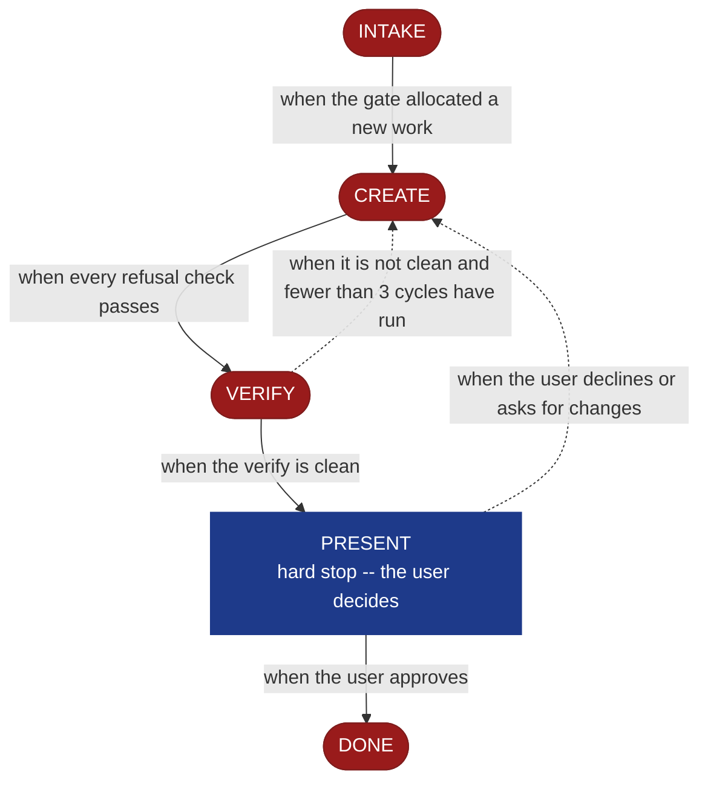

<!-- generated — do not edit; source: canonical/skills/aid-create-stack/SKILL.md -->

## Frontmatter

- **`name`** — aid-create-stack
- **`description`** — Realize a ready stack seed from `.aid/design/stack.md` into the project's technology (C0) Knowledge Base document -- languages, runtimes, frameworks, package managers, and build and test tooling, each with its version. Use this skill when a stack seed is ready and the project has no technology-stack document yet. When it creates the document it also registers it in `.aid/settings.yml` and `.aid/knowledge/README.md` in the same run, which opts that document into the Conformance Lane permanently -- a choice you are making by running this skill. To revise C0 content this lifecycle already committed, use `/aid-update-stack`; to create or revise a configuration option within a chosen stack rather than the stack itself, use `/aid-create-config` or `/aid-update-config`. Produced by the aid-architect agent and independently verified by aid-reviewer (full verify). Allocates a work-NNN folder.
- **`allowed-tools`** — Read Glob Grep Bash Shell Terminal Write Edit Agent
- **`argument-hint`** — [&lt;direction>] -- which parts of the stack seed to realize

[Definition: `canonical/skills/aid-create-stack/SKILL.md`](https://github.com/AndreVianna/aid-methodology/blob/master/canonical/skills/aid-create-stack/SKILL.md)

## Flow

## Source fragments

Every node in the chart above, in chart order, with the exact `canonical/` text it was derived from.

**1 · `INTAKE`** · _exit_ · HALT

~~~~plaintext title="canonical/skills/aid-create-stack/SKILL.md#L52-L66" wrap
## State: INTAKE

1. **Allocate** through the Work Initiation Gate exactly as the contract's Allocation rule
   requires (`.agents/skills/aid-design/SKILL.md` INTAKE step 4 is the shape), with
   `--skill aid-create-stack` given to the gate's `--create`. `phase` is not driven.
2. **Read the seed** at `.aid/design/stack.md`.
3. **Resolve the destination by concern, not filename.** This skill binds concern **C0**
   (technology, `.aid/runtime/templates/kb-authoring/concern-model.md`). The seed's
   `## Destination` names the resolved path; where it does not, resolve C0 against
   `.aid/settings.yml` `knowledge.doc_set`, falling back to the C0 row of
   `.aid/runtime/templates/kb-authoring/domain-doc-matrix.md`, and confirm with the user.
   An ambiguous realization is **asked**, never picked silently. The seed also names a
   **second** destination -- the project's D document, for the rejected alternatives.
4. **Read the whole destination** if it exists, and note its `source:` field.
5. **Classify complexity** for the `aid-architect` dispatch (verifier tier >= producer).
~~~~

[Source: `canonical/skills/aid-create-stack/SKILL.md#L52-L66`](https://github.com/AndreVianna/aid-methodology/blob/master/canonical/skills/aid-create-stack/SKILL.md#L52-L66) · [full step: `canonical/skills/aid-create-stack/SKILL.md#L52-L68`](https://github.com/AndreVianna/aid-methodology/blob/master/canonical/skills/aid-create-stack/SKILL.md#L52-L68)

**2 · `CREATE`** · _exit_ · HALT

~~~~plaintext title="canonical/skills/aid-create-stack/SKILL.md#L72-L74" wrap
## State: CREATE

**Exactly three conditions refuse. There is no fourth.**
~~~~

[Source: `canonical/skills/aid-create-stack/SKILL.md#L72-L74`](https://github.com/AndreVianna/aid-methodology/blob/master/canonical/skills/aid-create-stack/SKILL.md#L72-L74) · [full step: `canonical/skills/aid-create-stack/SKILL.md#L72-L108`](https://github.com/AndreVianna/aid-methodology/blob/master/canonical/skills/aid-create-stack/SKILL.md#L72-L108)

**3 · `VERIFY`** · _exit_ · HALT

~~~~plaintext title="canonical/skills/aid-create-stack/SKILL.md#L112-L115" wrap
## State: VERIFY

**Full verify**, as `design-lifecycle.md` defines it. Not clean -> loop to CREATE; the
3-cycle circuit breaker there escalates to IMPEDIMENT, and the lifecycle is set to `Blocked` through the writer.
~~~~

[Source: `canonical/skills/aid-create-stack/SKILL.md#L112-L115`](https://github.com/AndreVianna/aid-methodology/blob/master/canonical/skills/aid-create-stack/SKILL.md#L112-L115) · [full step: `canonical/skills/aid-create-stack/SKILL.md#L112-L117`](https://github.com/AndreVianna/aid-methodology/blob/master/canonical/skills/aid-create-stack/SKILL.md#L112-L117)

**4 · `PRESENT`** — hard stop -- the user decides · _loop-back_

~~~~plaintext title="canonical/skills/aid-create-stack/SKILL.md#L121-L126" wrap
## State: PRESENT (hard stop -- the user decides)

Present the realized document and assert: the seed
was consumed only for what was written; on the creation path both registration surfaces were
written; the rejected alternatives went to the D document; and anything routed to
`/aid-update-stack` is named.
~~~~

[Source: `canonical/skills/aid-create-stack/SKILL.md#L121-L126`](https://github.com/AndreVianna/aid-methodology/blob/master/canonical/skills/aid-create-stack/SKILL.md#L121-L126) · [full step: `canonical/skills/aid-create-stack/SKILL.md#L121-L131`](https://github.com/AndreVianna/aid-methodology/blob/master/canonical/skills/aid-create-stack/SKILL.md#L121-L131)

**5 · `DONE`** · _exit_ · UNSPECIFIED

~~~~plaintext title="canonical/skills/aid-create-stack/SKILL.md#L135-L137" wrap
## State: DONE

Set the lifecycle to `Completed` through the writer.
~~~~

[Source: `canonical/skills/aid-create-stack/SKILL.md#L135-L137`](https://github.com/AndreVianna/aid-methodology/blob/master/canonical/skills/aid-create-stack/SKILL.md#L135-L137) · [full step: `canonical/skills/aid-create-stack/SKILL.md#L135-L137`](https://github.com/AndreVianna/aid-methodology/blob/master/canonical/skills/aid-create-stack/SKILL.md#L135-L137)
