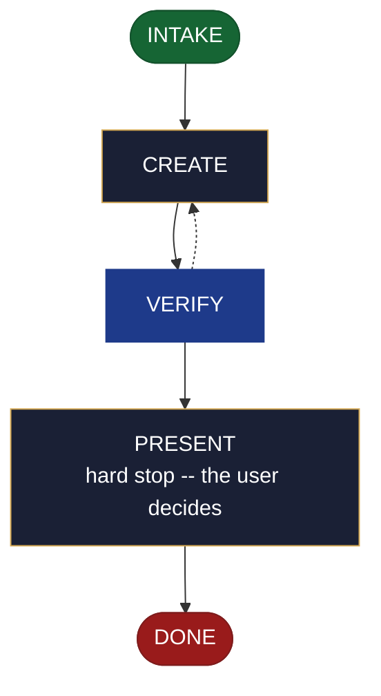

<!-- generated — do not edit; source: canonical/skills/aid-create-testing-strategy/SKILL.md -->

## Frontmatter

- **`name`** — aid-create-testing-strategy
- **`description`** — Write the testing-strategy documents (test landscape, merge gates) from a ready seed. Use when none exist.
- **`allowed-tools`** — Read Glob Grep Bash Shell Terminal Write Edit Agent
- **`argument-hint`** — [&lt;direction>] -- which parts of the testing-strategy seed to realize

[Definition: `canonical/skills/aid-create-testing-strategy/SKILL.md`](https://github.com/AndreVianna/aid-methodology/blob/master/canonical/skills/aid-create-testing-strategy/SKILL.md)

## Flow

## Source fragments

Every node in the chart above, in chart order, with the exact `canonical/` text it was derived from.

**1 · `INTAKE`** · _entry_

~~~~plaintext title="canonical/skills/aid-create-testing-strategy/SKILL.md#L30-L43" wrap
## State: INTAKE

1. **Allocate** through the Work Initiation Gate exactly as the contract's Allocation rule
   requires (`.agents/skills/aid-design/SKILL.md` INTAKE step 4 is the shape), with
   `initiator: aid-create-testing-strategy`. `phase` is not driven.
2. **Read the seed** at `.aid/design/testing-strategy.md`.
3. **Resolve the destinations by concern, not filename.** This skill binds concern **C6**
   (quality & testing, `.aid/runtime/templates/kb-authoring/concern-model.md`) and owns
   **two** documents. The seed's `## Destination` names both halves; where it does not,
   resolve C6 against `.aid/settings.yml` `knowledge.doc_set`, falling back to the C6 row of
   `.aid/runtime/templates/kb-authoring/domain-doc-matrix.md`, and confirm with the user. An
   ambiguous realization is **asked**, never picked silently.
4. **Read both destinations** whole where they exist, and note each one's `source:` field.
5. **Classify complexity** for the `aid-architect` dispatch (verifier tier >= producer).
~~~~

[Source: `canonical/skills/aid-create-testing-strategy/SKILL.md#L30-L43`](https://github.com/AndreVianna/aid-methodology/blob/master/canonical/skills/aid-create-testing-strategy/SKILL.md#L30-L43) · [full step: `canonical/skills/aid-create-testing-strategy/SKILL.md#L30-L45`](https://github.com/AndreVianna/aid-methodology/blob/master/canonical/skills/aid-create-testing-strategy/SKILL.md#L30-L45)

**2 · `CREATE`** · _step_

~~~~plaintext title="canonical/skills/aid-create-testing-strategy/SKILL.md#L49-L51" wrap
## State: CREATE

**Exactly three conditions refuse. There is no fourth.**
~~~~

[Source: `canonical/skills/aid-create-testing-strategy/SKILL.md#L49-L51`](https://github.com/AndreVianna/aid-methodology/blob/master/canonical/skills/aid-create-testing-strategy/SKILL.md#L49-L51) · [full step: `canonical/skills/aid-create-testing-strategy/SKILL.md#L49-L83`](https://github.com/AndreVianna/aid-methodology/blob/master/canonical/skills/aid-create-testing-strategy/SKILL.md#L49-L83)

**3 · `VERIFY`** · _loop-back_

~~~~plaintext title="canonical/skills/aid-create-testing-strategy/SKILL.md#L87-L90" wrap
## State: VERIFY

**Full verify**, as `design-lifecycle.md` defines it. Not clean -> loop to CREATE; the
3-cycle circuit breaker there escalates to IMPEDIMENT + `lifecycle: Blocked`.
~~~~

[Source: `canonical/skills/aid-create-testing-strategy/SKILL.md#L87-L90`](https://github.com/AndreVianna/aid-methodology/blob/master/canonical/skills/aid-create-testing-strategy/SKILL.md#L87-L90) · [full step: `canonical/skills/aid-create-testing-strategy/SKILL.md#L87-L92`](https://github.com/AndreVianna/aid-methodology/blob/master/canonical/skills/aid-create-testing-strategy/SKILL.md#L87-L92)

**4 · `PRESENT`** — hard stop -- the user decides · _step_

~~~~plaintext title="canonical/skills/aid-create-testing-strategy/SKILL.md#L96-L100" wrap
## State: PRESENT (hard stop -- the user decides)

Set `lifecycle: Paused-Awaiting-Input`. Present both realized documents and assert: which
half went where; on a creation path both registration surfaces were written; and anything
routed to `/aid-update-testing-strategy` is named.
~~~~

[Source: `canonical/skills/aid-create-testing-strategy/SKILL.md#L96-L100`](https://github.com/AndreVianna/aid-methodology/blob/master/canonical/skills/aid-create-testing-strategy/SKILL.md#L96-L100) · [full step: `canonical/skills/aid-create-testing-strategy/SKILL.md#L96-L102`](https://github.com/AndreVianna/aid-methodology/blob/master/canonical/skills/aid-create-testing-strategy/SKILL.md#L96-L102)

**5 · `DONE`** · _exit_ · UNSPECIFIED

~~~~plaintext title="canonical/skills/aid-create-testing-strategy/SKILL.md#L106-L108" wrap
## State: DONE

Set `lifecycle: Completed`, `updated` now, append a `## Lifecycle History` row.
~~~~

[Source: `canonical/skills/aid-create-testing-strategy/SKILL.md#L106-L108`](https://github.com/AndreVianna/aid-methodology/blob/master/canonical/skills/aid-create-testing-strategy/SKILL.md#L106-L108) · [full step: `canonical/skills/aid-create-testing-strategy/SKILL.md#L106-L108`](https://github.com/AndreVianna/aid-methodology/blob/master/canonical/skills/aid-create-testing-strategy/SKILL.md#L106-L108)
