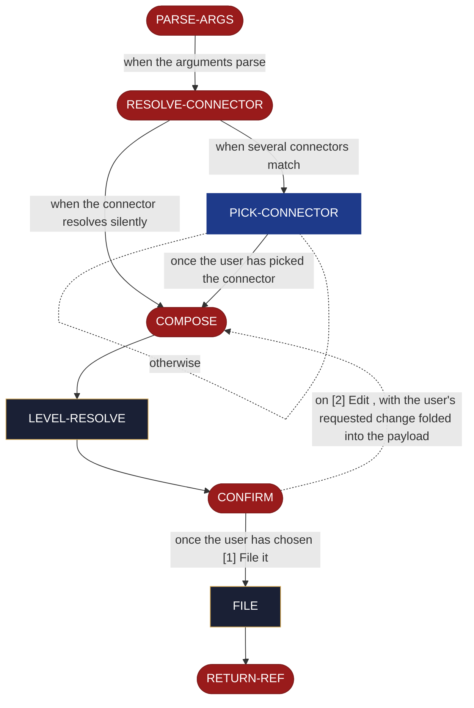

<!-- generated — do not edit; source: canonical/skills/aid-create-ticket/SKILL.md -->

## Frontmatter

- **`name`** — aid-create-ticket
- **`description`** — File one new ticket in the project's issue tracker. Use this skill when work needs recording where the team tracks it, rather than only inside AID. Describe the ticket in free text; flags let you name the connector, the level (epic, story or task) and a parent. It resolves which tracker to use, composes the payload, maps the level to that tracker's own issue type, and shows you the exact payload before anything is filed. One confirmation gates the write, and carries the level choice when you did not give one. It returns the new ticket's id only after you confirm; nothing is filed, and no local file is written, before that.
- **`allowed-tools`** — Read Glob Grep AskUserQuestion
- **`argument-hint`** — [--connector &lt;stem>] [--level epic|story|task] [--parent &lt;ref>] &lt;description>

[Definition: `canonical/skills/aid-create-ticket/SKILL.md`](https://github.com/AndreVianna/aid-methodology/blob/master/canonical/skills/aid-create-ticket/SKILL.md)

## Flow

> **Approximate:** This chart is derived by heuristic; exact transitions may differ from runtime behaviour.

## Source fragments

Every node in the chart above, in chart order, with the exact `canonical/` text it was derived from.

**1 · `PARSE-ARGS`** · _exit_ · HALT

~~~~plaintext title="canonical/skills/aid-create-ticket/SKILL.md#L69" wrap
### State 1 — PARSE-ARGS
~~~~

[Source: `canonical/skills/aid-create-ticket/SKILL.md#L69`](https://github.com/AndreVianna/aid-methodology/blob/master/canonical/skills/aid-create-ticket/SKILL.md#L69)

**2 · `RESOLVE-CONNECTOR`** · _exit_ · HALT

~~~~plaintext title="canonical/skills/aid-create-ticket/SKILL.md#L104" wrap
### State 2 — RESOLVE-CONNECTOR
~~~~

[Source: `canonical/skills/aid-create-ticket/SKILL.md#L104`](https://github.com/AndreVianna/aid-methodology/blob/master/canonical/skills/aid-create-ticket/SKILL.md#L104)

**3 · `PICK-CONNECTOR`** · _loop-back_

~~~~plaintext title="canonical/skills/aid-create-ticket/SKILL.md#L120" wrap
### State 2a — PICK-CONNECTOR
~~~~

[Source: `canonical/skills/aid-create-ticket/SKILL.md#L120`](https://github.com/AndreVianna/aid-methodology/blob/master/canonical/skills/aid-create-ticket/SKILL.md#L120)

**4 · `COMPOSE`** · _exit_ · HALT

~~~~plaintext title="canonical/skills/aid-create-ticket/SKILL.md#L131" wrap
### State 3 — COMPOSE
~~~~

[Source: `canonical/skills/aid-create-ticket/SKILL.md#L131`](https://github.com/AndreVianna/aid-methodology/blob/master/canonical/skills/aid-create-ticket/SKILL.md#L131)

**5 · `LEVEL-RESOLVE`** · _step_

~~~~plaintext title="canonical/skills/aid-create-ticket/SKILL.md#L159" wrap
### State 4 — LEVEL-RESOLVE
~~~~

[Source: `canonical/skills/aid-create-ticket/SKILL.md#L159`](https://github.com/AndreVianna/aid-methodology/blob/master/canonical/skills/aid-create-ticket/SKILL.md#L159)

**6 · `CONFIRM`** · _exit_ · HALT

~~~~plaintext title="canonical/skills/aid-create-ticket/SKILL.md#L185" wrap
### State 5 — CONFIRM
~~~~

[Source: `canonical/skills/aid-create-ticket/SKILL.md#L185`](https://github.com/AndreVianna/aid-methodology/blob/master/canonical/skills/aid-create-ticket/SKILL.md#L185)

**7 · `FILE`** · _step_

~~~~plaintext title="canonical/skills/aid-create-ticket/SKILL.md#L215" wrap
### State 6 — FILE
~~~~

[Source: `canonical/skills/aid-create-ticket/SKILL.md#L215`](https://github.com/AndreVianna/aid-methodology/blob/master/canonical/skills/aid-create-ticket/SKILL.md#L215)

**8 · `RETURN-REF`** · _exit_ · HALT

~~~~plaintext title="canonical/skills/aid-create-ticket/SKILL.md#L232" wrap
### State 7 — RETURN-REF
~~~~

[Source: `canonical/skills/aid-create-ticket/SKILL.md#L232`](https://github.com/AndreVianna/aid-methodology/blob/master/canonical/skills/aid-create-ticket/SKILL.md#L232)
