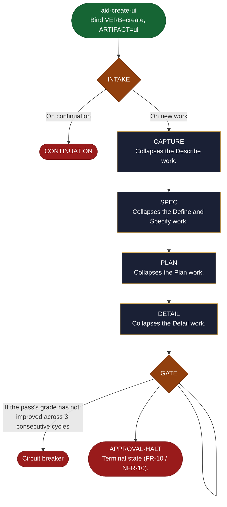

<!-- generated — do not edit; source: canonical/skills/aid-create-ui/SKILL.md -->

## Frontmatter

- **`name`** — aid-create-ui
- **`description`** — Create a UI component or page. Use when the request is already clear and you want it scoped, specified and broken into reviewable tasks in one pass, before anything is built.
- **`allowed-tools`** — Read Glob Grep Bash Shell Terminal Write Edit Agent
- **`argument-hint`** — [description]  -- a request to create; runs straight to a graded flattened Lite work

[Definition: `canonical/skills/aid-create-ui/SKILL.md`](https://github.com/AndreVianna/aid-methodology/blob/master/canonical/skills/aid-create-ui/SKILL.md)

## Flow

## Source fragments

Every node in the chart above, in chart order, with the exact `canonical/` text it was derived from.

**1 · `aid-create-ui`** — Bind VERB=create, ARTIFACT=ui · _entry_

~~~~plaintext title="canonical/skills/aid-create-ui/SKILL.md#L15" wrap
Bind **VERB=`create`**, **ARTIFACT=`ui`**, then run the shared engine at `.aid/runtime/templates/shortcut-engine.md`. The engine scaffolds the flattened Lite work (feature-001 structure) and authors exactly two documents: `REQUIREMENTS.md`, whose `§ 11` feature section carries the technical specification and whose `§ 9` carries the gate criteria, and the task `DETAIL.md` files -- with reduced capture. One feature and one delivery means there is nothing to sequence, so no plan is written and the execution graph is derived from each task's `**Depends on:**` field. It runs the per-document Grading Gates (feature-004) and halts at the FR-10 approval gate. It never executes. This shortcut's `default_type`/`group` are its row in `.aid/runtime/templates/shortcut-catalog.yml`.
~~~~

[Source: `canonical/skills/aid-create-ui/SKILL.md#L15`](https://github.com/AndreVianna/aid-methodology/blob/master/canonical/skills/aid-create-ui/SKILL.md#L15)

**2 · `INTAKE`** — parse the bound invocation values; resolve the catalog row… · _decision_

~~~~plaintext title="canonical/aid/templates/shortcut-engine.md#L88" wrap
| INTAKE | below | inline | CHAIN -> CAPTURE |
~~~~

[Source: `canonical/aid/templates/shortcut-engine.md#L88`](https://github.com/AndreVianna/aid-methodology/blob/master/canonical/aid/templates/shortcut-engine.md#L88) · [full step: `canonical/aid/templates/shortcut-engine.md#L221-L366`](https://github.com/AndreVianna/aid-methodology/blob/master/canonical/aid/templates/shortcut-engine.md#L221-L366)

**3 · `CONTINUATION`** · _exit_ · HALT

~~~~plaintext title="canonical/aid/templates/work-initiation-gate.md#L146" wrap
### 3b. CONTINUATION -> the work's record decides where it resumes
~~~~

[Source: `canonical/aid/templates/work-initiation-gate.md#L146`](https://github.com/AndreVianna/aid-methodology/blob/master/canonical/aid/templates/work-initiation-gate.md#L146)

**4 · `CAPTURE`** — Collapses the Describe work. · _step_

~~~~plaintext title="canonical/aid/templates/shortcut-engine.md#L89" wrap
| CAPTURE | below | `aid-architect` (Large) | CHAIN -> SPEC |
~~~~

[Source: `canonical/aid/templates/shortcut-engine.md#L89`](https://github.com/AndreVianna/aid-methodology/blob/master/canonical/aid/templates/shortcut-engine.md#L89) · [full step: `canonical/aid/templates/shortcut-engine.md#L370-L461`](https://github.com/AndreVianna/aid-methodology/blob/master/canonical/aid/templates/shortcut-engine.md#L370-L461)

**5 · `SPEC`** — Collapses the Define and Specify work. · _step_

~~~~plaintext title="canonical/aid/templates/shortcut-engine.md#L90" wrap
| SPEC | below | `aid-architect` (Large) | CHAIN -> PLAN |
~~~~

[Source: `canonical/aid/templates/shortcut-engine.md#L90`](https://github.com/AndreVianna/aid-methodology/blob/master/canonical/aid/templates/shortcut-engine.md#L90) · [full step: `canonical/aid/templates/shortcut-engine.md#L465-L525`](https://github.com/AndreVianna/aid-methodology/blob/master/canonical/aid/templates/shortcut-engine.md#L465-L525)

**6 · `PLAN`** — Collapses the Plan work. · _step_

~~~~plaintext title="canonical/aid/templates/shortcut-engine.md#L91" wrap
| PLAN | below | `aid-architect` (Large) | CHAIN -> DETAIL |
~~~~

[Source: `canonical/aid/templates/shortcut-engine.md#L91`](https://github.com/AndreVianna/aid-methodology/blob/master/canonical/aid/templates/shortcut-engine.md#L91) · [full step: `canonical/aid/templates/shortcut-engine.md#L529-L598`](https://github.com/AndreVianna/aid-methodology/blob/master/canonical/aid/templates/shortcut-engine.md#L529-L598)

**7 · `DETAIL`** — Collapses the Detail work. · _step_

~~~~plaintext title="canonical/aid/templates/shortcut-engine.md#L92" wrap
| DETAIL | below | `aid-architect` (Large) | CHAIN -> GATE |
~~~~

[Source: `canonical/aid/templates/shortcut-engine.md#L92`](https://github.com/AndreVianna/aid-methodology/blob/master/canonical/aid/templates/shortcut-engine.md#L92) · [full step: `canonical/aid/templates/shortcut-engine.md#L602-L703`](https://github.com/AndreVianna/aid-methodology/blob/master/canonical/aid/templates/shortcut-engine.md#L602-L703)

**8 · `GATE`** — Runs feature-004's two batched Grading-Gate passes over the… · _decision_

~~~~plaintext title="canonical/aid/templates/shortcut-engine.md#L93" wrap
| GATE | below | `aid-reviewer` (Large) | CHAIN -> APPROVAL-HALT |
~~~~

[Source: `canonical/aid/templates/shortcut-engine.md#L93`](https://github.com/AndreVianna/aid-methodology/blob/master/canonical/aid/templates/shortcut-engine.md#L93) · [full step: `canonical/aid/templates/shortcut-engine.md#L705-L884`](https://github.com/AndreVianna/aid-methodology/blob/master/canonical/aid/templates/shortcut-engine.md#L705-L884)

**9 · `Circuit breaker`** · _exit_ · HALT

~~~~plaintext title="canonical/aid/templates/shortcut-engine.md#L840" wrap
   **Circuit breaker.** If the pass's grade has not improved across 3
~~~~

[Source: `canonical/aid/templates/shortcut-engine.md#L840`](https://github.com/AndreVianna/aid-methodology/blob/master/canonical/aid/templates/shortcut-engine.md#L840)

**10 · `APPROVAL-HALT`** — Terminal state (FR-10 / NFR-10). · _exit_ · ASK

~~~~plaintext title="canonical/aid/templates/shortcut-engine.md#L94" wrap
| APPROVAL-HALT | below | inline | ASK then HALT |
~~~~

[Source: `canonical/aid/templates/shortcut-engine.md#L94`](https://github.com/AndreVianna/aid-methodology/blob/master/canonical/aid/templates/shortcut-engine.md#L94) · [full step: `canonical/aid/templates/shortcut-engine.md#L888-L948`](https://github.com/AndreVianna/aid-methodology/blob/master/canonical/aid/templates/shortcut-engine.md#L888-L948)
