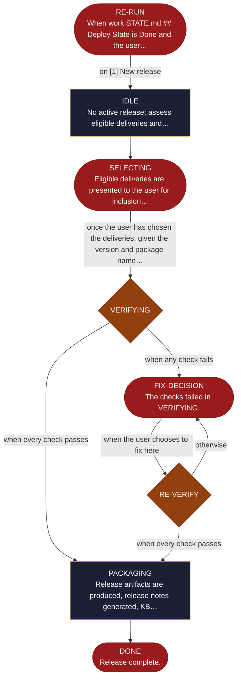

<!-- generated — do not edit; source: canonical/skills/aid-deploy/SKILL.md -->

## Frontmatter

- **`name`** — aid-deploy
- **`description`** — Package completed deliveries into a release. Use when completed deliveries are ready to ship.
- **`allowed-tools`** — Read Glob Grep Bash Shell Terminal Write

[Definition: `canonical/skills/aid-deploy/SKILL.md`](https://github.com/AndreVianna/aid-methodology/blob/master/canonical/skills/aid-deploy/SKILL.md)

## Flow

## Source fragments

Every node in the chart above, in chart order, with the exact `canonical/` text it was derived from.

**1 · `IDLE`** — No active release; assess eligible deliveries and… · _step_

~~~~plaintext title="canonical/skills/aid-deploy/SKILL.md#L188" wrap
| IDLE | `references/state-idle.md` | `aid-operator` | CHAIN → SELECTING |
~~~~

[Source: `canonical/skills/aid-deploy/SKILL.md#L188`](https://github.com/AndreVianna/aid-methodology/blob/master/canonical/skills/aid-deploy/SKILL.md#L188) · [full step: `canonical/skills/aid-deploy/references/state-idle.md#L1-L34`](https://github.com/AndreVianna/aid-methodology/blob/master/canonical/skills/aid-deploy/references/state-idle.md#L1-L34)

**2 · `SELECTING`** — Eligible deliveries are presented to the user for inclusion… · _exit_ · HALT

~~~~plaintext title="canonical/skills/aid-deploy/SKILL.md#L189" wrap
| SELECTING | `references/state-selecting.md` | `inline` | CHAIN → VERIFYING; HALT on cancel |
~~~~

[Source: `canonical/skills/aid-deploy/SKILL.md#L189`](https://github.com/AndreVianna/aid-methodology/blob/master/canonical/skills/aid-deploy/SKILL.md#L189) · [full step: `canonical/skills/aid-deploy/references/state-selecting.md#L1-L48`](https://github.com/AndreVianna/aid-methodology/blob/master/canonical/skills/aid-deploy/references/state-selecting.md#L1-L48)

**3 · `VERIFYING`** — Full build, tests, and lint are run against the combined… · _decision_

~~~~plaintext title="canonical/skills/aid-deploy/SKILL.md#L190" wrap
| VERIFYING | `references/state-verifying.md` | `aid-operator` | CHAIN → PACKAGING when every check passes; CHAIN → FIX-DECISION when a check fails |
~~~~

[Source: `canonical/skills/aid-deploy/SKILL.md#L190`](https://github.com/AndreVianna/aid-methodology/blob/master/canonical/skills/aid-deploy/SKILL.md#L190) · [full step: `canonical/skills/aid-deploy/references/state-verifying.md#L1-L47`](https://github.com/AndreVianna/aid-methodology/blob/master/canonical/skills/aid-deploy/references/state-verifying.md#L1-L47)

**4 · `FIX-DECISION`** — The checks failed in VERIFYING. · _exit_ · HALT

~~~~plaintext title="canonical/skills/aid-deploy/SKILL.md#L191" wrap
| FIX-DECISION | `references/state-fix-decision.md` | `inline` | CHAIN → RE-VERIFY; HALT on loop back |
~~~~

[Source: `canonical/skills/aid-deploy/SKILL.md#L191`](https://github.com/AndreVianna/aid-methodology/blob/master/canonical/skills/aid-deploy/SKILL.md#L191) · [full step: `canonical/skills/aid-deploy/references/state-fix-decision.md#L1-L19`](https://github.com/AndreVianna/aid-methodology/blob/master/canonical/skills/aid-deploy/references/state-fix-decision.md#L1-L19)

**5 · `RE-VERIFY`** — The user chose to fix the failed checks here. · _decision_

~~~~plaintext title="canonical/skills/aid-deploy/SKILL.md#L192" wrap
| RE-VERIFY | `references/state-re-verify.md` | `aid-operator` | CHAIN → PACKAGING when every check passes; CHAIN → FIX-DECISION otherwise |
~~~~

[Source: `canonical/skills/aid-deploy/SKILL.md#L192`](https://github.com/AndreVianna/aid-methodology/blob/master/canonical/skills/aid-deploy/SKILL.md#L192) · [full step: `canonical/skills/aid-deploy/references/state-re-verify.md#L1-L17`](https://github.com/AndreVianna/aid-methodology/blob/master/canonical/skills/aid-deploy/references/state-re-verify.md#L1-L17)

**6 · `PACKAGING`** — Release artifacts are produced, release notes generated, KB… · _step_

~~~~plaintext title="canonical/skills/aid-deploy/SKILL.md#L193" wrap
| PACKAGING | `references/state-packaging.md` | `aid-operator` | CHAIN → DONE |
~~~~

[Source: `canonical/skills/aid-deploy/SKILL.md#L193`](https://github.com/AndreVianna/aid-methodology/blob/master/canonical/skills/aid-deploy/SKILL.md#L193) · [full step: `canonical/skills/aid-deploy/references/state-packaging.md#L1-L99`](https://github.com/AndreVianna/aid-methodology/blob/master/canonical/skills/aid-deploy/references/state-packaging.md#L1-L99)

**7 · `DONE`** — Release complete. · _exit_ · HALT

~~~~plaintext title="canonical/skills/aid-deploy/SKILL.md#L194" wrap
| DONE | `references/state-done.md` | `inline` | HALT |
~~~~

[Source: `canonical/skills/aid-deploy/SKILL.md#L194`](https://github.com/AndreVianna/aid-methodology/blob/master/canonical/skills/aid-deploy/SKILL.md#L194) · [full step: `canonical/skills/aid-deploy/references/state-done.md#L1-L33`](https://github.com/AndreVianna/aid-methodology/blob/master/canonical/skills/aid-deploy/references/state-done.md#L1-L33)

**8 · `RE-RUN`** — When work STATE.md ## Deploy State is Done and the user… · _exit_ · HALT

~~~~plaintext title="canonical/skills/aid-deploy/SKILL.md#L195" wrap
| RE-RUN | `references/state-re-run.md` | `inline` | CHAIN → IDLE; HALT on review |
~~~~

[Source: `canonical/skills/aid-deploy/SKILL.md#L195`](https://github.com/AndreVianna/aid-methodology/blob/master/canonical/skills/aid-deploy/SKILL.md#L195) · [full step: `canonical/skills/aid-deploy/references/state-re-run.md#L1-L20`](https://github.com/AndreVianna/aid-methodology/blob/master/canonical/skills/aid-deploy/references/state-re-run.md#L1-L20)
