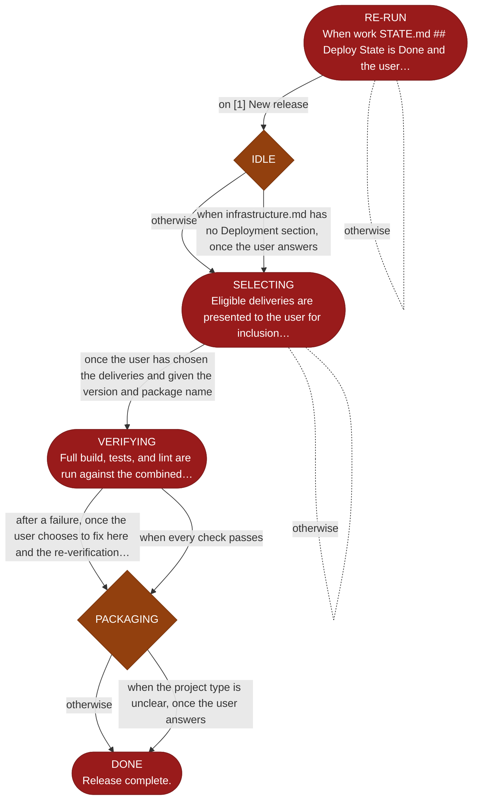

<!-- generated — do not edit; source: canonical/skills/aid-deploy/SKILL.md -->

## Frontmatter

- **`name`** — aid-deploy
- **`description`** — Package completed deliveries into a release. Use when completed deliveries are ready to ship.
- **`allowed-tools`** — Read Glob Grep Bash Shell Terminal Write

[Definition: `canonical/skills/aid-deploy/SKILL.md`](https://github.com/AndreVianna/aid-methodology/blob/master/canonical/skills/aid-deploy/SKILL.md)

## Flow

## Source fragments

Every node in the chart above, in chart order, with the exact `canonical/` text it was derived from.

**1 · `IDLE`** — No active release; assess eligible deliveries and… · _decision_

~~~~plaintext title="canonical/skills/aid-deploy/SKILL.md#L180" wrap
| IDLE | `references/state-idle.md` | `aid-operator` | → SELECTING |
~~~~

[Source: `canonical/skills/aid-deploy/SKILL.md#L180`](https://github.com/AndreVianna/aid-methodology/blob/master/canonical/skills/aid-deploy/SKILL.md#L180) · [full step: `canonical/skills/aid-deploy/references/state-idle.md#L1-L35`](https://github.com/AndreVianna/aid-methodology/blob/master/canonical/skills/aid-deploy/references/state-idle.md#L1-L35)

**2 · `SELECTING`** — Eligible deliveries are presented to the user for inclusion… · _exit_ · HALT

~~~~plaintext title="canonical/skills/aid-deploy/SKILL.md#L181" wrap
| SELECTING | `references/state-selecting.md` | `aid-operator` | → VERIFYING |
~~~~

[Source: `canonical/skills/aid-deploy/SKILL.md#L181`](https://github.com/AndreVianna/aid-methodology/blob/master/canonical/skills/aid-deploy/SKILL.md#L181) · [full step: `canonical/skills/aid-deploy/references/state-selecting.md#L1-L39`](https://github.com/AndreVianna/aid-methodology/blob/master/canonical/skills/aid-deploy/references/state-selecting.md#L1-L39)

**3 · `VERIFYING`** — Full build, tests, and lint are run against the combined… · _exit_ · HALT

~~~~plaintext title="canonical/skills/aid-deploy/SKILL.md#L182" wrap
| VERIFYING | `references/state-verifying.md` | `aid-operator` | → PACKAGING |
~~~~

[Source: `canonical/skills/aid-deploy/SKILL.md#L182`](https://github.com/AndreVianna/aid-methodology/blob/master/canonical/skills/aid-deploy/SKILL.md#L182) · [full step: `canonical/skills/aid-deploy/references/state-verifying.md#L1-L53`](https://github.com/AndreVianna/aid-methodology/blob/master/canonical/skills/aid-deploy/references/state-verifying.md#L1-L53)

**4 · `PACKAGING`** — Release artifacts are produced, release notes generated, KB… · _decision_

~~~~plaintext title="canonical/skills/aid-deploy/SKILL.md#L183" wrap
| PACKAGING | `references/state-packaging.md` | `aid-operator` | → DONE |
~~~~

[Source: `canonical/skills/aid-deploy/SKILL.md#L183`](https://github.com/AndreVianna/aid-methodology/blob/master/canonical/skills/aid-deploy/SKILL.md#L183) · [full step: `canonical/skills/aid-deploy/references/state-packaging.md#L1-L99`](https://github.com/AndreVianna/aid-methodology/blob/master/canonical/skills/aid-deploy/references/state-packaging.md#L1-L99)

**5 · `DONE`** — Release complete. · _exit_ · HALT

~~~~plaintext title="canonical/skills/aid-deploy/SKILL.md#L184" wrap
| DONE | `references/state-done.md` | `inline` | → halt |
~~~~

[Source: `canonical/skills/aid-deploy/SKILL.md#L184`](https://github.com/AndreVianna/aid-methodology/blob/master/canonical/skills/aid-deploy/SKILL.md#L184) · [full step: `canonical/skills/aid-deploy/references/state-done.md#L1-L33`](https://github.com/AndreVianna/aid-methodology/blob/master/canonical/skills/aid-deploy/references/state-done.md#L1-L33)

**6 · `RE-RUN`** — When work STATE.md ## Deploy State is Done and the user… · _exit_ · HALT

~~~~plaintext title="canonical/skills/aid-deploy/SKILL.md#L185" wrap
| RE-RUN | `references/state-re-run.md` | `inline` | → halt |
~~~~

[Source: `canonical/skills/aid-deploy/SKILL.md#L185`](https://github.com/AndreVianna/aid-methodology/blob/master/canonical/skills/aid-deploy/SKILL.md#L185) · [full step: `canonical/skills/aid-deploy/references/state-re-run.md#L1-L19`](https://github.com/AndreVianna/aid-methodology/blob/master/canonical/skills/aid-deploy/references/state-re-run.md#L1-L19)
