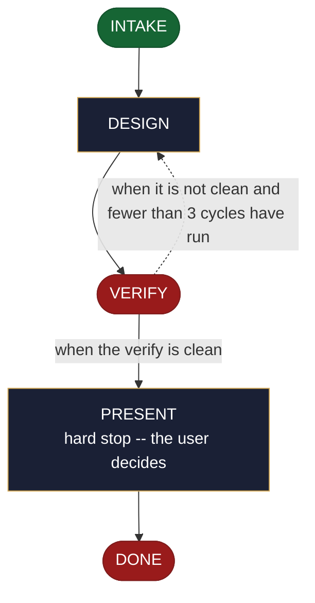

<!-- generated — do not edit; source: canonical/skills/aid-design-data-pipeline/SKILL.md -->

## Frontmatter

- **`name`** — aid-design-data-pipeline
- **`description`** — Develop a data-pipeline design as a DESIGN SEED in `.aid/design/data-pipeline.md` -- the source, the transform, the sink, and the schedule. Use this skill when where the data comes from, what happens to it, and where it lands are still open questions. Grounded in the Knowledge Base (`.aid/knowledge/`) and the project source. It WRITES NO production code and NO KB document -- realize the seed into the built pipeline with `/aid-create-data-pipeline` once it is ready. Produced by the aid-architect agent and independently verified by aid-reviewer (full verify). Allocates a work-NNN folder.
- **`allowed-tools`** — Read Glob Grep Bash Shell Terminal Write Edit Agent
- **`argument-hint`** — &lt;subject> -- the data pipeline to design (source, transform, sink, schedule)

[Definition: `canonical/skills/aid-design-data-pipeline/SKILL.md`](https://github.com/AndreVianna/aid-methodology/blob/master/canonical/skills/aid-design-data-pipeline/SKILL.md)

## Flow

## Source fragments

Every node in the chart above, in chart order, with the exact `canonical/` text it was derived from.

**1 · `INTAKE`** · _entry_

~~~~plaintext title="canonical/skills/aid-design-data-pipeline/SKILL.md#L36-L45" wrap
## State: INTAKE

1. **Require a subject.** Empty argument -> ask one bootstrapping question ("What data
   pipeline do you want to design -- its source, transform, sink, and schedule?") and wait.
2. **Allocate** through the Work Initiation Gate exactly as the contract's Allocation rule
   requires (`.agents/skills/aid-design/SKILL.md` INTAKE step 4 is the shape), with
   `--skill aid-design-data-pipeline` given to the gate's `--create`. `phase` is not driven.
3. **Acquire `.aid/design/`** per the contract, then read `.aid/design/data-pipeline.md` if
   a prior seed exists -- re-invocation iterates it rather than starting over.
4. **Classify complexity** for the `aid-architect` dispatch (verifier tier >= producer).
~~~~

[Source: `canonical/skills/aid-design-data-pipeline/SKILL.md#L36-L45`](https://github.com/AndreVianna/aid-methodology/blob/master/canonical/skills/aid-design-data-pipeline/SKILL.md#L36-L45) · [full step: `canonical/skills/aid-design-data-pipeline/SKILL.md#L36-L51`](https://github.com/AndreVianna/aid-methodology/blob/master/canonical/skills/aid-design-data-pipeline/SKILL.md#L36-L51)

**2 · `DESIGN`** · _step_

~~~~plaintext title="canonical/skills/aid-design-data-pipeline/SKILL.md#L55-L63" wrap
## State: DESIGN

Dispatch **`aid-architect`** (clean context, tiered) to write or iterate
`.aid/design/data-pipeline.md` in the seed shape the contract fixes (`design-seed.md`;
feature-002 §4), grounded in `.aid/knowledge/` and the project source plus any seed read
in INTAKE. What this artifact's seed must settle: **the source, the transform, the sink,
and the schedule**; its `## Destination` names where the built pipeline lands. **Never
writes `.aid/knowledge/` and never writes production code** -- the `design` invariant
(`design-lifecycle.md`).
~~~~

[Source: `canonical/skills/aid-design-data-pipeline/SKILL.md#L55-L63`](https://github.com/AndreVianna/aid-methodology/blob/master/canonical/skills/aid-design-data-pipeline/SKILL.md#L55-L63) · [full step: `canonical/skills/aid-design-data-pipeline/SKILL.md#L55-L65`](https://github.com/AndreVianna/aid-methodology/blob/master/canonical/skills/aid-design-data-pipeline/SKILL.md#L55-L65)

**3 · `VERIFY`** · _exit_ · HALT

~~~~plaintext title="canonical/skills/aid-design-data-pipeline/SKILL.md#L69-L72" wrap
## State: VERIFY

**Full verify**, as `design-lifecycle.md` defines it. Not clean -> loop to DESIGN; the
3-cycle circuit breaker there escalates to IMPEDIMENT, and the lifecycle is set to `Blocked` through the writer.
~~~~

[Source: `canonical/skills/aid-design-data-pipeline/SKILL.md#L69-L72`](https://github.com/AndreVianna/aid-methodology/blob/master/canonical/skills/aid-design-data-pipeline/SKILL.md#L69-L72) · [full step: `canonical/skills/aid-design-data-pipeline/SKILL.md#L69-L74`](https://github.com/AndreVianna/aid-methodology/blob/master/canonical/skills/aid-design-data-pipeline/SKILL.md#L69-L74)

**4 · `PRESENT`** — hard stop -- the user decides · _step_

~~~~plaintext title="canonical/skills/aid-design-data-pipeline/SKILL.md#L78-L81" wrap
## State: PRESENT (hard stop -- the user decides)

Set the lifecycle to `Paused-Awaiting-Input` through the writer. Present the seed clearly. Assert no resolution --
the user iterates (re-invoke this skill) or realizes it now (`/aid-create-data-pipeline`).
~~~~

[Source: `canonical/skills/aid-design-data-pipeline/SKILL.md#L78-L81`](https://github.com/AndreVianna/aid-methodology/blob/master/canonical/skills/aid-design-data-pipeline/SKILL.md#L78-L81) · [full step: `canonical/skills/aid-design-data-pipeline/SKILL.md#L78-L83`](https://github.com/AndreVianna/aid-methodology/blob/master/canonical/skills/aid-design-data-pipeline/SKILL.md#L78-L83)

**5 · `DONE`** · _exit_ · UNSPECIFIED

~~~~plaintext title="canonical/skills/aid-design-data-pipeline/SKILL.md#L87-L91" wrap
## State: DONE

Set the lifecycle to `Completed` through the writer. The seed
persists at `.aid/design/data-pipeline.md`; consumption happens at
`/aid-create-data-pipeline`.
~~~~

[Source: `canonical/skills/aid-design-data-pipeline/SKILL.md#L87-L91`](https://github.com/AndreVianna/aid-methodology/blob/master/canonical/skills/aid-design-data-pipeline/SKILL.md#L87-L91) · [full step: `canonical/skills/aid-design-data-pipeline/SKILL.md#L87-L91`](https://github.com/AndreVianna/aid-methodology/blob/master/canonical/skills/aid-design-data-pipeline/SKILL.md#L87-L91)
