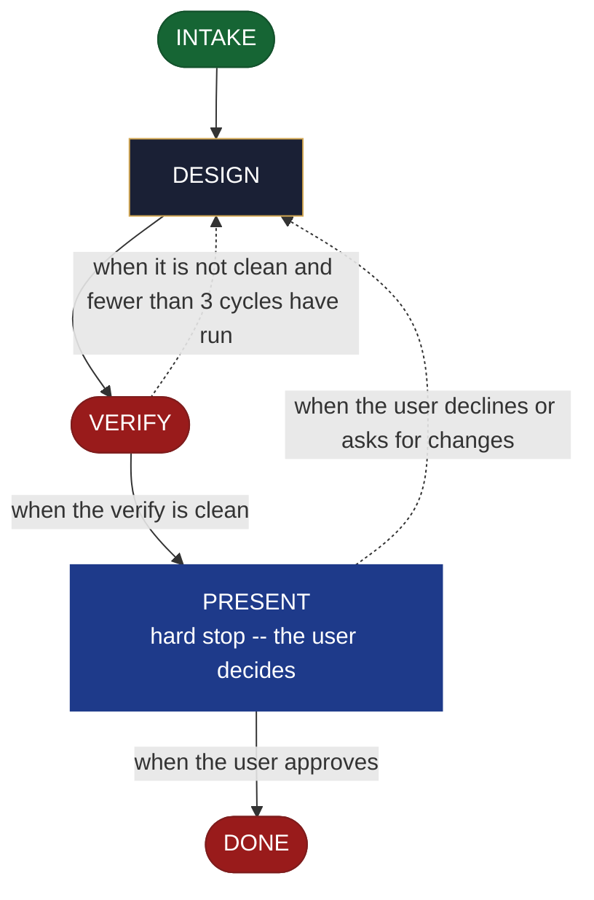

<!-- generated — do not edit; source: canonical/skills/aid-design-job/SKILL.md -->

## Frontmatter

- **`name`** — aid-design-job
- **`description`** — Develop a scheduled or background job design as a DESIGN SEED in `.aid/design/job.md` -- the trigger, the work it performs, and its idempotency and failure handling. Use this skill when a job's schedule, its work, and its retry behaviour are still being decided. Grounded in the Knowledge Base (`.aid/knowledge/`) and the project source. It WRITES NO production code and NO KB document -- realize the seed into the built job with `/aid-create-job` once it is ready. Produced by the aid-architect agent and independently verified by aid-reviewer (full verify).
- **`allowed-tools`** — Read Glob Grep Bash Shell Terminal Write Edit Agent
- **`argument-hint`** — &lt;subject> -- the job to design (trigger, work, idempotency/failure)

[Definition: `canonical/skills/aid-design-job/SKILL.md`](https://github.com/AndreVianna/aid-methodology/blob/master/canonical/skills/aid-design-job/SKILL.md)

## Flow

## Source fragments

Every node in the chart above, in chart order, with the exact `canonical/` text it was derived from.

**1 · `INTAKE`** · _entry_

~~~~plaintext title="canonical/skills/aid-design-job/SKILL.md#L37-L44" wrap
## State: INTAKE

1. **Require a subject.** Empty argument -> ask one bootstrapping question ("What job do
   you want to design -- its trigger, the work it performs, and its failure handling?") and wait: acquire `.aid/design/` first (below), then record the question with `bash .aid/runtime/scripts/execute/writeback-state.sh --ask --design .aid/design/job.md --category Scope --impact High --context '<the question, as shown>' --suggested '<your suggestion>' --asked-by aid-design-job`, which opens the seed document (`status: draft`) when it does not exist yet, and record the reply with `--answer --design .aid/design/job.md --id <id> --state Answered --value '<the reply>'`.
2. **Name the seed; open no work.** The seed is `.aid/design/job.md`. This skill allocates nothing through the Work Initiation Gate and writes nothing under `.aid/works/`: a work is opened later, by a build skill or `/aid-orchestrate`, which takes the seed into it. Record every question with `--ask --design .aid/design/job.md` and its reply with `--answer --design`, and track the step with `--step INTAKE --design .aid/design/job.md`, all through `.aid/runtime/scripts/execute/writeback-state.sh`.
3. **Acquire `.aid/design/`** per the contract, then read `.aid/design/job.md` if a prior
   seed exists -- re-invocation iterates it rather than starting over.
4. **Classify complexity** for the `aid-architect` dispatch (verifier tier >= producer).
~~~~

[Source: `canonical/skills/aid-design-job/SKILL.md#L37-L44`](https://github.com/AndreVianna/aid-methodology/blob/master/canonical/skills/aid-design-job/SKILL.md#L37-L44) · [full step: `canonical/skills/aid-design-job/SKILL.md#L37-L50`](https://github.com/AndreVianna/aid-methodology/blob/master/canonical/skills/aid-design-job/SKILL.md#L37-L50)

**2 · `DESIGN`** · _step_

~~~~plaintext title="canonical/skills/aid-design-job/SKILL.md#L54-L62" wrap
## State: DESIGN

Dispatch **`aid-architect`** (clean context, tiered) to write or iterate
`.aid/design/job.md` in the seed shape the contract fixes (`design-seed.md`;
feature-002 §4), grounded in `.aid/knowledge/` and the project source plus any seed read
in INTAKE. What this artifact's seed must settle: **the trigger, the work it performs, and
its idempotency and failure handling**; its `## Destination` names where the built job
lands. **Never writes `.aid/knowledge/` and never writes production code** -- the `design`
invariant (`design-lifecycle.md`).
~~~~

[Source: `canonical/skills/aid-design-job/SKILL.md#L54-L62`](https://github.com/AndreVianna/aid-methodology/blob/master/canonical/skills/aid-design-job/SKILL.md#L54-L62) · [full step: `canonical/skills/aid-design-job/SKILL.md#L54-L64`](https://github.com/AndreVianna/aid-methodology/blob/master/canonical/skills/aid-design-job/SKILL.md#L54-L64)

**3 · `VERIFY`** · _exit_ · HALT

~~~~plaintext title="canonical/skills/aid-design-job/SKILL.md#L68-L71" wrap
## State: VERIFY

**Full verify**, as `design-lifecycle.md` defines it. Not clean -> loop to DESIGN; the
3-cycle circuit breaker there escalates to IMPEDIMENT, and the impediment is recorded with `--step VERIFY --design .aid/design/job.md --detail 'impediment: <reason>'`.
~~~~

[Source: `canonical/skills/aid-design-job/SKILL.md#L68-L71`](https://github.com/AndreVianna/aid-methodology/blob/master/canonical/skills/aid-design-job/SKILL.md#L68-L71) · [full step: `canonical/skills/aid-design-job/SKILL.md#L68-L73`](https://github.com/AndreVianna/aid-methodology/blob/master/canonical/skills/aid-design-job/SKILL.md#L68-L73)

**4 · `PRESENT`** — hard stop -- the user decides · _loop-back_

~~~~plaintext title="canonical/skills/aid-design-job/SKILL.md#L77-L80" wrap
## State: PRESENT (hard stop -- the user decides)

Present the seed clearly. Assert no resolution --
the user iterates (declining the approval below changes the seed in place) or realizes it now (`/aid-create-job`).
~~~~

[Source: `canonical/skills/aid-design-job/SKILL.md#L77-L80`](https://github.com/AndreVianna/aid-methodology/blob/master/canonical/skills/aid-design-job/SKILL.md#L77-L80) · [full step: `canonical/skills/aid-design-job/SKILL.md#L77-L85`](https://github.com/AndreVianna/aid-methodology/blob/master/canonical/skills/aid-design-job/SKILL.md#L77-L85)

**5 · `DONE`** · _exit_ · UNSPECIFIED

~~~~plaintext title="canonical/skills/aid-design-job/SKILL.md#L89-L92" wrap
## State: DONE

Record the step with `--step DONE --design .aid/design/job.md --detail 'approved'`. The seed
persists at `.aid/design/job.md`; consumption happens at `/aid-create-job`.
~~~~

[Source: `canonical/skills/aid-design-job/SKILL.md#L89-L92`](https://github.com/AndreVianna/aid-methodology/blob/master/canonical/skills/aid-design-job/SKILL.md#L89-L92) · [full step: `canonical/skills/aid-design-job/SKILL.md#L89-L92`](https://github.com/AndreVianna/aid-methodology/blob/master/canonical/skills/aid-design-job/SKILL.md#L89-L92)
