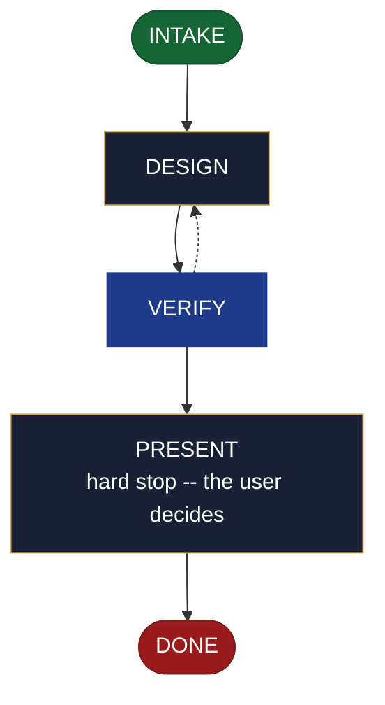

<!-- generated — do not edit; source: canonical/skills/aid-design-messaging/SKILL.md -->

## Frontmatter

- **`name`** — aid-design-messaging
- **`description`** — Develop a messaging design as a DESIGN SEED in `.aid/design/messaging.md` -- the message/event schema, its channel, and its emission points. Use this skill when an event's schema and who consumes it are still being worked out. Grounded in the Knowledge Base (`.aid/knowledge/`) and the project source. It WRITES NO production code and NO KB document -- realize the seed into the built schema and emission with `/aid-create-messaging` once it is ready. Produced by the aid-architect agent and independently verified by aid-reviewer (full verify). Allocates a work-NNN folder.
- **`allowed-tools`** — Read Glob Grep Bash Shell Terminal Write Edit Agent
- **`argument-hint`** — &lt;subject> -- the message/event to design (schema, channel, emission)

[Definition: `canonical/skills/aid-design-messaging/SKILL.md`](https://github.com/AndreVianna/aid-methodology/blob/master/canonical/skills/aid-design-messaging/SKILL.md)

## Flow

## Source fragments

Every node in the chart above, in chart order, with the exact `canonical/` text it was derived from.

**1 · `INTAKE`** · _entry_

~~~~plaintext title="canonical/skills/aid-design-messaging/SKILL.md#L36-L46" wrap
## State: INTAKE

1. **Require a subject.** Empty argument -> ask one bootstrapping question ("What
   message/event do you want to design -- its schema, channel, and emission points?") and
   wait.
2. **Allocate** through the Work Initiation Gate exactly as the contract's Allocation rule
   requires (`.agents/skills/aid-design/SKILL.md` INTAKE step 4 is the shape), with
   `--skill aid-design-messaging` given to the gate's `--create`. `phase` is not driven.
3. **Acquire `.aid/design/`** per the contract, then read `.aid/design/messaging.md` if a
   prior seed exists -- re-invocation iterates it rather than starting over.
4. **Classify complexity** for the `aid-architect` dispatch (verifier tier >= producer).
~~~~

[Source: `canonical/skills/aid-design-messaging/SKILL.md#L36-L46`](https://github.com/AndreVianna/aid-methodology/blob/master/canonical/skills/aid-design-messaging/SKILL.md#L36-L46) · [full step: `canonical/skills/aid-design-messaging/SKILL.md#L36-L52`](https://github.com/AndreVianna/aid-methodology/blob/master/canonical/skills/aid-design-messaging/SKILL.md#L36-L52)

**2 · `DESIGN`** · _step_

~~~~plaintext title="canonical/skills/aid-design-messaging/SKILL.md#L56-L64" wrap
## State: DESIGN

Dispatch **`aid-architect`** (clean context, tiered) to write or iterate
`.aid/design/messaging.md` in the seed shape the contract fixes (`design-seed.md`;
feature-002 §4), grounded in `.aid/knowledge/` and the project source plus any seed read
in INTAKE. What this artifact's seed must settle: **the message/event schema, its channel,
and its emission points**; its `## Destination` names where the built schema and emission
land. **Never writes `.aid/knowledge/` and never writes production code** -- the `design`
invariant (`design-lifecycle.md`).
~~~~

[Source: `canonical/skills/aid-design-messaging/SKILL.md#L56-L64`](https://github.com/AndreVianna/aid-methodology/blob/master/canonical/skills/aid-design-messaging/SKILL.md#L56-L64) · [full step: `canonical/skills/aid-design-messaging/SKILL.md#L56-L66`](https://github.com/AndreVianna/aid-methodology/blob/master/canonical/skills/aid-design-messaging/SKILL.md#L56-L66)

**3 · `VERIFY`** · _loop-back_

~~~~plaintext title="canonical/skills/aid-design-messaging/SKILL.md#L70-L73" wrap
## State: VERIFY

**Full verify**, as `design-lifecycle.md` defines it. Not clean -> loop to DESIGN; the
3-cycle circuit breaker there escalates to IMPEDIMENT, and the lifecycle is set to `Blocked` through the writer.
~~~~

[Source: `canonical/skills/aid-design-messaging/SKILL.md#L70-L73`](https://github.com/AndreVianna/aid-methodology/blob/master/canonical/skills/aid-design-messaging/SKILL.md#L70-L73) · [full step: `canonical/skills/aid-design-messaging/SKILL.md#L70-L75`](https://github.com/AndreVianna/aid-methodology/blob/master/canonical/skills/aid-design-messaging/SKILL.md#L70-L75)

**4 · `PRESENT`** — hard stop -- the user decides · _step_

~~~~plaintext title="canonical/skills/aid-design-messaging/SKILL.md#L79-L82" wrap
## State: PRESENT (hard stop -- the user decides)

Set the lifecycle to `Paused-Awaiting-Input` through the writer. Present the seed clearly. Assert no resolution --
the user iterates (re-invoke this skill) or realizes it now (`/aid-create-messaging`).
~~~~

[Source: `canonical/skills/aid-design-messaging/SKILL.md#L79-L82`](https://github.com/AndreVianna/aid-methodology/blob/master/canonical/skills/aid-design-messaging/SKILL.md#L79-L82) · [full step: `canonical/skills/aid-design-messaging/SKILL.md#L79-L84`](https://github.com/AndreVianna/aid-methodology/blob/master/canonical/skills/aid-design-messaging/SKILL.md#L79-L84)

**5 · `DONE`** · _exit_ · UNSPECIFIED

~~~~plaintext title="canonical/skills/aid-design-messaging/SKILL.md#L88-L91" wrap
## State: DONE

Set the lifecycle to `Completed` through the writer, `updated` now, append a `## Lifecycle History` row. The seed
persists at `.aid/design/messaging.md`; consumption happens at `/aid-create-messaging`.
~~~~

[Source: `canonical/skills/aid-design-messaging/SKILL.md#L88-L91`](https://github.com/AndreVianna/aid-methodology/blob/master/canonical/skills/aid-design-messaging/SKILL.md#L88-L91) · [full step: `canonical/skills/aid-design-messaging/SKILL.md#L88-L91`](https://github.com/AndreVianna/aid-methodology/blob/master/canonical/skills/aid-design-messaging/SKILL.md#L88-L91)
