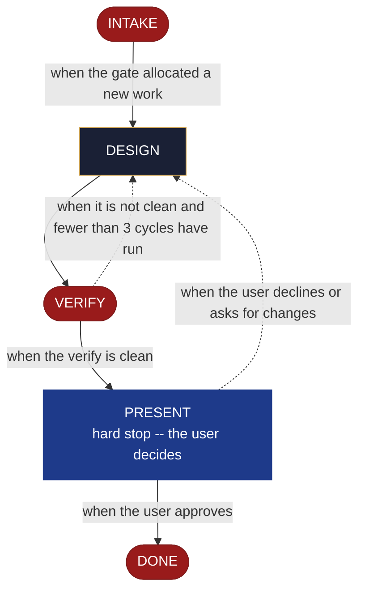

<!-- generated — do not edit; source: canonical/skills/aid-design-mvp/SKILL.md -->

## Frontmatter

- **`name`** — aid-design-mvp
- **`description`** — Draw the MVP line as a DESIGN SEED in `.aid/design/mvp.md` -- what is in the first shippable slice, what defers, and the reason for each cut. Use this skill when what the first shippable slice should contain is still an open question. Grounded in the Knowledge Base (`.aid/knowledge/`) and the project source. It WRITES NO KB DOCUMENT and NO production code -- realize the seed into roadmap.md's ## MVP section with `/aid-create-mvp` once it is ready. For direction beyond the first slice, use `/aid-design-roadmap` instead. Produced by the aid-architect agent and independently verified by aid-reviewer (full verify). Allocates a work-NNN folder.
- **`allowed-tools`** — Read Glob Grep Bash Shell Terminal Write Edit Agent
- **`argument-hint`** — &lt;slice> -- what belongs in the first shippable slice, and what to cut

[Definition: `canonical/skills/aid-design-mvp/SKILL.md`](https://github.com/AndreVianna/aid-methodology/blob/master/canonical/skills/aid-design-mvp/SKILL.md)

## Flow

## Source fragments

Every node in the chart above, in chart order, with the exact `canonical/` text it was derived from.

**1 · `INTAKE`** · _exit_ · HALT

~~~~plaintext title="canonical/skills/aid-design-mvp/SKILL.md#L41-L51" wrap
## State: INTAKE

1. **Require a subject.** Empty argument -> ask one bootstrapping question ("What
   belongs in the first shippable slice, and what should defer?") and wait.
2. **Allocate, exactly per `design-lifecycle.md § Skill shape -- Allocation`** -- the Work Initiation Gate, whose `--create` is given `--skill aid-design-mvp`, `--step INTAKE` and `--path lite`; the record starts `Running`. `phase` is not driven.
3. **Acquire `.aid/design/`.** Per `design-lifecycle.md § Before writing a seed` -- ensure
   the folder exists and seed its `README.md` on first use, before writing anything.
4. **Read the existing seed, if one is present.** `.aid/design/mvp.md` -- re-invocation
   iterates the same seed rather than starting over.
5. **Classify complexity (model + effort)** for the `aid-architect` dispatch below;
   verifier tier >= producer tier (`agent-dispatch-tiering.md`).
~~~~

[Source: `canonical/skills/aid-design-mvp/SKILL.md#L41-L51`](https://github.com/AndreVianna/aid-methodology/blob/master/canonical/skills/aid-design-mvp/SKILL.md#L41-L51) · [full step: `canonical/skills/aid-design-mvp/SKILL.md#L41-L57`](https://github.com/AndreVianna/aid-methodology/blob/master/canonical/skills/aid-design-mvp/SKILL.md#L41-L57)

**2 · `DESIGN`** · _step_

~~~~plaintext title="canonical/skills/aid-design-mvp/SKILL.md#L61-L66" wrap
## State: DESIGN

Dispatch **`aid-architect`** (clean context, tiered) to develop or iterate the seed,
grounded in `.aid/knowledge/` and the project source, plus the seed read in INTAKE if one
exists. Draws out: **the line -- what is in the first shippable slice, what defers, and
the reason for each cut.**
~~~~

[Source: `canonical/skills/aid-design-mvp/SKILL.md#L61-L66`](https://github.com/AndreVianna/aid-methodology/blob/master/canonical/skills/aid-design-mvp/SKILL.md#L61-L66) · [full step: `canonical/skills/aid-design-mvp/SKILL.md#L61-L73`](https://github.com/AndreVianna/aid-methodology/blob/master/canonical/skills/aid-design-mvp/SKILL.md#L61-L73)

**3 · `VERIFY`** · _exit_ · HALT

~~~~plaintext title="canonical/skills/aid-design-mvp/SKILL.md#L77-L81" wrap
## State: VERIFY

**Full verify** -- exactly as `design-lifecycle.md § Skill shape -- "Full verify"`
defines it. Not clean -> loop to DESIGN; the circuit-breaker there governs escalation to
IMPEDIMENT, and the lifecycle is set to `Blocked` through the writer.
~~~~

[Source: `canonical/skills/aid-design-mvp/SKILL.md#L77-L81`](https://github.com/AndreVianna/aid-methodology/blob/master/canonical/skills/aid-design-mvp/SKILL.md#L77-L81) · [full step: `canonical/skills/aid-design-mvp/SKILL.md#L77-L83`](https://github.com/AndreVianna/aid-methodology/blob/master/canonical/skills/aid-design-mvp/SKILL.md#L77-L83)

**4 · `PRESENT`** — hard stop -- the user decides · _loop-back_

~~~~plaintext title="canonical/skills/aid-design-mvp/SKILL.md#L87-L91" wrap
## State: PRESENT (hard stop -- the user decides)

Present the seed clearly. Assert no resolution --
the user decides whether to iterate further (re-invoke this skill) or realize it now
(`/aid-create-mvp`).
~~~~

[Source: `canonical/skills/aid-design-mvp/SKILL.md#L87-L91`](https://github.com/AndreVianna/aid-methodology/blob/master/canonical/skills/aid-design-mvp/SKILL.md#L87-L91) · [full step: `canonical/skills/aid-design-mvp/SKILL.md#L87-L96`](https://github.com/AndreVianna/aid-methodology/blob/master/canonical/skills/aid-design-mvp/SKILL.md#L87-L96)

**5 · `DONE`** · _exit_ · UNSPECIFIED

~~~~plaintext title="canonical/skills/aid-design-mvp/SKILL.md#L100-L103" wrap
## State: DONE

Set the lifecycle to `Completed` through the writer. The seed
stays at `.aid/design/mvp.md` -- consumption happens at `/aid-create-mvp`, not here.
~~~~

[Source: `canonical/skills/aid-design-mvp/SKILL.md#L100-L103`](https://github.com/AndreVianna/aid-methodology/blob/master/canonical/skills/aid-design-mvp/SKILL.md#L100-L103) · [full step: `canonical/skills/aid-design-mvp/SKILL.md#L100-L103`](https://github.com/AndreVianna/aid-methodology/blob/master/canonical/skills/aid-design-mvp/SKILL.md#L100-L103)
