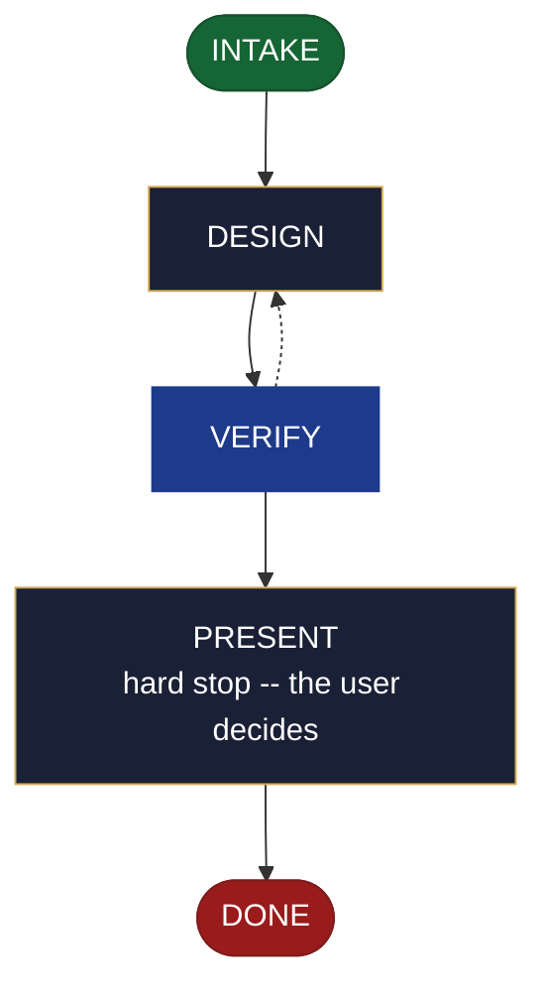

<!-- generated — do not edit; source: canonical/skills/aid-design-roadmap/SKILL.md -->

## Frontmatter

- **`name`** — aid-design-roadmap
- **`description`** — Design the roadmap direction as a seed in .aid/design (no code). Use while its shape is still open.
- **`allowed-tools`** — Read Glob Grep Bash Shell Terminal Write Edit Agent
- **`argument-hint`** — &lt;direction> -- what to develop (committed vs. wanted, sequencing, rejected alternatives)

[Definition: `canonical/skills/aid-design-roadmap/SKILL.md`](https://github.com/AndreVianna/aid-methodology/blob/master/canonical/skills/aid-design-roadmap/SKILL.md)

## Flow

## Source fragments

Every node in the chart above, in chart order, with the exact `canonical/` text it was derived from.

**1 · `INTAKE`** · _entry_

~~~~plaintext title="canonical/skills/aid-design-roadmap/SKILL.md#L32-L46" wrap
## State: INTAKE

1. **Require a subject.** Empty argument -> ask one bootstrapping question ("What
   direction do you want to develop -- what's committed, what's merely wanted, and why?")
   and wait.
2. **Allocate, exactly per `design-lifecycle.md § Skill shape -- Allocation`** -- the Work
   Initiation Gate, then `initiator: aid-design-roadmap`, `active_skill:
   aid-design-roadmap`, `pipeline.path: lite`, `lifecycle: Running`. `phase` is not
   driven.
3. **Acquire `.aid/design/`.** Per `design-lifecycle.md § Before writing a seed` -- ensure
   the folder exists and seed its `README.md` on first use, before writing anything.
4. **Read the existing seed, if one is present.** `.aid/design/roadmap.md` --
   re-invocation iterates the same seed rather than starting over.
5. **Classify complexity (model + effort)** for the `aid-architect` dispatch below;
   verifier tier >= producer tier (`agent-dispatch-tiering.md`).
~~~~

[Source: `canonical/skills/aid-design-roadmap/SKILL.md#L32-L46`](https://github.com/AndreVianna/aid-methodology/blob/master/canonical/skills/aid-design-roadmap/SKILL.md#L32-L46) · [full step: `canonical/skills/aid-design-roadmap/SKILL.md#L32-L48`](https://github.com/AndreVianna/aid-methodology/blob/master/canonical/skills/aid-design-roadmap/SKILL.md#L32-L48)

**2 · `DESIGN`** · _step_

~~~~plaintext title="canonical/skills/aid-design-roadmap/SKILL.md#L52-L57" wrap
## State: DESIGN

Dispatch **`aid-architect`** (clean context, tiered) to develop or iterate the seed,
grounded in `.aid/knowledge/` and the project source, plus the seed read in INTAKE if one
exists. Draws out: **direction and its *why*; what is committed vs. merely wanted;
sequencing rationale; the alternatives being rejected and why.**
~~~~

[Source: `canonical/skills/aid-design-roadmap/SKILL.md#L52-L57`](https://github.com/AndreVianna/aid-methodology/blob/master/canonical/skills/aid-design-roadmap/SKILL.md#L52-L57) · [full step: `canonical/skills/aid-design-roadmap/SKILL.md#L52-L64`](https://github.com/AndreVianna/aid-methodology/blob/master/canonical/skills/aid-design-roadmap/SKILL.md#L52-L64)

**3 · `VERIFY`** · _loop-back_

~~~~plaintext title="canonical/skills/aid-design-roadmap/SKILL.md#L68-L72" wrap
## State: VERIFY

**Full verify** -- exactly as `design-lifecycle.md § Skill shape -- "Full verify"`
defines it. Not clean -> loop to DESIGN; the circuit-breaker there governs escalation to
IMPEDIMENT + `lifecycle: Blocked`.
~~~~

[Source: `canonical/skills/aid-design-roadmap/SKILL.md#L68-L72`](https://github.com/AndreVianna/aid-methodology/blob/master/canonical/skills/aid-design-roadmap/SKILL.md#L68-L72) · [full step: `canonical/skills/aid-design-roadmap/SKILL.md#L68-L74`](https://github.com/AndreVianna/aid-methodology/blob/master/canonical/skills/aid-design-roadmap/SKILL.md#L68-L74)

**4 · `PRESENT`** — hard stop -- the user decides · _step_

~~~~plaintext title="canonical/skills/aid-design-roadmap/SKILL.md#L78-L82" wrap
## State: PRESENT (hard stop -- the user decides)

Set `lifecycle: Paused-Awaiting-Input`. Present the seed clearly. Assert no resolution --
the user decides whether to iterate further (re-invoke this skill) or realize it now
(`/aid-create-roadmap`).
~~~~

[Source: `canonical/skills/aid-design-roadmap/SKILL.md#L78-L82`](https://github.com/AndreVianna/aid-methodology/blob/master/canonical/skills/aid-design-roadmap/SKILL.md#L78-L82) · [full step: `canonical/skills/aid-design-roadmap/SKILL.md#L78-L84`](https://github.com/AndreVianna/aid-methodology/blob/master/canonical/skills/aid-design-roadmap/SKILL.md#L78-L84)

**5 · `DONE`** · _exit_ · UNSPECIFIED

~~~~plaintext title="canonical/skills/aid-design-roadmap/SKILL.md#L88-L92" wrap
## State: DONE

Set `lifecycle: Completed`, `updated` now, append a `## Lifecycle History` row. The seed
stays at `.aid/design/roadmap.md` -- consumption happens at `/aid-create-roadmap`, not
here.
~~~~

[Source: `canonical/skills/aid-design-roadmap/SKILL.md#L88-L92`](https://github.com/AndreVianna/aid-methodology/blob/master/canonical/skills/aid-design-roadmap/SKILL.md#L88-L92) · [full step: `canonical/skills/aid-design-roadmap/SKILL.md#L88-L92`](https://github.com/AndreVianna/aid-methodology/blob/master/canonical/skills/aid-design-roadmap/SKILL.md#L88-L92)
