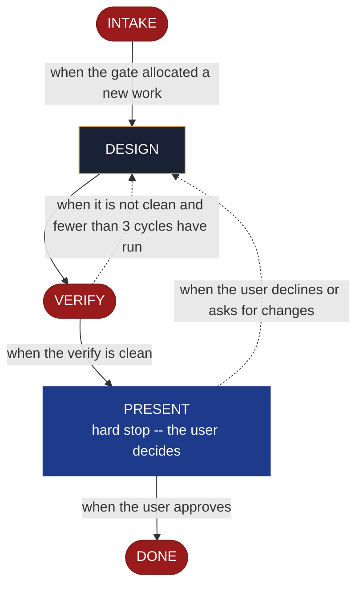

<!-- generated — do not edit; source: canonical/skills/aid-design-test/SKILL.md -->

## Frontmatter

- **`name`** — aid-design-test
- **`description`** — Develop a test design as a DESIGN SEED in `.aid/design/test.md` -- the units under test, the cases, and the framework and fixtures. Use this skill when what a test should actually assert is still being worked out. Grounded in the Knowledge Base (`.aid/knowledge/`) and the project source. It WRITES NO production code and NO KB document -- realize the seed into authored tests with `/aid-create-test` once it is ready. To design the testing policy rather than specific tests, use `/aid-design-testing-strategy`; to RUN existing suites rather than design them, use `/aid-test`. Produced by the aid-architect agent and independently verified by aid-reviewer (full verify). Allocates a work-NNN folder.
- **`allowed-tools`** — Read Glob Grep Bash Shell Terminal Write Edit Agent
- **`argument-hint`** — &lt;subject> -- the tests to design (units under test, cases, framework/fixtures)

[Definition: `canonical/skills/aid-design-test/SKILL.md`](https://github.com/AndreVianna/aid-methodology/blob/master/canonical/skills/aid-design-test/SKILL.md)

## Flow

## Source fragments

Every node in the chart above, in chart order, with the exact `canonical/` text it was derived from.

**1 · `INTAKE`** · _exit_ · HALT

~~~~plaintext title="canonical/skills/aid-design-test/SKILL.md#L40-L49" wrap
## State: INTAKE

1. **Require a subject.** Empty argument -> ask one bootstrapping question ("What tests do
   you want to design -- the units under test, the cases, and the framework?") and wait.
2. **Allocate** through the Work Initiation Gate exactly as the contract's Allocation rule
   requires (`.agents/skills/aid-design/SKILL.md` INTAKE step 4 is the shape), with
   `--skill aid-design-test` given to the gate's `--create`. `phase` is not driven.
3. **Acquire `.aid/design/`** per the contract, then read `.aid/design/test.md` if a prior
   seed exists -- re-invocation iterates it rather than starting over.
4. **Classify complexity** for the `aid-architect` dispatch (verifier tier >= producer).
~~~~

[Source: `canonical/skills/aid-design-test/SKILL.md#L40-L49`](https://github.com/AndreVianna/aid-methodology/blob/master/canonical/skills/aid-design-test/SKILL.md#L40-L49) · [full step: `canonical/skills/aid-design-test/SKILL.md#L40-L55`](https://github.com/AndreVianna/aid-methodology/blob/master/canonical/skills/aid-design-test/SKILL.md#L40-L55)

**2 · `DESIGN`** · _step_

~~~~plaintext title="canonical/skills/aid-design-test/SKILL.md#L59-L67" wrap
## State: DESIGN

Dispatch **`aid-architect`** (clean context, tiered) to write or iterate
`.aid/design/test.md` in the seed shape the contract fixes (`design-seed.md`;
feature-002 §4), grounded in `.aid/knowledge/` and the project source plus any seed read
in INTAKE. What this artifact's seed must settle: **the units under test, the cases, and
the framework and fixtures**; its `## Destination` names where the authored tests land.
**Never writes `.aid/knowledge/` and never writes production code** -- the `design`
invariant (`design-lifecycle.md`).
~~~~

[Source: `canonical/skills/aid-design-test/SKILL.md#L59-L67`](https://github.com/AndreVianna/aid-methodology/blob/master/canonical/skills/aid-design-test/SKILL.md#L59-L67) · [full step: `canonical/skills/aid-design-test/SKILL.md#L59-L69`](https://github.com/AndreVianna/aid-methodology/blob/master/canonical/skills/aid-design-test/SKILL.md#L59-L69)

**3 · `VERIFY`** · _exit_ · HALT

~~~~plaintext title="canonical/skills/aid-design-test/SKILL.md#L73-L76" wrap
## State: VERIFY

**Full verify**, as `design-lifecycle.md` defines it. Not clean -> loop to DESIGN; the
3-cycle circuit breaker there escalates to IMPEDIMENT, and the lifecycle is set to `Blocked` through the writer.
~~~~

[Source: `canonical/skills/aid-design-test/SKILL.md#L73-L76`](https://github.com/AndreVianna/aid-methodology/blob/master/canonical/skills/aid-design-test/SKILL.md#L73-L76) · [full step: `canonical/skills/aid-design-test/SKILL.md#L73-L78`](https://github.com/AndreVianna/aid-methodology/blob/master/canonical/skills/aid-design-test/SKILL.md#L73-L78)

**4 · `PRESENT`** — hard stop -- the user decides · _loop-back_

~~~~plaintext title="canonical/skills/aid-design-test/SKILL.md#L82-L85" wrap
## State: PRESENT (hard stop -- the user decides)

Present the seed clearly. Assert no resolution --
the user iterates (re-invoke this skill) or realizes it now (`/aid-create-test`).
~~~~

[Source: `canonical/skills/aid-design-test/SKILL.md#L82-L85`](https://github.com/AndreVianna/aid-methodology/blob/master/canonical/skills/aid-design-test/SKILL.md#L82-L85) · [full step: `canonical/skills/aid-design-test/SKILL.md#L82-L90`](https://github.com/AndreVianna/aid-methodology/blob/master/canonical/skills/aid-design-test/SKILL.md#L82-L90)

**5 · `DONE`** · _exit_ · UNSPECIFIED

~~~~plaintext title="canonical/skills/aid-design-test/SKILL.md#L94-L97" wrap
## State: DONE

Set the lifecycle to `Completed` through the writer. The seed
persists at `.aid/design/test.md`; consumption happens at `/aid-create-test`.
~~~~

[Source: `canonical/skills/aid-design-test/SKILL.md#L94-L97`](https://github.com/AndreVianna/aid-methodology/blob/master/canonical/skills/aid-design-test/SKILL.md#L94-L97) · [full step: `canonical/skills/aid-design-test/SKILL.md#L94-L97`](https://github.com/AndreVianna/aid-methodology/blob/master/canonical/skills/aid-design-test/SKILL.md#L94-L97)
