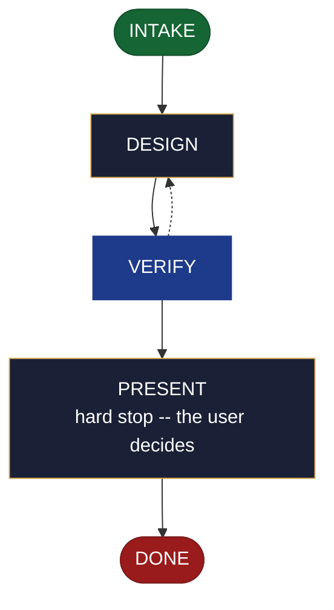

<!-- generated — do not edit; source: canonical/skills/aid-design-theme/SKILL.md -->

## Frontmatter

- **`name`** — aid-design-theme
- **`description`** — Design a visual theme as a seed in .aid/design (no code). Use while its shape is still open.
- **`allowed-tools`** — Read Glob Grep Bash Shell Terminal Write Edit Agent
- **`argument-hint`** — &lt;subject> -- the theme/token set to design (color, type, spacing; light/dark)

[Definition: `canonical/skills/aid-design-theme/SKILL.md`](https://github.com/AndreVianna/aid-methodology/blob/master/canonical/skills/aid-design-theme/SKILL.md)

## Flow

## Source fragments

Every node in the chart above, in chart order, with the exact `canonical/` text it was derived from.

**1 · `INTAKE`** · _entry_

~~~~plaintext title="canonical/skills/aid-design-theme/SKILL.md#L29-L38" wrap
## State: INTAKE

1. **Require a subject.** Empty argument -> ask one bootstrapping question ("What theme or
   token set do you want to design -- its palette, type, spacing, and variants?") and wait.
2. **Allocate** through the Work Initiation Gate exactly as the contract's Allocation rule
   requires (`.agents/skills/aid-design/SKILL.md` INTAKE step 4 is the shape), with
   `initiator: aid-design-theme`. `phase` is not driven.
3. **Acquire `.aid/design/`** per the contract, then read `.aid/design/theme.md` if a
   prior seed exists -- re-invocation iterates it rather than starting over.
4. **Classify complexity** for the `aid-architect` dispatch (verifier tier >= producer).
~~~~

[Source: `canonical/skills/aid-design-theme/SKILL.md#L29-L38`](https://github.com/AndreVianna/aid-methodology/blob/master/canonical/skills/aid-design-theme/SKILL.md#L29-L38) · [full step: `canonical/skills/aid-design-theme/SKILL.md#L29-L40`](https://github.com/AndreVianna/aid-methodology/blob/master/canonical/skills/aid-design-theme/SKILL.md#L29-L40)

**2 · `DESIGN`** · _step_

~~~~plaintext title="canonical/skills/aid-design-theme/SKILL.md#L44-L52" wrap
## State: DESIGN

Dispatch **`aid-architect`** (clean context, tiered) to write or iterate
`.aid/design/theme.md` in the seed shape the contract fixes (`design-seed.md`;
feature-002 §4), grounded in `.aid/knowledge/` and the project source plus any seed read
in INTAKE. What this artifact's seed must settle: **the style-token set (color, type,
spacing), the light/dark variants, and how components apply the tokens**; its
`## Destination` names where the built theme lands. **Never writes `.aid/knowledge/` and
never writes production code** -- the `design` invariant (`design-lifecycle.md`).
~~~~

[Source: `canonical/skills/aid-design-theme/SKILL.md#L44-L52`](https://github.com/AndreVianna/aid-methodology/blob/master/canonical/skills/aid-design-theme/SKILL.md#L44-L52) · [full step: `canonical/skills/aid-design-theme/SKILL.md#L44-L54`](https://github.com/AndreVianna/aid-methodology/blob/master/canonical/skills/aid-design-theme/SKILL.md#L44-L54)

**3 · `VERIFY`** · _loop-back_

~~~~plaintext title="canonical/skills/aid-design-theme/SKILL.md#L58-L61" wrap
## State: VERIFY

**Full verify**, as `design-lifecycle.md` defines it. Not clean -> loop to DESIGN; the
3-cycle circuit breaker there escalates to IMPEDIMENT + `lifecycle: Blocked`.
~~~~

[Source: `canonical/skills/aid-design-theme/SKILL.md#L58-L61`](https://github.com/AndreVianna/aid-methodology/blob/master/canonical/skills/aid-design-theme/SKILL.md#L58-L61) · [full step: `canonical/skills/aid-design-theme/SKILL.md#L58-L63`](https://github.com/AndreVianna/aid-methodology/blob/master/canonical/skills/aid-design-theme/SKILL.md#L58-L63)

**4 · `PRESENT`** — hard stop -- the user decides · _step_

~~~~plaintext title="canonical/skills/aid-design-theme/SKILL.md#L67-L70" wrap
## State: PRESENT (hard stop -- the user decides)

Set `lifecycle: Paused-Awaiting-Input`. Present the seed clearly. Assert no resolution --
the user iterates (re-invoke this skill) or realizes it now (`/aid-create-theme`).
~~~~

[Source: `canonical/skills/aid-design-theme/SKILL.md#L67-L70`](https://github.com/AndreVianna/aid-methodology/blob/master/canonical/skills/aid-design-theme/SKILL.md#L67-L70) · [full step: `canonical/skills/aid-design-theme/SKILL.md#L67-L72`](https://github.com/AndreVianna/aid-methodology/blob/master/canonical/skills/aid-design-theme/SKILL.md#L67-L72)

**5 · `DONE`** · _exit_ · UNSPECIFIED

~~~~plaintext title="canonical/skills/aid-design-theme/SKILL.md#L76-L79" wrap
## State: DONE

Set `lifecycle: Completed`, `updated` now, append a `## Lifecycle History` row. The seed
persists at `.aid/design/theme.md`; consumption happens at `/aid-create-theme`.
~~~~

[Source: `canonical/skills/aid-design-theme/SKILL.md#L76-L79`](https://github.com/AndreVianna/aid-methodology/blob/master/canonical/skills/aid-design-theme/SKILL.md#L76-L79) · [full step: `canonical/skills/aid-design-theme/SKILL.md#L76-L79`](https://github.com/AndreVianna/aid-methodology/blob/master/canonical/skills/aid-design-theme/SKILL.md#L76-L79)
