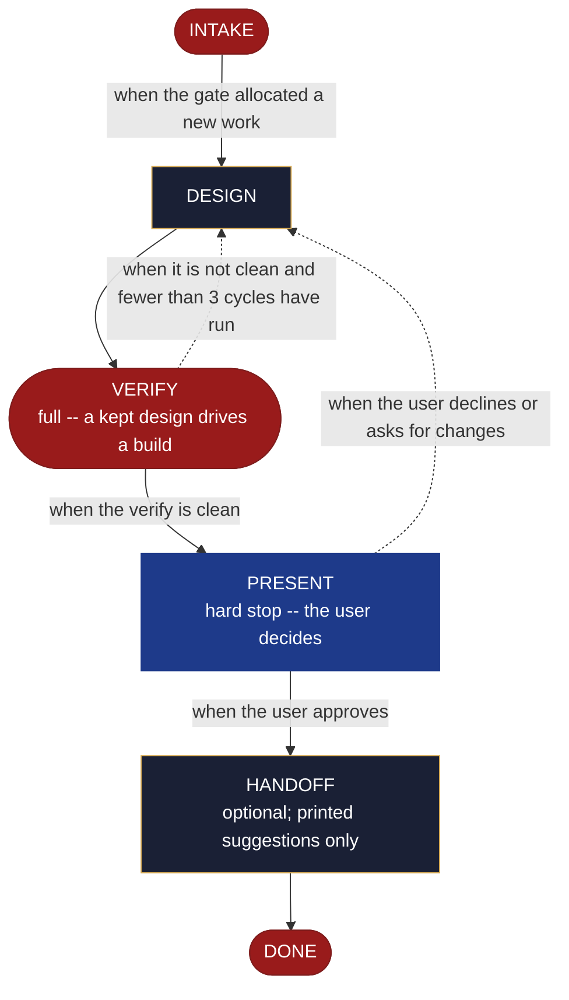

<!-- generated — do not edit; source: canonical/skills/aid-design/SKILL.md -->

## Frontmatter

- **`name`** — aid-design
- **`description`** — Produce a design artifact you intend to keep -- a UX or interaction flow, a component or interface design, with accessibility notes -- meant to inform the real build. Use this skill when the subject has no dedicated design row of its own; when a dedicated `/aid-design-`&lt;artifact> row exists, use that row instead. It is grounded in the Knowledge Base (`.aid/knowledge/`) and the project source, produced by aid-architect and independently verified by aid-reviewer, because a kept design drives a build and its correctness matters. It resolves nothing: it presents the design, you decide, and building it is a separate `/aid-create` step. For a throwaway model that only validates a direction, use `/aid-prototype` instead.
- **`allowed-tools`** — Read Glob Grep Bash Shell Terminal Write Edit Agent
- **`argument-hint`** — &lt;subject> -- what to design (a flow, a component/interface, a UI; use a dedicated /aid-design-&lt;artifact> row when one exists)

[Definition: `canonical/skills/aid-design/SKILL.md`](https://github.com/AndreVianna/aid-methodology/blob/master/canonical/skills/aid-design/SKILL.md)

## Flow

## Source fragments

Every node in the chart above, in chart order, with the exact `canonical/` text it was derived from.

**1 · `INTAKE`** · _exit_ · HALT

~~~~plaintext title="canonical/skills/aid-design/SKILL.md#L38-L42" wrap
## State: INTAKE

**State Detection.** Detection shapes the entry step of a fresh start and validates a saved step
on resume; it never routes. Which skill and step a work continues at come from its work record
(`.aid/runtime/templates/skill-steps.md`, § State Detection).
~~~~

[Source: `canonical/skills/aid-design/SKILL.md#L38-L42`](https://github.com/AndreVianna/aid-methodology/blob/master/canonical/skills/aid-design/SKILL.md#L38-L42) · [full step: `canonical/skills/aid-design/SKILL.md#L38-L63`](https://github.com/AndreVianna/aid-methodology/blob/master/canonical/skills/aid-design/SKILL.md#L38-L63)

**2 · `DESIGN`** · _step_

~~~~plaintext title="canonical/skills/aid-design/SKILL.md#L67-L73" wrap
## State: DESIGN

Dispatch **`aid-architect`** (clean context, tiered) to produce the design, **grounded in
the KB** (existing patterns, conventions, `architecture.md`) + the request: variables/flow,
control/interaction, component or interface shape, and **accessibility notes**
(`task-type-rules.md ## DESIGN`). It writes `DESIGN.md` into the work folder (the design's
kept record).
~~~~

[Source: `canonical/skills/aid-design/SKILL.md#L67-L73`](https://github.com/AndreVianna/aid-methodology/blob/master/canonical/skills/aid-design/SKILL.md#L67-L73) · [full step: `canonical/skills/aid-design/SKILL.md#L67-L75`](https://github.com/AndreVianna/aid-methodology/blob/master/canonical/skills/aid-design/SKILL.md#L67-L75)

**3 · `VERIFY`** — full -- a kept design drives a build · _exit_ · HALT

~~~~plaintext title="canonical/skills/aid-design/SKILL.md#L79-L87" wrap
## State: VERIFY  (full -- a kept design drives a build)

1. **Mechanical grounding check** (no dispatch): design decisions cite the KB/source they
   build on; accessibility is addressed.
2. **Adversarial verification** -- clean-context **`aid-reviewer`** checks `DESIGN.md`:
   grounded, complete, internally consistent, consistent with KB conventions + a11y, and
   buildable. Writes a review-quality ledger to `.aid/.temp/review-pending/<work>-verify.md`.
3. **Grade:** `bash .aid/runtime/scripts/grade.sh --explain <ledger>`. Not clean -> loop
   to DESIGN. Circuit-breaker: 3 cycles -> IMPEDIMENT, and the lifecycle is set to `Blocked` through the writer.
~~~~

[Source: `canonical/skills/aid-design/SKILL.md#L79-L87`](https://github.com/AndreVianna/aid-methodology/blob/master/canonical/skills/aid-design/SKILL.md#L79-L87) · [full step: `canonical/skills/aid-design/SKILL.md#L79-L89`](https://github.com/AndreVianna/aid-methodology/blob/master/canonical/skills/aid-design/SKILL.md#L79-L89)

**4 · `PRESENT`** — hard stop -- the user decides · _loop-back_

~~~~plaintext title="canonical/skills/aid-design/SKILL.md#L93-L96" wrap
## State: PRESENT  (hard stop -- the user decides)

Present `DESIGN.md` clearly. Assert no resolution --
the user decides whether/when to build it.
~~~~

[Source: `canonical/skills/aid-design/SKILL.md#L93-L96`](https://github.com/AndreVianna/aid-methodology/blob/master/canonical/skills/aid-design/SKILL.md#L93-L96) · [full step: `canonical/skills/aid-design/SKILL.md#L93-L101`](https://github.com/AndreVianna/aid-methodology/blob/master/canonical/skills/aid-design/SKILL.md#L93-L101)

**5 · `HANDOFF`** — optional; printed suggestions only · _step_

~~~~plaintext title="canonical/skills/aid-design/SKILL.md#L105-L108" wrap
## State: HANDOFF  (optional; printed suggestions only)

Printed suggestions: build it (`/aid-create*` / `/aid-update*`, referencing the design), or
capture it as a formal doc (`/aid-create-document`). Never auto-invoked; never a resolution.
~~~~

[Source: `canonical/skills/aid-design/SKILL.md#L105-L108`](https://github.com/AndreVianna/aid-methodology/blob/master/canonical/skills/aid-design/SKILL.md#L105-L108) · [full step: `canonical/skills/aid-design/SKILL.md#L105-L110`](https://github.com/AndreVianna/aid-methodology/blob/master/canonical/skills/aid-design/SKILL.md#L105-L110)

**6 · `DONE`** · _exit_ · UNSPECIFIED

~~~~plaintext title="canonical/skills/aid-design/SKILL.md#L114-L117" wrap
## State: DONE

Set the lifecycle to `Completed` through the writer. Keep
`DESIGN.md` in the work folder as the kept design record.
~~~~

[Source: `canonical/skills/aid-design/SKILL.md#L114-L117`](https://github.com/AndreVianna/aid-methodology/blob/master/canonical/skills/aid-design/SKILL.md#L114-L117) · [full step: `canonical/skills/aid-design/SKILL.md#L114-L117`](https://github.com/AndreVianna/aid-methodology/blob/master/canonical/skills/aid-design/SKILL.md#L114-L117)
