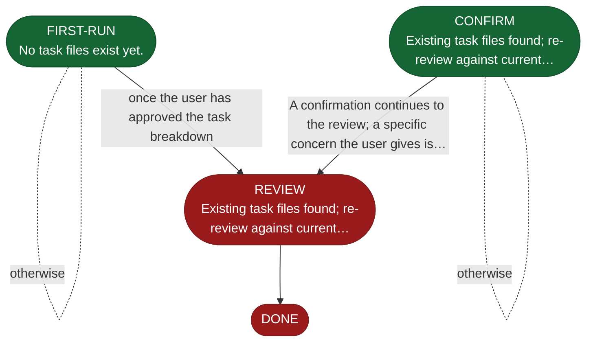

<!-- generated — do not edit; source: canonical/skills/aid-detail/SKILL.md -->

## Frontmatter

- **`name`** — aid-detail
- **`description`** — Break deliverables into small, dependency-driven, typed tasks -- each one a reviewable unit. The ultimate breakdown. Use this skill when a delivery has been planned and the actual work items are needed before execution starts. It detects each task's type from the SPEC's own signals -- RESEARCH, DESIGN, IMPLEMENT, TEST, DOCUMENT, MIGRATE, REFACTOR, CONFIGURE -- gives every task exactly one type, and builds the delivery's execution graph with explicit dependencies and the parallelism they allow.
- **`allowed-tools`** — Read Glob Grep Write Edit Bash Shell Terminal
- **`argument-hint`** — work-001 (required if multiple works)  [--reset] clear deliveries/delivery-NNN/tasks/

[Definition: `canonical/skills/aid-detail/SKILL.md`](https://github.com/AndreVianna/aid-methodology/blob/master/canonical/skills/aid-detail/SKILL.md)

## Flow

## Source fragments

Every node in the chart above, in chart order, with the exact `canonical/` text it was derived from.

**1 · `FIRST-RUN`** — No task files exist yet. · _entry_

~~~~plaintext title="canonical/skills/aid-detail/SKILL.md#L94" wrap
| FIRST-RUN | `references/first-run.md` | `aid-architect` | ASK → REVIEW |
~~~~

[Source: `canonical/skills/aid-detail/SKILL.md#L94`](https://github.com/AndreVianna/aid-methodology/blob/master/canonical/skills/aid-detail/SKILL.md#L94) · [full step: `canonical/skills/aid-detail/references/first-run.md#L1-L129`](https://github.com/AndreVianna/aid-methodology/blob/master/canonical/skills/aid-detail/references/first-run.md#L1-L129)

**2 · `CONFIRM`** — Existing task files found; re-review against current… · _entry_

~~~~plaintext title="canonical/skills/aid-detail/SKILL.md#L95" wrap
| CONFIRM | `references/review.md` | `inline` | ASK → REVIEW |
~~~~

[Source: `canonical/skills/aid-detail/SKILL.md#L95`](https://github.com/AndreVianna/aid-methodology/blob/master/canonical/skills/aid-detail/SKILL.md#L95) · [full step: `canonical/skills/aid-detail/references/review.md#L1-L87`](https://github.com/AndreVianna/aid-methodology/blob/master/canonical/skills/aid-detail/references/review.md#L1-L87)

**3 · `REVIEW`** — Existing task files found; re-review against current… · _exit_ · ASK

~~~~plaintext title="canonical/skills/aid-detail/SKILL.md#L96" wrap
| REVIEW | `references/review.md` | `aid-reviewer` | CHAIN → DONE |
~~~~

[Source: `canonical/skills/aid-detail/SKILL.md#L96`](https://github.com/AndreVianna/aid-methodology/blob/master/canonical/skills/aid-detail/SKILL.md#L96) · [full step: `canonical/skills/aid-detail/references/review.md#L1-L87`](https://github.com/AndreVianna/aid-methodology/blob/master/canonical/skills/aid-detail/references/review.md#L1-L87)

**4 · `DONE`** · _exit_ · HALT

~~~~plaintext title="canonical/skills/aid-detail/SKILL.md#L97" wrap
| DONE | — | `inline` | HALT |
~~~~

[Source: `canonical/skills/aid-detail/SKILL.md#L97`](https://github.com/AndreVianna/aid-methodology/blob/master/canonical/skills/aid-detail/SKILL.md#L97)
