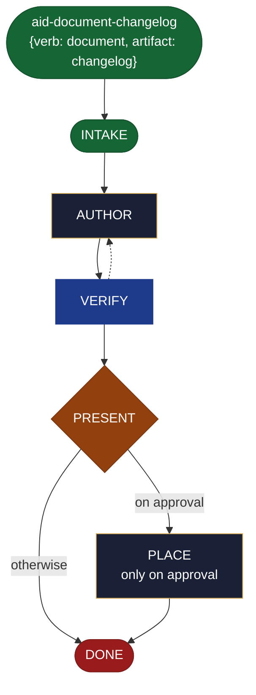

<!-- generated — do not edit; source: canonical/skills/aid-document-changelog/SKILL.md -->

## Frontmatter

- **`name`** — aid-document-changelog
- **`description`** — Write a changelog in one pass -- release notes grouped as Added, Changed, Fixed, Removed and Security. Use this skill when you already know the document you need is changelog, and want it drafted now rather than planned. It is grounded in, and accuracy-checked against, the Knowledge Base (`.aid/knowledge/`) and the project source; aid-tech-writer produces it and aid-reviewer verifies it. It resolves nothing: it drafts, you approve, and only then is the document placed. It never writes into `.aid/knowledge/`. A thin kind-sibling of `/aid-create-document`, which defines its full behavior.
- **`allowed-tools`** — Read Glob Grep Bash Shell Terminal Write Edit Agent
- **`argument-hint`** — &lt;version/changes> -- the changelog

[Definition: `canonical/skills/aid-document-changelog/SKILL.md`](https://github.com/AndreVianna/aid-methodology/blob/master/canonical/skills/aid-document-changelog/SKILL.md)

## Flow

## Source fragments

Every node in the chart above, in chart order, with the exact `canonical/` text it was derived from.

**1 · `aid-document-changelog`** — {verb: document, artifact: changelog} · _entry_

~~~~plaintext title="canonical/skills/aid-document-changelog/SKILL.md#L19" wrap
row (`alias_of: null`, its own `{verb: document, artifact: changelog}`),
~~~~

[Source: `canonical/skills/aid-document-changelog/SKILL.md#L19`](https://github.com/AndreVianna/aid-methodology/blob/master/canonical/skills/aid-document-changelog/SKILL.md#L19)

**2 · `INTAKE`** · _entry_

~~~~plaintext title="canonical/skills/aid-create-document/SKILL.md#L48-L78" wrap
## State: INTAKE

1. **Require a subject.** Empty argument -> ask one bootstrapping question ("What do you
   want documented, and for whom?") and wait.
2. **Resolve format + genre** from the request (or the hint a kind-sibling bound): e.g. "an
   ADR for X" -> markdown ADR; "a diagram of the pipeline" -> mermaid; "the release notes"
   -> changelog. Use the genre structures in `document.md`.
3. **Pick the path:** **Fast** -- a clear subject + kind -> author now. **Guided** -- vague
   -> scope subject / audience / kind first.
4. **Classify complexity (model + effort):** most docs -> `aid-tech-writer` at **sonnet /
   medium**; a heavy architecture write-up -> **opus / high**. Verifier tier >= producer.
5. **Allocate the work through the gate.** Run the Work Initiation Gate
   (`.aid/runtime/templates/work-initiation-gate.md`): `bash .aid/runtime/scripts/works/enumerate-works.sh`
   (main tree + every git worktree). Empty -> no prompt. Works exist -> ask the gate's
   new-vs-continuation question with the enumerated list.
   - **New work:** call the gate's `§ 3a` with the user's words, this skill's name
     (`aid-create-document`), its first step (`INTAKE`), `--path lite`, and a kebab-case slug from
     the subject. The gate's `§ 3a` step 2 creates and enters the worktree
     (`worktree-lifecycle.sh create <work-id> <name>`),
     **then** allocate (`.aid/works/<work-id>-<slug>/`) the work folder and write its record through
     the writer, before it hands back: "`STATE.yml` was created by the gate;
     skip any instruction to write `initiator`, `active_skill`, `lifecycle` or `phase` by hand;
     set other keys through the writer." This skill drives no `phase`. When `/aid-orchestrate`
     passed an `intent:` block, write it into that STATE.yml in block style, keys as passed,
     replacing the template's `intent:` rest value, as the engine's INTAKE Step 5 does
     (`.aid/runtime/templates/shortcut-engine.md`); a typed `/aid-create-document` (or
     `/aid-document`, which runs this skill) writes none.
   - **Continuation:** On continuation, follow the gate's § 3b: enter the chosen work's worktree and run the skill its record names, at its saved step.
6. **Read the design seed, if present.** If `.aid/design/document.md` exists, read it as
   prior context before drafting; it is an input, never a substitute, and is not modified
   by this run.
~~~~

[Source: `canonical/skills/aid-create-document/SKILL.md#L48-L78`](https://github.com/AndreVianna/aid-methodology/blob/master/canonical/skills/aid-create-document/SKILL.md#L48-L78) · [full step: `canonical/skills/aid-create-document/SKILL.md#L48-L80`](https://github.com/AndreVianna/aid-methodology/blob/master/canonical/skills/aid-create-document/SKILL.md#L48-L80)

**3 · `AUTHOR`** · _step_

~~~~plaintext title="canonical/skills/aid-create-document/SKILL.md#L84-L91" wrap
## State: AUTHOR

Dispatch **`aid-tech-writer`** (clean context, tiered) to write the document in the resolved
format + genre structure, **grounded in and accurate to** the KB + project source
(`task-type-rules.md ## DOCUMENT` -- verify accuracy against the current codebase and KB).
It drafts into the work folder (not yet placed). Text formats are produced natively
(markdown, mermaid, HTML, CSV/tables); for a format it cannot cleanly emit (native
`.pptx`/`.xlsx`), it produces the best text form and notes the conversion handoff.
~~~~

[Source: `canonical/skills/aid-create-document/SKILL.md#L84-L91`](https://github.com/AndreVianna/aid-methodology/blob/master/canonical/skills/aid-create-document/SKILL.md#L84-L91) · [full step: `canonical/skills/aid-create-document/SKILL.md#L84-L93`](https://github.com/AndreVianna/aid-methodology/blob/master/canonical/skills/aid-create-document/SKILL.md#L84-L93)

**4 · `VERIFY`** · _loop-back_

~~~~plaintext title="canonical/skills/aid-create-document/SKILL.md#L97-L105" wrap
## State: VERIFY

1. **Mechanical grounding check** (no dispatch): claims about the project cite a KB doc or
   `file:line`; the genre's required structure is present.
2. **Adversarial verification** -- clean-context **`aid-reviewer`** checks the draft:
   accurate against KB + codebase, complete for its genre, no fabricated content. Writes a
   review-quality ledger to `.aid/.temp/review-pending/<work>-verify.md`.
3. **Grade:** `bash .aid/runtime/scripts/grade.sh --explain <ledger>`. Not clean -> loop
   to AUTHOR. Circuit-breaker: 3 cycles -> IMPEDIMENT, and the lifecycle set to `Blocked` through the writer.
~~~~

[Source: `canonical/skills/aid-create-document/SKILL.md#L97-L105`](https://github.com/AndreVianna/aid-methodology/blob/master/canonical/skills/aid-create-document/SKILL.md#L97-L105) · [full step: `canonical/skills/aid-create-document/SKILL.md#L97-L107`](https://github.com/AndreVianna/aid-methodology/blob/master/canonical/skills/aid-create-document/SKILL.md#L97-L107)

**5 · `PRESENT`** — hard stop -- human final say before placing · _decision_

~~~~plaintext title="canonical/skills/aid-create-document/SKILL.md#L111-L115" wrap
## State: PRESENT  (hard stop -- human final say before placing)

The hard stop follows the ASK step of `skill-steps.md`. Present the drafted document **and the proposed
target location** (KB-informed: `docs/`, an ADR dir, `CHANGELOG.md`, a runbook path, ...).
Await approval. **Never writes `.aid/knowledge/`.**
~~~~

[Source: `canonical/skills/aid-create-document/SKILL.md#L111-L115`](https://github.com/AndreVianna/aid-methodology/blob/master/canonical/skills/aid-create-document/SKILL.md#L111-L115) · [full step: `canonical/skills/aid-create-document/SKILL.md#L111-L117`](https://github.com/AndreVianna/aid-methodology/blob/master/canonical/skills/aid-create-document/SKILL.md#L111-L117)

**6 · `PLACE`** — only on approval · _step_

~~~~plaintext title="canonical/skills/aid-create-document/SKILL.md#L121-L127" wrap
## State: PLACE  (only on approval)

Write the document to its approved target location. **Extra care on overwrite or on the
published `docs/` tree:** inspect the target first and show the diff -- never silently
overwrite an existing doc. Then optionally print handoffs the user may act on: `/aid-update-kb`
(if it belongs in the KB), `/aid-create*` (if it describes something not yet built),
`/aid-refactor` (an ADR mandating a refactor).
~~~~

[Source: `canonical/skills/aid-create-document/SKILL.md#L121-L127`](https://github.com/AndreVianna/aid-methodology/blob/master/canonical/skills/aid-create-document/SKILL.md#L121-L127) · [full step: `canonical/skills/aid-create-document/SKILL.md#L121-L129`](https://github.com/AndreVianna/aid-methodology/blob/master/canonical/skills/aid-create-document/SKILL.md#L121-L129)

**7 · `DONE`** · _exit_ · HALT

~~~~plaintext title="canonical/skills/aid-create-document/SKILL.md#L133-L135" wrap
## State: DONE

Finish through the writer: `bash .aid/runtime/scripts/execute/writeback-state.sh --pipeline --field Lifecycle --value Completed`, which also clears the saved skill and step. Keep the work folder (draft + verify ledger) as the audit record.
~~~~

[Source: `canonical/skills/aid-create-document/SKILL.md#L133-L135`](https://github.com/AndreVianna/aid-methodology/blob/master/canonical/skills/aid-create-document/SKILL.md#L133-L135) · [full step: `canonical/skills/aid-create-document/SKILL.md#L133-L137`](https://github.com/AndreVianna/aid-methodology/blob/master/canonical/skills/aid-create-document/SKILL.md#L133-L137)
