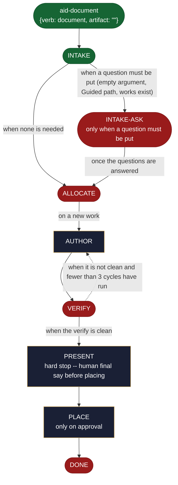

<!-- generated — do not edit; source: canonical/skills/aid-document/SKILL.md -->

## Frontmatter

- **`name`** — aid-document
- **`description`** — Write a how-to, reference or explanation document. Use when a general document is needed rather than one specific kind of document.
- **`allowed-tools`** — Read Glob Grep Bash Shell Terminal Write Edit Agent
- **`argument-hint`** — &lt;subject> -- what to document

[Definition: `canonical/skills/aid-document/SKILL.md`](https://github.com/AndreVianna/aid-methodology/blob/master/canonical/skills/aid-document/SKILL.md)

## Flow

## Source fragments

Every node in the chart above, in chart order, with the exact `canonical/` text it was derived from.

**1 · `aid-document`** — {verb: document, artifact: ""} · _entry_

~~~~plaintext title="canonical/skills/aid-document/SKILL.md#L14" wrap
row (`alias_of: null`, its own `{verb: document, artifact: ""}`), `repurpose: true`
~~~~

[Source: `canonical/skills/aid-document/SKILL.md#L14`](https://github.com/AndreVianna/aid-methodology/blob/master/canonical/skills/aid-document/SKILL.md#L14)

**2 · `INTAKE`** · _entry_

~~~~plaintext title="canonical/skills/aid-create-document/SKILL.md#L48-L50" wrap
## State: INTAKE

INTAKE and INTAKE-ASK run before any work exists, so they save no steps (`skill-steps.md`, "Before a work exists"). Their questions are asked through the question protocol, and their answers go into the record when ALLOCATE creates it.
~~~~

[Source: `canonical/skills/aid-create-document/SKILL.md#L48-L50`](https://github.com/AndreVianna/aid-methodology/blob/master/canonical/skills/aid-create-document/SKILL.md#L48-L50) · [full step: `canonical/skills/aid-create-document/SKILL.md#L48-L66`](https://github.com/AndreVianna/aid-methodology/blob/master/canonical/skills/aid-create-document/SKILL.md#L48-L66)

**3 · `INTAKE-ASK`** — only when a question must be put · _exit_ · HALT

~~~~plaintext title="canonical/skills/aid-create-document/SKILL.md#L70-L72" wrap
## State: INTAKE-ASK  (only when a question must be put)

Ask one topic at a time, through the question protocol, in this order and only for what applies:
~~~~

[Source: `canonical/skills/aid-create-document/SKILL.md#L70-L72`](https://github.com/AndreVianna/aid-methodology/blob/master/canonical/skills/aid-create-document/SKILL.md#L70-L72) · [full step: `canonical/skills/aid-create-document/SKILL.md#L70-L81`](https://github.com/AndreVianna/aid-methodology/blob/master/canonical/skills/aid-create-document/SKILL.md#L70-L81)

**4 · `ALLOCATE`** · _exit_ · HALT

~~~~plaintext title="canonical/skills/aid-create-document/SKILL.md#L85-L88" wrap
## State: ALLOCATE

Allocate the work through the gate: the Work Initiation Gate
(`.aid/runtime/templates/work-initiation-gate.md`).
~~~~

[Source: `canonical/skills/aid-create-document/SKILL.md#L85-L88`](https://github.com/AndreVianna/aid-methodology/blob/master/canonical/skills/aid-create-document/SKILL.md#L85-L88) · [full step: `canonical/skills/aid-create-document/SKILL.md#L85-L110`](https://github.com/AndreVianna/aid-methodology/blob/master/canonical/skills/aid-create-document/SKILL.md#L85-L110)

**5 · `AUTHOR`** · _step_

~~~~plaintext title="canonical/skills/aid-create-document/SKILL.md#L114-L121" wrap
## State: AUTHOR

Dispatch **`aid-tech-writer`** (clean context, tiered) to write the document in the resolved
format + genre structure, **grounded in and accurate to** the KB + project source
(`task-type-rules.md ## DOCUMENT` -- verify accuracy against the current codebase and KB).
It drafts into the work folder (not yet placed). Text formats are produced natively
(markdown, mermaid, HTML, CSV/tables); for a format it cannot cleanly emit (native
`.pptx`/`.xlsx`), it produces the best text form and notes the conversion handoff.
~~~~

[Source: `canonical/skills/aid-create-document/SKILL.md#L114-L121`](https://github.com/AndreVianna/aid-methodology/blob/master/canonical/skills/aid-create-document/SKILL.md#L114-L121) · [full step: `canonical/skills/aid-create-document/SKILL.md#L114-L123`](https://github.com/AndreVianna/aid-methodology/blob/master/canonical/skills/aid-create-document/SKILL.md#L114-L123)

**6 · `VERIFY`** · _exit_ · HALT

~~~~plaintext title="canonical/skills/aid-create-document/SKILL.md#L127-L135" wrap
## State: VERIFY

1. **Mechanical grounding check** (no dispatch): claims about the project cite a KB doc or
   `file:line`; the genre's required structure is present.
2. **Adversarial verification** -- clean-context **`aid-reviewer`** checks the draft:
   accurate against KB + codebase, complete for its genre, no fabricated content. Writes a
   review-quality ledger to `.aid/.temp/review-pending/<work>-verify.md`.
3. **Grade:** `bash .aid/runtime/scripts/grade.sh --explain <ledger>`. Not clean -> loop
   to AUTHOR. Circuit-breaker: 3 cycles -> IMPEDIMENT, and the lifecycle set to `Blocked` through the writer.
~~~~

[Source: `canonical/skills/aid-create-document/SKILL.md#L127-L135`](https://github.com/AndreVianna/aid-methodology/blob/master/canonical/skills/aid-create-document/SKILL.md#L127-L135) · [full step: `canonical/skills/aid-create-document/SKILL.md#L127-L137`](https://github.com/AndreVianna/aid-methodology/blob/master/canonical/skills/aid-create-document/SKILL.md#L127-L137)

**7 · `PRESENT`** — hard stop -- human final say before placing · _step_

~~~~plaintext title="canonical/skills/aid-create-document/SKILL.md#L141-L145" wrap
## State: PRESENT  (hard stop -- human final say before placing)

The hard stop follows the ASK step of `skill-steps.md`. Present the drafted document **and the proposed
target location** (KB-informed: `docs/`, an ADR dir, `CHANGELOG.md`, a runbook path, ...).
Await approval. **Never writes `.aid/knowledge/`.**
~~~~

[Source: `canonical/skills/aid-create-document/SKILL.md#L141-L145`](https://github.com/AndreVianna/aid-methodology/blob/master/canonical/skills/aid-create-document/SKILL.md#L141-L145) · [full step: `canonical/skills/aid-create-document/SKILL.md#L141-L149`](https://github.com/AndreVianna/aid-methodology/blob/master/canonical/skills/aid-create-document/SKILL.md#L141-L149)

**8 · `PLACE`** — only on approval · _step_

~~~~plaintext title="canonical/skills/aid-create-document/SKILL.md#L153-L160" wrap
## State: PLACE  (only on approval)

If the user declined, place nothing: the draft stays in the work folder, and the step goes on to
DONE. Otherwise write the document to its approved target location. **Extra care on overwrite or on the
published `docs/` tree:** inspect the target first and show the diff -- never silently
overwrite an existing doc. Then optionally print handoffs the user may act on: `/aid-update-kb`
(if it belongs in the KB), `/aid-create*` (if it describes something not yet built),
`/aid-refactor` (an ADR mandating a refactor).
~~~~

[Source: `canonical/skills/aid-create-document/SKILL.md#L153-L160`](https://github.com/AndreVianna/aid-methodology/blob/master/canonical/skills/aid-create-document/SKILL.md#L153-L160) · [full step: `canonical/skills/aid-create-document/SKILL.md#L153-L162`](https://github.com/AndreVianna/aid-methodology/blob/master/canonical/skills/aid-create-document/SKILL.md#L153-L162)

**9 · `DONE`** · _exit_ · HALT

~~~~plaintext title="canonical/skills/aid-create-document/SKILL.md#L166-L168" wrap
## State: DONE

Finish through the writer: `bash .aid/runtime/scripts/execute/writeback-state.sh --pipeline --field Lifecycle --value Completed`, which also clears the saved skill and step. Keep the work folder (draft + verify ledger) as the audit record.
~~~~

[Source: `canonical/skills/aid-create-document/SKILL.md#L166-L168`](https://github.com/AndreVianna/aid-methodology/blob/master/canonical/skills/aid-create-document/SKILL.md#L166-L168) · [full step: `canonical/skills/aid-create-document/SKILL.md#L166-L170`](https://github.com/AndreVianna/aid-methodology/blob/master/canonical/skills/aid-create-document/SKILL.md#L166-L170)
