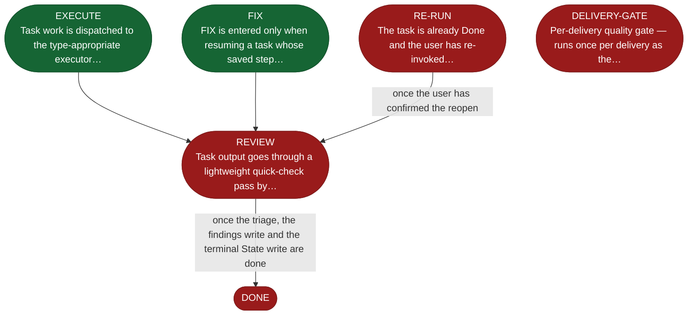

<!-- generated — do not edit; source: canonical/skills/aid-execute/SKILL.md -->

## Frontmatter

- **`name`** — aid-execute
- **`description`** — Carry out and review each planned task of a delivery. Use when the delivery's tasks are ready to build.
- **`allowed-tools`** — Read Glob Grep Write Edit Bash Shell Terminal
- **`argument-hint`** — work-001 (required if multiple works)  task-001 (required)

[Definition: `canonical/skills/aid-execute/SKILL.md`](https://github.com/AndreVianna/aid-methodology/blob/master/canonical/skills/aid-execute/SKILL.md)

## Flow

## Source fragments

Every node in the chart above, in chart order, with the exact `canonical/` text it was derived from.

**1 · `EXECUTE`** — Task work is dispatched to the type-appropriate executor… · _entry_

~~~~plaintext title="canonical/skills/aid-execute/SKILL.md#L191" wrap
| EXECUTE | `references/state-execute.md` | _(type-specific — see state file; delivery-mode uses pool dispatch PD-0→PD-6)_ | CHAIN → REVIEW |
~~~~

[Source: `canonical/skills/aid-execute/SKILL.md#L191`](https://github.com/AndreVianna/aid-methodology/blob/master/canonical/skills/aid-execute/SKILL.md#L191) · [full step: `canonical/skills/aid-execute/references/state-execute.md#L1-L780`](https://github.com/AndreVianna/aid-methodology/blob/master/canonical/skills/aid-execute/references/state-execute.md#L1-L780)

**2 · `REVIEW`** — Task output goes through a lightweight quick-check pass by… · _exit_ · HALT

~~~~plaintext title="canonical/skills/aid-execute/SKILL.md#L192" wrap
| REVIEW | `references/state-review.md` | `aid-reviewer` (Small tier, quick-check only — no grade loop per FR2) | CHAIN → DONE; HALT when a `[CRITICAL]` persists after the fix-on-spot |
~~~~

[Source: `canonical/skills/aid-execute/SKILL.md#L192`](https://github.com/AndreVianna/aid-methodology/blob/master/canonical/skills/aid-execute/SKILL.md#L192) · [full step: `canonical/skills/aid-execute/references/state-review.md#L1-L197`](https://github.com/AndreVianna/aid-methodology/blob/master/canonical/skills/aid-execute/references/state-review.md#L1-L197)

**3 · `FIX`** — FIX is entered only when resuming a task whose saved step… · _entry_

~~~~plaintext title="canonical/skills/aid-execute/SKILL.md#L193" wrap
| FIX | `references/state-fix.md` | _(same type as EXECUTE)_ | CHAIN → REVIEW (entered only when resuming a task saved at FIX; a new run fixes inside REVIEW) |
~~~~

[Source: `canonical/skills/aid-execute/SKILL.md#L193`](https://github.com/AndreVianna/aid-methodology/blob/master/canonical/skills/aid-execute/SKILL.md#L193) · [full step: `canonical/skills/aid-execute/references/state-fix.md#L1-L184`](https://github.com/AndreVianna/aid-methodology/blob/master/canonical/skills/aid-execute/references/state-fix.md#L1-L184)

**4 · `DONE`** · _exit_ · HALT

~~~~plaintext title="canonical/skills/aid-execute/SKILL.md#L194" wrap
| DONE | _(inline — task complete)_ | `inline` | HALT |
~~~~

[Source: `canonical/skills/aid-execute/SKILL.md#L194`](https://github.com/AndreVianna/aid-methodology/blob/master/canonical/skills/aid-execute/SKILL.md#L194)

**5 · `RE-RUN`** — The task is already Done and the user has re-invoked… · _exit_ · HALT

~~~~plaintext title="canonical/skills/aid-execute/SKILL.md#L195" wrap
| RE-RUN | `references/state-re-run.md` | `inline` | CHAIN → REVIEW when the user reopens; HALT when the task stays Done |
~~~~

[Source: `canonical/skills/aid-execute/SKILL.md#L195`](https://github.com/AndreVianna/aid-methodology/blob/master/canonical/skills/aid-execute/SKILL.md#L195) · [full step: `canonical/skills/aid-execute/references/state-re-run.md#L1-L21`](https://github.com/AndreVianna/aid-methodology/blob/master/canonical/skills/aid-execute/references/state-re-run.md#L1-L21)

**6 · `DELIVERY-GATE`** — Per-delivery quality gate — runs once per delivery as the… · _exit_ · HALT

~~~~plaintext title="canonical/skills/aid-execute/SKILL.md#L196" wrap
| DELIVERY-GATE | `references/state-delivery-gate.md` | `aid-reviewer` (tier = complexity score) | HALT |
~~~~

[Source: `canonical/skills/aid-execute/SKILL.md#L196`](https://github.com/AndreVianna/aid-methodology/blob/master/canonical/skills/aid-execute/SKILL.md#L196) · [full step: `canonical/skills/aid-execute/references/state-delivery-gate.md#L1-L515`](https://github.com/AndreVianna/aid-methodology/blob/master/canonical/skills/aid-execute/references/state-delivery-gate.md#L1-L515)
