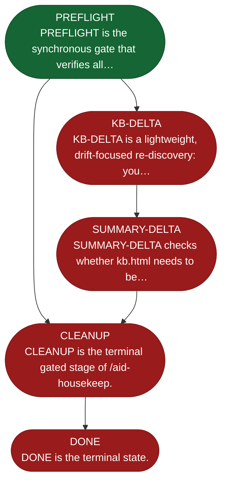

<!-- generated — do not edit; source: canonical/skills/aid-housekeep/SKILL.md -->

## Frontmatter

- **`name`** — aid-housekeep
- **`description`** — Sweep the project back into a consistent state after work has landed. Use this skill when the Knowledge Base has drifted from the code, the generated summary is stale, or work-area artifacts have piled up. It runs three gated jobs in order: re-discovering KB docs that changed since the last approval, regenerating the visual summary if the KB moved, and clearing stale work-area artifacts. Forward-authored greenfield docs take the Conformance Lane, which flags design-versus-as-built divergence for you to reconcile and never overwrites the design itself. Each stage commits on its own branch and nothing is pushed; a stalled run resumes where it stopped. This is the source-driven global reconcile -- for a targeted, prompt-named delta use `/aid-update-kb`.
- **`allowed-tools`** — Read Glob Grep Bash Shell Terminal Write Edit Agent
- **`argument-hint`** — [--cleanup-only] [--grade X] jump to cleanup stage, or set minimum summary grade

[Definition: `canonical/skills/aid-housekeep/SKILL.md`](https://github.com/AndreVianna/aid-methodology/blob/master/canonical/skills/aid-housekeep/SKILL.md)

## Flow

## Source fragments

Every node in the chart above, in chart order, with the exact `canonical/` text it was derived from.

**1 · `PREFLIGHT`** — PREFLIGHT is the synchronous gate that verifies all… · _entry_

~~~~plaintext title="canonical/skills/aid-housekeep/SKILL.md#L236" wrap
| PREFLIGHT | `references/state-preflight.md` | inline | CHAIN → KB-DELTA (or CLEANUP if Mode=cleanup-only) |
~~~~

[Source: `canonical/skills/aid-housekeep/SKILL.md#L236`](https://github.com/AndreVianna/aid-methodology/blob/master/canonical/skills/aid-housekeep/SKILL.md#L236) · [full step: `canonical/skills/aid-housekeep/references/state-preflight.md#L1-L118`](https://github.com/AndreVianna/aid-methodology/blob/master/canonical/skills/aid-housekeep/references/state-preflight.md#L1-L118)

**2 · `KB-DELTA`** — KB-DELTA is a lightweight, drift-focused re-discovery: you… · _exit_ · HALT

~~~~plaintext title="canonical/skills/aid-housekeep/SKILL.md#L237" wrap
| KB-DELTA | `references/state-kb-delta.md` | `aid-architect` (feat-002 dispatches sub-agents via `/aid-discover`) | ASK (scope confirm, Step 3) · CHAIN → SUMMARY-DELTA / WAIT if stalled |
~~~~

[Source: `canonical/skills/aid-housekeep/SKILL.md#L237`](https://github.com/AndreVianna/aid-methodology/blob/master/canonical/skills/aid-housekeep/SKILL.md#L237) · [full step: `canonical/skills/aid-housekeep/references/state-kb-delta.md#L1-L889`](https://github.com/AndreVianna/aid-methodology/blob/master/canonical/skills/aid-housekeep/references/state-kb-delta.md#L1-L889)

**3 · `SUMMARY-DELTA`** — SUMMARY-DELTA checks whether kb.html needs to be… · _exit_ · WAIT

~~~~plaintext title="canonical/skills/aid-housekeep/SKILL.md#L238" wrap
| SUMMARY-DELTA | `references/state-summary-delta.md` | inline (delegates to `/aid-summarize`) | CHAIN → CLEANUP / WAIT if stalled |
~~~~

[Source: `canonical/skills/aid-housekeep/SKILL.md#L238`](https://github.com/AndreVianna/aid-methodology/blob/master/canonical/skills/aid-housekeep/SKILL.md#L238) · [full step: `canonical/skills/aid-housekeep/references/state-summary-delta.md#L1-L357`](https://github.com/AndreVianna/aid-methodology/blob/master/canonical/skills/aid-housekeep/references/state-summary-delta.md#L1-L357)

**4 · `CLEANUP`** — CLEANUP is the terminal gated stage of /aid-housekeep. · _exit_ · ASK

~~~~plaintext title="canonical/skills/aid-housekeep/SKILL.md#L239" wrap
| CLEANUP | `references/state-cleanup.md` | inline | ASK (checklist and teardown offers) · CHAIN → DONE |
~~~~

[Source: `canonical/skills/aid-housekeep/SKILL.md#L239`](https://github.com/AndreVianna/aid-methodology/blob/master/canonical/skills/aid-housekeep/SKILL.md#L239) · [full step: `canonical/skills/aid-housekeep/references/state-cleanup.md#L1-L540`](https://github.com/AndreVianna/aid-methodology/blob/master/canonical/skills/aid-housekeep/references/state-cleanup.md#L1-L540)

**5 · `DONE`** — DONE is the terminal state. · _exit_ · HALT

~~~~plaintext title="canonical/skills/aid-housekeep/SKILL.md#L240" wrap
| DONE | `references/state-done.md` | inline | HALT |
~~~~

[Source: `canonical/skills/aid-housekeep/SKILL.md#L240`](https://github.com/AndreVianna/aid-methodology/blob/master/canonical/skills/aid-housekeep/SKILL.md#L240) · [full step: `canonical/skills/aid-housekeep/references/state-done.md#L1-L73`](https://github.com/AndreVianna/aid-methodology/blob/master/canonical/skills/aid-housekeep/references/state-done.md#L1-L73)
