<!-- generated — do not edit; source: canonical/skills/aid-orchestrate/SKILL.md -->

## Frontmatter

- **`name`** — aid-orchestrate
- **`description`** — Start, resume, close or cancel an AID work: find where it stands, size it and pick its phases. Use when a plain request starts, continues, closes or cancels a work.
- **`allowed-tools`** — Read Glob Grep Bash Shell Terminal Write Edit AskUserQuestion
- **`argument-hint`** — [request]  -- what you want to do, in your own words

[Definition: `canonical/skills/aid-orchestrate/SKILL.md`](https://github.com/AndreVianna/aid-methodology/blob/master/canonical/skills/aid-orchestrate/SKILL.md)

## Flow

> **Approximate:** This chart is derived by heuristic; exact transitions may differ from runtime behaviour.

```mermaid
flowchart TB
  classDef aidNode color:#fff
  classDef aidEntry fill:#166534,stroke:#14532d,color:#fff
  classDef aidExit fill:#991b1b,stroke:#7f1d1d,color:#fff
  classDef aidDecision fill:#92400e,stroke:#78350f,color:#fff
  classDef aidLoopBack fill:#1e3a8a,stroke:#1e3a8a,color:#fff
  classDef aidStep fill:#1a2035,stroke:#d4a853,color:#f1f5f9
  n1(["STEP-1<br/>**Project question.** references/check-intent.md step 0…"])
  n2["STEP-2<br/>**Check the reading.** references/check-intent.md steps 1…"]
  n3["STEP-3<br/>**Size the reading.** references/size-and-route.md sections…"]
  n4["STEP-4<br/>**Show the reading.** One line with its reason, the phases…"]
  n5["STEP-5<br/>**Hand over an action-skill reading.** Once the user…"]
  n6["STEP-6<br/>**Find or create the work.** references/start-or-resume.md…"]
  n7["STEP-7<br/>**Record the intent.** references/start-or-resume.md…"]
  n8["STEP-8<br/>**Cancel a named work.** references/start-or-resume.md…"]
  n9["STEP-9<br/>**Close a work.** references/size-and-route.md section 3…"]
  n10["STEP-10<br/>**Hand over.** Ask the user to go ahead, then start the…"]
  n11(["STEP-11<br/>**During the work.** Load references/external-sources.md…"])
  n1 --> n2
  n2 --> n3
  n3 --> n4
  n4 --> n5
  n5 --> n6
  n6 --> n7
  n7 --> n8
  n8 --> n9
  n9 --> n10
  n10 --> n11
  class n1 aidEntry
  class n2 aidStep
  class n3 aidStep
  class n4 aidStep
  class n5 aidStep
  class n6 aidStep
  class n7 aidStep
  class n8 aidStep
  class n9 aidStep
  class n10 aidStep
  class n11 aidExit
  class n1 aidNode
  class n2 aidNode
  class n3 aidNode
  class n4 aidNode
  class n5 aidNode
  class n6 aidNode
  class n7 aidNode
  class n8 aidNode
  class n9 aidNode
  class n10 aidNode
  class n11 aidNode
```

## Source fragments

Every node in the chart above, in chart order, with the exact `canonical/` text it was derived from.

**1 · `STEP-1`** — \*\*Project question.\*\* references/check-intent.md step 0… · _entry_

~~~~plaintext title="canonical/skills/aid-orchestrate/SKILL.md#L20" wrap
1. **Project question.** `references/check-intent.md` step 0 spots a question about the
~~~~

[Source: `canonical/skills/aid-orchestrate/SKILL.md#L20`](https://github.com/AndreVianna/aid-methodology/blob/master/canonical/skills/aid-orchestrate/SKILL.md#L20)

**2 · `STEP-2`** — \*\*Check the reading.\*\* references/check-intent.md steps 1… · _step_

~~~~plaintext title="canonical/skills/aid-orchestrate/SKILL.md#L23" wrap
2. **Check the reading.** `references/check-intent.md` steps 1 to 5 compare the request with
~~~~

[Source: `canonical/skills/aid-orchestrate/SKILL.md#L23`](https://github.com/AndreVianna/aid-methodology/blob/master/canonical/skills/aid-orchestrate/SKILL.md#L23)

**3 · `STEP-3`** — \*\*Size the reading.\*\* references/size-and-route.md sections… · _step_

~~~~plaintext title="canonical/skills/aid-orchestrate/SKILL.md#L26" wrap
3. **Size the reading.** `references/size-and-route.md` sections 1 and 2 pick the phases and the
~~~~

[Source: `canonical/skills/aid-orchestrate/SKILL.md#L26`](https://github.com/AndreVianna/aid-methodology/blob/master/canonical/skills/aid-orchestrate/SKILL.md#L26)

**4 · `STEP-4`** — \*\*Show the reading.\*\* One line with its reason, the phases… · _step_

~~~~plaintext title="canonical/skills/aid-orchestrate/SKILL.md#L29" wrap
4. **Show the reading.** One line with its reason, the phases and the depth, in the same
~~~~

[Source: `canonical/skills/aid-orchestrate/SKILL.md#L29`](https://github.com/AndreVianna/aid-methodology/blob/master/canonical/skills/aid-orchestrate/SKILL.md#L29)

**5 · `STEP-5`** — \*\*Hand over an action-skill reading.\*\* Once the user… · _step_

~~~~plaintext title="canonical/skills/aid-orchestrate/SKILL.md#L32" wrap
5. **Hand over an action-skill reading.** Once the user approves, a reading that matches an
~~~~

[Source: `canonical/skills/aid-orchestrate/SKILL.md#L32`](https://github.com/AndreVianna/aid-methodology/blob/master/canonical/skills/aid-orchestrate/SKILL.md#L32)

**6 · `STEP-6`** — \*\*Find or create the work.\*\* references/start-or-resume.md… · _step_

~~~~plaintext title="canonical/skills/aid-orchestrate/SKILL.md#L37" wrap
6. **Find or create the work.** `references/start-or-resume.md` section 3. A matching work is
~~~~

[Source: `canonical/skills/aid-orchestrate/SKILL.md#L37`](https://github.com/AndreVianna/aid-methodology/blob/master/canonical/skills/aid-orchestrate/SKILL.md#L37)

**7 · `STEP-7`** — \*\*Record the intent.\*\* references/start-or-resume.md… · _step_

~~~~plaintext title="canonical/skills/aid-orchestrate/SKILL.md#L43" wrap
7. **Record the intent.** `references/start-or-resume.md` section 6. Write the `intent:` block
~~~~

[Source: `canonical/skills/aid-orchestrate/SKILL.md#L43`](https://github.com/AndreVianna/aid-methodology/blob/master/canonical/skills/aid-orchestrate/SKILL.md#L43)

**8 · `STEP-8`** — \*\*Cancel a named work.\*\* references/start-or-resume.md… · _step_

~~~~plaintext title="canonical/skills/aid-orchestrate/SKILL.md#L45" wrap
8. **Cancel a named work.** `references/start-or-resume.md` section 5: one confirmation question,
~~~~

[Source: `canonical/skills/aid-orchestrate/SKILL.md#L45`](https://github.com/AndreVianna/aid-methodology/blob/master/canonical/skills/aid-orchestrate/SKILL.md#L45)

**9 · `STEP-9`** — \*\*Close a work.\*\* references/size-and-route.md section 3… · _step_

~~~~plaintext title="canonical/skills/aid-orchestrate/SKILL.md#L47" wrap
9. **Close a work.** `references/size-and-route.md` section 3: when every task is `Done` (or, for an
~~~~

[Source: `canonical/skills/aid-orchestrate/SKILL.md#L47`](https://github.com/AndreVianna/aid-methodology/blob/master/canonical/skills/aid-orchestrate/SKILL.md#L47)

**10 · `STEP-10`** — \*\*Hand over.\*\* Ask the user to go ahead, then start the… · _step_

~~~~plaintext title="canonical/skills/aid-orchestrate/SKILL.md#L50" wrap
10. **Hand over.** Ask the user to go ahead, then start the first phase skill yourself, or name
~~~~

[Source: `canonical/skills/aid-orchestrate/SKILL.md#L50`](https://github.com/AndreVianna/aid-methodology/blob/master/canonical/skills/aid-orchestrate/SKILL.md#L50)

**11 · `STEP-11`** — \*\*During the work.\*\* Load references/external-sources.md… · _exit_ · UNSPECIFIED

~~~~plaintext title="canonical/skills/aid-orchestrate/SKILL.md#L52" wrap
11. **During the work.** Load `references/external-sources.md` when a source is pulled in, applied
~~~~

[Source: `canonical/skills/aid-orchestrate/SKILL.md#L52`](https://github.com/AndreVianna/aid-methodology/blob/master/canonical/skills/aid-orchestrate/SKILL.md#L52)
