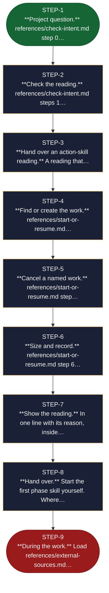

<!-- generated — do not edit; source: canonical/skills/aid-orchestrate/SKILL.md -->

## Frontmatter

- **`name`** — aid-orchestrate
- **`description`** — Start, resume or cancel an AID work: find where it stands, size it and pick its phases. Use when a plain request starts a new work, continues an existing one, or cancels one.
- **`allowed-tools`** — Read Glob Grep Bash Shell Terminal Write Edit AskUserQuestion
- **`argument-hint`** — [request]  -- what you want to do, in your own words

[Definition: `canonical/skills/aid-orchestrate/SKILL.md`](https://github.com/AndreVianna/aid-methodology/blob/master/canonical/skills/aid-orchestrate/SKILL.md)

## Flow

> **Approximate:** This chart is derived by heuristic; exact transitions may differ from runtime behaviour.

## Source fragments

Every node in the chart above, in chart order, with the exact `canonical/` text it was derived from.

**1 · `STEP-1`** — \*\*Project question.\*\* references/check-intent.md step 0… · _entry_

~~~~plaintext title="canonical/skills/aid-orchestrate/SKILL.md#L21" wrap
1. **Project question.** `references/check-intent.md` step 0 spots a question about the
~~~~

[Source: `canonical/skills/aid-orchestrate/SKILL.md#L21`](https://github.com/AndreVianna/aid-methodology/blob/master/canonical/skills/aid-orchestrate/SKILL.md#L21)

**2 · `STEP-2`** — \*\*Check the reading.\*\* references/check-intent.md steps 1… · _step_

~~~~plaintext title="canonical/skills/aid-orchestrate/SKILL.md#L24" wrap
2. **Check the reading.** `references/check-intent.md` steps 1 to 5 compare the request with
~~~~

[Source: `canonical/skills/aid-orchestrate/SKILL.md#L24`](https://github.com/AndreVianna/aid-methodology/blob/master/canonical/skills/aid-orchestrate/SKILL.md#L24)

**3 · `STEP-3`** — \*\*Hand over an action-skill reading.\*\* A reading that… · _step_

~~~~plaintext title="canonical/skills/aid-orchestrate/SKILL.md#L26" wrap
3. **Hand over an action-skill reading.** A reading that matches an action skill is handed to
~~~~

[Source: `canonical/skills/aid-orchestrate/SKILL.md#L26`](https://github.com/AndreVianna/aid-methodology/blob/master/canonical/skills/aid-orchestrate/SKILL.md#L26)

**4 · `STEP-4`** — \*\*Find or create the work.\*\* references/start-or-resume.md… · _step_

~~~~plaintext title="canonical/skills/aid-orchestrate/SKILL.md#L29" wrap
4. **Find or create the work.** `references/start-or-resume.md` steps 3 and 4. A matching work
~~~~

[Source: `canonical/skills/aid-orchestrate/SKILL.md#L29`](https://github.com/AndreVianna/aid-methodology/blob/master/canonical/skills/aid-orchestrate/SKILL.md#L29)

**5 · `STEP-5`** — \*\*Cancel a named work.\*\* references/start-or-resume.md step… · _step_

~~~~plaintext title="canonical/skills/aid-orchestrate/SKILL.md#L32" wrap
5. **Cancel a named work.** `references/start-or-resume.md` step 5: resolve the named work,
~~~~

[Source: `canonical/skills/aid-orchestrate/SKILL.md#L32`](https://github.com/AndreVianna/aid-methodology/blob/master/canonical/skills/aid-orchestrate/SKILL.md#L32)

**6 · `STEP-6`** — \*\*Size and record.\*\* references/start-or-resume.md step 6… · _step_

~~~~plaintext title="canonical/skills/aid-orchestrate/SKILL.md#L34" wrap
6. **Size and record.** `references/start-or-resume.md` step 6 with
~~~~

[Source: `canonical/skills/aid-orchestrate/SKILL.md#L34`](https://github.com/AndreVianna/aid-methodology/blob/master/canonical/skills/aid-orchestrate/SKILL.md#L34)

**7 · `STEP-7`** — \*\*Show the reading.\*\* In one line with its reason, inside… · _step_

~~~~plaintext title="canonical/skills/aid-orchestrate/SKILL.md#L37" wrap
7. **Show the reading.** In one line with its reason, inside the same message as the first
~~~~

[Source: `canonical/skills/aid-orchestrate/SKILL.md#L37`](https://github.com/AndreVianna/aid-methodology/blob/master/canonical/skills/aid-orchestrate/SKILL.md#L37)

**8 · `STEP-8`** — \*\*Hand over.\*\* Start the first phase skill yourself. Where… · _step_

~~~~plaintext title="canonical/skills/aid-orchestrate/SKILL.md#L39" wrap
8. **Hand over.** Start the first phase skill yourself. Where the tool cannot start a skill,
~~~~

[Source: `canonical/skills/aid-orchestrate/SKILL.md#L39`](https://github.com/AndreVianna/aid-methodology/blob/master/canonical/skills/aid-orchestrate/SKILL.md#L39)

**9 · `STEP-9`** — \*\*During the work.\*\* Load references/external-sources.md… · _exit_ · UNSPECIFIED

~~~~plaintext title="canonical/skills/aid-orchestrate/SKILL.md#L41" wrap
9. **During the work.** Load `references/external-sources.md` when a source is pulled in,
~~~~

[Source: `canonical/skills/aid-orchestrate/SKILL.md#L41`](https://github.com/AndreVianna/aid-methodology/blob/master/canonical/skills/aid-orchestrate/SKILL.md#L41)
