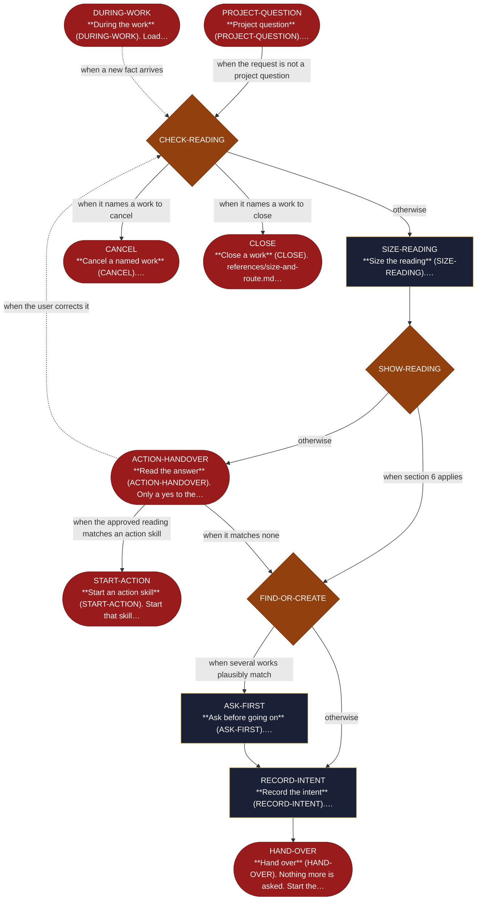

<!-- generated — do not edit; source: canonical/skills/aid-orchestrate/SKILL.md -->

## Frontmatter

- **`name`** — aid-orchestrate
- **`description`** — Start, resume, close or cancel an AID work: find where it stands, size it and pick its phases. Use when a plain request starts, continues, closes or cancels a work.
- **`allowed-tools`** — Read Glob Grep Bash Shell Terminal Write Edit
- **`argument-hint`** — [request]  -- what you want to do, in your own words

[Definition: `canonical/skills/aid-orchestrate/SKILL.md`](https://github.com/AndreVianna/aid-methodology/blob/master/canonical/skills/aid-orchestrate/SKILL.md)

## Flow

> **Approximate:** This chart is derived by heuristic; exact transitions may differ from runtime behaviour.

## Source fragments

Every node in the chart above, in chart order, with the exact `canonical/` text it was derived from.

**1 · `PROJECT-QUESTION`** — \*\*Project question\*\* (PROJECT-QUESTION).… · _exit_ · HALT

~~~~plaintext title="canonical/skills/aid-orchestrate/SKILL.md#L25" wrap
1. **Project question** (`PROJECT-QUESTION`). `references/check-intent.md` step 0 spots a question about the
~~~~

[Source: `canonical/skills/aid-orchestrate/SKILL.md#L25`](https://github.com/AndreVianna/aid-methodology/blob/master/canonical/skills/aid-orchestrate/SKILL.md#L25)

**2 · `CHECK-READING`** — \*\*Check the reading\*\* (CHECK-READING).… · _decision_

~~~~plaintext title="canonical/skills/aid-orchestrate/SKILL.md#L28" wrap
2. **Check the reading** (`CHECK-READING`). `references/check-intent.md` steps 1 to 5 classify the request by its
~~~~

[Source: `canonical/skills/aid-orchestrate/SKILL.md#L28`](https://github.com/AndreVianna/aid-methodology/blob/master/canonical/skills/aid-orchestrate/SKILL.md#L28)

**3 · `SIZE-READING`** — \*\*Size the reading\*\* (SIZE-READING).… · _step_

~~~~plaintext title="canonical/skills/aid-orchestrate/SKILL.md#L31" wrap
3. **Size the reading** (`SIZE-READING`). `references/size-and-route.md` sections 1 and 2 pick the phases and the
~~~~

[Source: `canonical/skills/aid-orchestrate/SKILL.md#L31`](https://github.com/AndreVianna/aid-methodology/blob/master/canonical/skills/aid-orchestrate/SKILL.md#L31)

**4 · `SHOW-READING`** — \*\*Show the reading\*\* (SHOW-READING). One line with its… · _decision_

~~~~plaintext title="canonical/skills/aid-orchestrate/SKILL.md#L33" wrap
4. **Show the reading** (`SHOW-READING`). One line with its reason, the phases and the depth, inside the go-ahead: one approval question
~~~~

[Source: `canonical/skills/aid-orchestrate/SKILL.md#L33`](https://github.com/AndreVianna/aid-methodology/blob/master/canonical/skills/aid-orchestrate/SKILL.md#L33)

**5 · `ACTION-HANDOVER`** — \*\*Read the answer\*\* (ACTION-HANDOVER). Only a yes to the… · _exit_ · HALT

~~~~plaintext title="canonical/skills/aid-orchestrate/SKILL.md#L41" wrap
5. **Read the answer** (`ACTION-HANDOVER`). Only a yes to the SHOW-READING go-ahead decides; an answer to a clarifying question never
~~~~

[Source: `canonical/skills/aid-orchestrate/SKILL.md#L41`](https://github.com/AndreVianna/aid-methodology/blob/master/canonical/skills/aid-orchestrate/SKILL.md#L41)

**6 · `START-ACTION`** — \*\*Start an action skill\*\* (START-ACTION). Start that skill… · _exit_ · PASS

~~~~plaintext title="canonical/skills/aid-orchestrate/SKILL.md#L46" wrap
5a. **Start an action skill** (`START-ACTION`). Start that skill in this turn, with the reading as an `intent:` block
~~~~

[Source: `canonical/skills/aid-orchestrate/SKILL.md#L46`](https://github.com/AndreVianna/aid-methodology/blob/master/canonical/skills/aid-orchestrate/SKILL.md#L46)

**7 · `FIND-OR-CREATE`** — \*\*Find or create the work\*\* (FIND-OR-CREATE).… · _decision_

~~~~plaintext title="canonical/skills/aid-orchestrate/SKILL.md#L48" wrap
6. **Find or create the work** (`FIND-OR-CREATE`). `references/start-or-resume.md` section 3: a matching work is
~~~~

[Source: `canonical/skills/aid-orchestrate/SKILL.md#L48`](https://github.com/AndreVianna/aid-methodology/blob/master/canonical/skills/aid-orchestrate/SKILL.md#L48)

**8 · `ASK-FIRST`** — \*\*Ask before going on\*\* (ASK-FIRST).… · _step_

~~~~plaintext title="canonical/skills/aid-orchestrate/SKILL.md#L51" wrap
6a. **Ask before going on** (`ASK-FIRST`). `references/start-or-resume.md` sections 3a and 4: which work, when several
~~~~

[Source: `canonical/skills/aid-orchestrate/SKILL.md#L51`](https://github.com/AndreVianna/aid-methodology/blob/master/canonical/skills/aid-orchestrate/SKILL.md#L51)

**9 · `RECORD-INTENT`** — \*\*Record the intent\*\* (RECORD-INTENT).… · _step_

~~~~plaintext title="canonical/skills/aid-orchestrate/SKILL.md#L54" wrap
7. **Record the intent** (`RECORD-INTENT`). `references/start-or-resume.md` section 6, through the writer only; a
~~~~

[Source: `canonical/skills/aid-orchestrate/SKILL.md#L54`](https://github.com/AndreVianna/aid-methodology/blob/master/canonical/skills/aid-orchestrate/SKILL.md#L54)

**10 · `CANCEL`** — \*\*Cancel a named work\*\* (CANCEL).… · _exit_ · HALT

~~~~plaintext title="canonical/skills/aid-orchestrate/SKILL.md#L56" wrap
8. **Cancel a named work** (`CANCEL`). `references/start-or-resume.md` section 5: one confirmation question, then
~~~~

[Source: `canonical/skills/aid-orchestrate/SKILL.md#L56`](https://github.com/AndreVianna/aid-methodology/blob/master/canonical/skills/aid-orchestrate/SKILL.md#L56)

**11 · `CLOSE`** — \*\*Close a work\*\* (CLOSE). references/size-and-route.md… · _exit_ · HALT

~~~~plaintext title="canonical/skills/aid-orchestrate/SKILL.md#L58" wrap
9. **Close a work** (`CLOSE`). `references/size-and-route.md` section 3. **Advance:** **HALT**.
~~~~

[Source: `canonical/skills/aid-orchestrate/SKILL.md#L58`](https://github.com/AndreVianna/aid-methodology/blob/master/canonical/skills/aid-orchestrate/SKILL.md#L58)

**12 · `HAND-OVER`** — \*\*Hand over\*\* (HAND-OVER). Nothing more is asked. Start the… · _exit_ · PASS

~~~~plaintext title="canonical/skills/aid-orchestrate/SKILL.md#L59" wrap
10. **Hand over** (`HAND-OVER`). Nothing more is asked. Start the first phase skill of a new work (`intent.phases`),
~~~~

[Source: `canonical/skills/aid-orchestrate/SKILL.md#L59`](https://github.com/AndreVianna/aid-methodology/blob/master/canonical/skills/aid-orchestrate/SKILL.md#L59)

**13 · `DURING-WORK`** — \*\*During the work\*\* (DURING-WORK). Load… · _exit_ · HALT

~~~~plaintext title="canonical/skills/aid-orchestrate/SKILL.md#L62" wrap
11. **During the work** (`DURING-WORK`). Load `references/external-sources.md` when a source is pulled in, applied
~~~~

[Source: `canonical/skills/aid-orchestrate/SKILL.md#L62`](https://github.com/AndreVianna/aid-methodology/blob/master/canonical/skills/aid-orchestrate/SKILL.md#L62)
