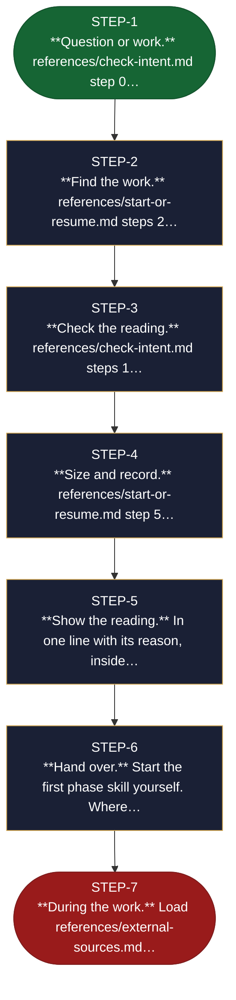

<!-- generated — do not edit; source: canonical/skills/aid-orchestrate/SKILL.md -->

## Frontmatter

- **`name`** — aid-orchestrate
- **`description`** — Start, resume or cancel an AID work: find where it stands, size it and pick its phases. Use when a plain request starts a new work, continues an existing one, or cancels one.
- **`allowed-tools`** — Read Glob Grep Bash Shell Terminal Write Edit AskUserQuestion
- **`argument-hint`** — [request]  -- what you want to do, in your own words

[Definition: `canonical/skills/aid-orchestrate/SKILL.md`](https://github.com/AndreVianna/aid-methodology/blob/master/canonical/skills/aid-orchestrate/SKILL.md)

## Flow

> **Approximate:** This chart is derived by heuristic; exact transitions may differ from runtime behaviour.

## Source fragments

Every node in the chart above, in chart order, with the exact `canonical/` text it was derived from.

**1 · `STEP-1`** — \*\*Question or work.\*\* references/check-intent.md step 0… · _entry_

~~~~plaintext title="canonical/skills/aid-orchestrate/SKILL.md#L20" wrap
1. **Question or work.** `references/check-intent.md` step 0 spots a question about the
~~~~

[Source: `canonical/skills/aid-orchestrate/SKILL.md#L20`](https://github.com/AndreVianna/aid-methodology/blob/master/canonical/skills/aid-orchestrate/SKILL.md#L20)

**2 · `STEP-2`** — \*\*Find the work.\*\* references/start-or-resume.md steps 2… · _step_

~~~~plaintext title="canonical/skills/aid-orchestrate/SKILL.md#L23" wrap
2. **Find the work.** `references/start-or-resume.md` steps 2 and 3. A matching work is
~~~~

[Source: `canonical/skills/aid-orchestrate/SKILL.md#L23`](https://github.com/AndreVianna/aid-methodology/blob/master/canonical/skills/aid-orchestrate/SKILL.md#L23)

**3 · `STEP-3`** — \*\*Check the reading.\*\* references/check-intent.md steps 1… · _step_

~~~~plaintext title="canonical/skills/aid-orchestrate/SKILL.md#L25" wrap
3. **Check the reading.** `references/check-intent.md` steps 1 to 5, for a new work or for a
~~~~

[Source: `canonical/skills/aid-orchestrate/SKILL.md#L25`](https://github.com/AndreVianna/aid-methodology/blob/master/canonical/skills/aid-orchestrate/SKILL.md#L25)

**4 · `STEP-4`** — \*\*Size and record.\*\* references/start-or-resume.md step 5… · _step_

~~~~plaintext title="canonical/skills/aid-orchestrate/SKILL.md#L28" wrap
4. **Size and record.** `references/start-or-resume.md` step 5 with
~~~~

[Source: `canonical/skills/aid-orchestrate/SKILL.md#L28`](https://github.com/AndreVianna/aid-methodology/blob/master/canonical/skills/aid-orchestrate/SKILL.md#L28)

**5 · `STEP-5`** — \*\*Show the reading.\*\* In one line with its reason, inside… · _step_

~~~~plaintext title="canonical/skills/aid-orchestrate/SKILL.md#L31" wrap
5. **Show the reading.** In one line with its reason, inside the same message as the first
~~~~

[Source: `canonical/skills/aid-orchestrate/SKILL.md#L31`](https://github.com/AndreVianna/aid-methodology/blob/master/canonical/skills/aid-orchestrate/SKILL.md#L31)

**6 · `STEP-6`** — \*\*Hand over.\*\* Start the first phase skill yourself. Where… · _step_

~~~~plaintext title="canonical/skills/aid-orchestrate/SKILL.md#L33" wrap
6. **Hand over.** Start the first phase skill yourself. Where the tool cannot start a skill,
~~~~

[Source: `canonical/skills/aid-orchestrate/SKILL.md#L33`](https://github.com/AndreVianna/aid-methodology/blob/master/canonical/skills/aid-orchestrate/SKILL.md#L33)

**7 · `STEP-7`** — \*\*During the work.\*\* Load references/external-sources.md… · _exit_ · UNSPECIFIED

~~~~plaintext title="canonical/skills/aid-orchestrate/SKILL.md#L35" wrap
7. **During the work.** Load `references/external-sources.md` when a source is pulled in,
~~~~

[Source: `canonical/skills/aid-orchestrate/SKILL.md#L35`](https://github.com/AndreVianna/aid-methodology/blob/master/canonical/skills/aid-orchestrate/SKILL.md#L35)
