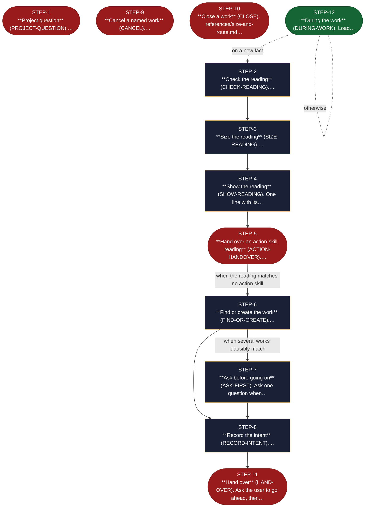

<!-- generated — do not edit; source: canonical/skills/aid-orchestrate/SKILL.md -->

## Frontmatter

- **`name`** — aid-orchestrate
- **`description`** — Start, resume, close or cancel an AID work: find where it stands, size it and pick its phases. Use when a plain request starts, continues, closes or cancels a work.
- **`allowed-tools`** — Read Glob Grep Bash Shell Terminal Write Edit AskUserQuestion
- **`argument-hint`** — [request]  -- what you want to do, in your own words

[Definition: `canonical/skills/aid-orchestrate/SKILL.md`](https://github.com/AndreVianna/aid-methodology/blob/master/canonical/skills/aid-orchestrate/SKILL.md)

## Flow

> **Approximate:** This chart is derived by heuristic; exact transitions may differ from runtime behaviour.

## Source fragments

Every node in the chart above, in chart order, with the exact `canonical/` text it was derived from.

**1 · `STEP-1`** — \*\*Project question\*\* (PROJECT-QUESTION).… · _exit_ · HALT

~~~~plaintext title="canonical/skills/aid-orchestrate/SKILL.md#L20" wrap
1. **Project question** (`PROJECT-QUESTION`). `references/check-intent.md` step 0 spots a question about the
~~~~

[Source: `canonical/skills/aid-orchestrate/SKILL.md#L20`](https://github.com/AndreVianna/aid-methodology/blob/master/canonical/skills/aid-orchestrate/SKILL.md#L20)

**2 · `STEP-2`** — \*\*Check the reading\*\* (CHECK-READING).… · _step_

~~~~plaintext title="canonical/skills/aid-orchestrate/SKILL.md#L23" wrap
2. **Check the reading** (`CHECK-READING`). `references/check-intent.md` steps 1 to 5 compare the request with
~~~~

[Source: `canonical/skills/aid-orchestrate/SKILL.md#L23`](https://github.com/AndreVianna/aid-methodology/blob/master/canonical/skills/aid-orchestrate/SKILL.md#L23)

**3 · `STEP-3`** — \*\*Size the reading\*\* (SIZE-READING).… · _step_

~~~~plaintext title="canonical/skills/aid-orchestrate/SKILL.md#L26" wrap
3. **Size the reading** (`SIZE-READING`). `references/size-and-route.md` sections 1 and 2 pick the phases and the
~~~~

[Source: `canonical/skills/aid-orchestrate/SKILL.md#L26`](https://github.com/AndreVianna/aid-methodology/blob/master/canonical/skills/aid-orchestrate/SKILL.md#L26)

**4 · `STEP-4`** — \*\*Show the reading\*\* (SHOW-READING). One line with its… · _step_

~~~~plaintext title="canonical/skills/aid-orchestrate/SKILL.md#L29" wrap
4. **Show the reading** (`SHOW-READING`). One line with its reason, the phases and the depth, in the same
~~~~

[Source: `canonical/skills/aid-orchestrate/SKILL.md#L29`](https://github.com/AndreVianna/aid-methodology/blob/master/canonical/skills/aid-orchestrate/SKILL.md#L29)

**5 · `STEP-5`** — \*\*Hand over an action-skill reading\*\* (ACTION-HANDOVER).… · _exit_ · ASK

~~~~plaintext title="canonical/skills/aid-orchestrate/SKILL.md#L32" wrap
5. **Hand over an action-skill reading** (`ACTION-HANDOVER`). Once the user approves, a reading that matches an
~~~~

[Source: `canonical/skills/aid-orchestrate/SKILL.md#L32`](https://github.com/AndreVianna/aid-methodology/blob/master/canonical/skills/aid-orchestrate/SKILL.md#L32)

**6 · `STEP-6`** — \*\*Find or create the work\*\* (FIND-OR-CREATE).… · _step_

~~~~plaintext title="canonical/skills/aid-orchestrate/SKILL.md#L38" wrap
6. **Find or create the work** (`FIND-OR-CREATE`). `references/start-or-resume.md` section 3. A matching work is
~~~~

[Source: `canonical/skills/aid-orchestrate/SKILL.md#L38`](https://github.com/AndreVianna/aid-methodology/blob/master/canonical/skills/aid-orchestrate/SKILL.md#L38)

**7 · `STEP-7`** — \*\*Ask before going on\*\* (ASK-FIRST). Ask one question when… · _step_

~~~~plaintext title="canonical/skills/aid-orchestrate/SKILL.md#L41" wrap
6a. **Ask before going on** (`ASK-FIRST`). Ask one question when several works plausibly match
~~~~

[Source: `canonical/skills/aid-orchestrate/SKILL.md#L41`](https://github.com/AndreVianna/aid-methodology/blob/master/canonical/skills/aid-orchestrate/SKILL.md#L41)

**8 · `STEP-8`** — \*\*Record the intent\*\* (RECORD-INTENT).… · _step_

~~~~plaintext title="canonical/skills/aid-orchestrate/SKILL.md#L44" wrap
7. **Record the intent** (`RECORD-INTENT`). `references/start-or-resume.md` section 6. The record's keys are set
~~~~

[Source: `canonical/skills/aid-orchestrate/SKILL.md#L44`](https://github.com/AndreVianna/aid-methodology/blob/master/canonical/skills/aid-orchestrate/SKILL.md#L44)

**9 · `STEP-9`** — \*\*Cancel a named work\*\* (CANCEL).… · _exit_ · ASK

~~~~plaintext title="canonical/skills/aid-orchestrate/SKILL.md#L47" wrap
8. **Cancel a named work** (`CANCEL`). `references/start-or-resume.md` section 5: one confirmation question,
~~~~

[Source: `canonical/skills/aid-orchestrate/SKILL.md#L47`](https://github.com/AndreVianna/aid-methodology/blob/master/canonical/skills/aid-orchestrate/SKILL.md#L47)

**10 · `STEP-10`** — \*\*Close a work\*\* (CLOSE). references/size-and-route.md… · _exit_ · HALT

~~~~plaintext title="canonical/skills/aid-orchestrate/SKILL.md#L49" wrap
9. **Close a work** (`CLOSE`). `references/size-and-route.md` section 3: when every task is `Done` (or, for an
~~~~

[Source: `canonical/skills/aid-orchestrate/SKILL.md#L49`](https://github.com/AndreVianna/aid-methodology/blob/master/canonical/skills/aid-orchestrate/SKILL.md#L49)

**11 · `STEP-11`** — \*\*Hand over\*\* (HAND-OVER). Ask the user to go ahead, then… · _exit_ · ASK

~~~~plaintext title="canonical/skills/aid-orchestrate/SKILL.md#L52" wrap
10. **Hand over** (`HAND-OVER`). Ask the user to go ahead, then start the first phase skill of a new work
~~~~

[Source: `canonical/skills/aid-orchestrate/SKILL.md#L52`](https://github.com/AndreVianna/aid-methodology/blob/master/canonical/skills/aid-orchestrate/SKILL.md#L52)

**12 · `STEP-12`** — \*\*During the work\*\* (DURING-WORK). Load… · _entry_

~~~~plaintext title="canonical/skills/aid-orchestrate/SKILL.md#L56" wrap
11. **During the work** (`DURING-WORK`). Load `references/external-sources.md` when a source is pulled in, applied
~~~~

[Source: `canonical/skills/aid-orchestrate/SKILL.md#L56`](https://github.com/AndreVianna/aid-methodology/blob/master/canonical/skills/aid-orchestrate/SKILL.md#L56)
