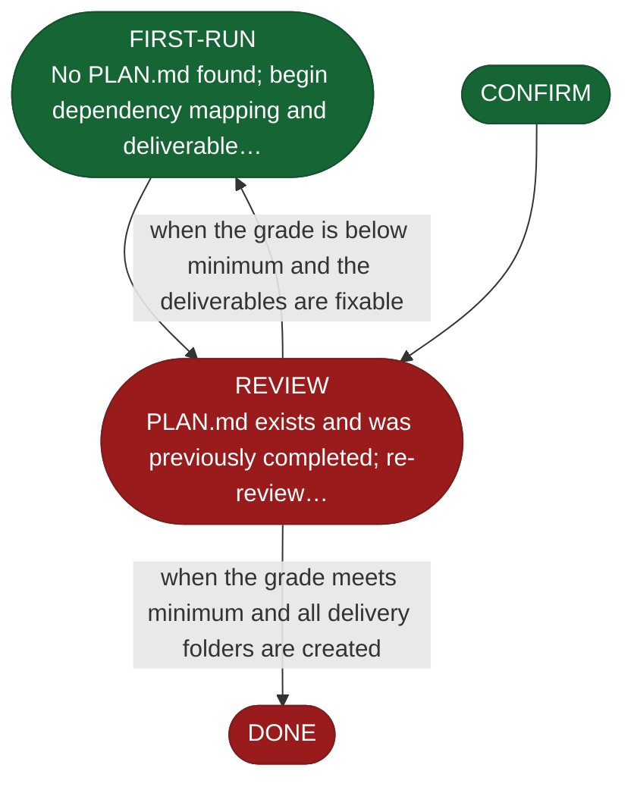

<!-- generated — do not edit; source: canonical/skills/aid-plan/SKILL.md -->

## Frontmatter

- **`name`** — aid-plan
- **`description`** — Group the specified features into deliveries. Use when the feature specifications are approved and ready to group.
- **`allowed-tools`** — Read Glob Grep Write Edit Bash Shell Terminal
- **`argument-hint`** — work-001 (required if multiple works)  [--reset] clear PLAN.md and restart

[Definition: `canonical/skills/aid-plan/SKILL.md`](https://github.com/AndreVianna/aid-methodology/blob/master/canonical/skills/aid-plan/SKILL.md)

## Flow

## Source fragments

Every node in the chart above, in chart order, with the exact `canonical/` text it was derived from.

**1 · `FIRST-RUN`** — No PLAN.md found; begin dependency mapping and deliverable… · _entry_

~~~~plaintext title="canonical/skills/aid-plan/SKILL.md#L164" wrap
| FIRST-RUN | `references/first-run-loop.md` | `aid-architect` | CHAIN → REVIEW |
~~~~

[Source: `canonical/skills/aid-plan/SKILL.md#L164`](https://github.com/AndreVianna/aid-methodology/blob/master/canonical/skills/aid-plan/SKILL.md#L164) · [full step: `canonical/skills/aid-plan/references/first-run-loop.md#L1-L234`](https://github.com/AndreVianna/aid-methodology/blob/master/canonical/skills/aid-plan/references/first-run-loop.md#L1-L234)

**2 · `CONFIRM`** · _entry_

~~~~plaintext title="canonical/skills/aid-plan/SKILL.md#L165" wrap
| CONFIRM | `references/confirm-reopen.md` | `inline` | ASK → REVIEW |
~~~~

[Source: `canonical/skills/aid-plan/SKILL.md#L165`](https://github.com/AndreVianna/aid-methodology/blob/master/canonical/skills/aid-plan/SKILL.md#L165) · [full step: `canonical/skills/aid-plan/references/confirm-reopen.md#L1-L13`](https://github.com/AndreVianna/aid-methodology/blob/master/canonical/skills/aid-plan/references/confirm-reopen.md#L1-L13)

**3 · `REVIEW`** — PLAN.md exists and was previously completed; re-review… · _exit_ · HALT

~~~~plaintext title="canonical/skills/aid-plan/SKILL.md#L166" wrap
| REVIEW | `references/review-deliverables.md` | `aid-reviewer` | CHAIN → DONE when the grade meets minimum and all delivery folders are created; CHAIN → FIRST-RUN when the grade is below minimum and the deliverables are fixable; HALT when the sequence is invalidated |
~~~~

[Source: `canonical/skills/aid-plan/SKILL.md#L166`](https://github.com/AndreVianna/aid-methodology/blob/master/canonical/skills/aid-plan/SKILL.md#L166) · [full step: `canonical/skills/aid-plan/references/review-deliverables.md#L1-L76`](https://github.com/AndreVianna/aid-methodology/blob/master/canonical/skills/aid-plan/references/review-deliverables.md#L1-L76)

**4 · `DONE`** · _exit_ · HALT

~~~~plaintext title="canonical/skills/aid-plan/SKILL.md#L167" wrap
| DONE | _(inline — plan complete; print summary and exit)_ | `inline` | HALT |
~~~~

[Source: `canonical/skills/aid-plan/SKILL.md#L167`](https://github.com/AndreVianna/aid-methodology/blob/master/canonical/skills/aid-plan/SKILL.md#L167)
