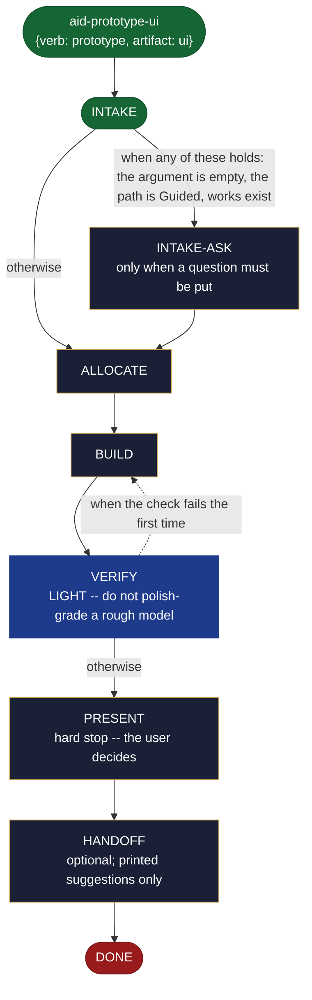

<!-- generated — do not edit; source: canonical/skills/aid-prototype-ui/SKILL.md -->

## Frontmatter

- **`name`** — aid-prototype-ui
- **`description`** — Build a throwaway, low-fidelity UI wireframe and interaction flow to test whether a UX direction actually works. Use this skill when you want to see a screen before committing to building it. Isolated and disposable: it never touches production, and it reports what the mock shows rather than deciding anything for you. For a kept UI design meant to inform the real build rather than a throwaway that validates a direction, use `/aid-design-ui` instead. A thin kind-sibling of `/aid-prototype`, which defines its full behavior.
- **`allowed-tools`** — Read Glob Grep Bash Shell Terminal Write Edit Agent
- **`argument-hint`** — &lt;screen/flow> -- the UI screen(s)/flow whose direction to validate

[Definition: `canonical/skills/aid-prototype-ui/SKILL.md`](https://github.com/AndreVianna/aid-methodology/blob/master/canonical/skills/aid-prototype-ui/SKILL.md)

## Flow

## Source fragments

Every node in the chart above, in chart order, with the exact `canonical/` text it was derived from.

**1 · `aid-prototype-ui`** — {verb: prototype, artifact: ui} · _entry_

~~~~plaintext title="canonical/skills/aid-prototype-ui/SKILL.md#L18" wrap
(`alias_of: null`, its own `{verb: prototype, artifact: ui}`), `repurpose: true`
~~~~

[Source: `canonical/skills/aid-prototype-ui/SKILL.md#L18`](https://github.com/AndreVianna/aid-methodology/blob/master/canonical/skills/aid-prototype-ui/SKILL.md#L18)

**2 · `INTAKE`** · _entry_

~~~~plaintext title="canonical/skills/aid-prototype/SKILL.md#L33-L35" wrap
## State: INTAKE

INTAKE and INTAKE-ASK run before the work record exists, so they save no steps (`skill-steps.md`, § Before a work exists). Their questions are recorded in a design document under `.aid/design/`, not in a work record.
~~~~

[Source: `canonical/skills/aid-prototype/SKILL.md#L33-L35`](https://github.com/AndreVianna/aid-methodology/blob/master/canonical/skills/aid-prototype/SKILL.md#L33-L35) · [full step: `canonical/skills/aid-prototype/SKILL.md#L33-L49`](https://github.com/AndreVianna/aid-methodology/blob/master/canonical/skills/aid-prototype/SKILL.md#L33-L49)

**3 · `INTAKE-ASK`** — only when a question must be put · _step_

~~~~plaintext title="canonical/skills/aid-prototype/SKILL.md#L53-L55" wrap
## State: INTAKE-ASK  (only when a question must be put)

Ask one topic at a time, through the question protocol, in this order and only for what applies:
~~~~

[Source: `canonical/skills/aid-prototype/SKILL.md#L53-L55`](https://github.com/AndreVianna/aid-methodology/blob/master/canonical/skills/aid-prototype/SKILL.md#L53-L55) · [full step: `canonical/skills/aid-prototype/SKILL.md#L53-L65`](https://github.com/AndreVianna/aid-methodology/blob/master/canonical/skills/aid-prototype/SKILL.md#L53-L65)

**4 · `ALLOCATE`** · _step_

~~~~plaintext title="canonical/skills/aid-prototype/SKILL.md#L69-L72" wrap
## State: ALLOCATE

Allocate the work through the gate: the Work Initiation Gate
(`.aid/runtime/templates/work-initiation-gate.md`).
~~~~

[Source: `canonical/skills/aid-prototype/SKILL.md#L69-L72`](https://github.com/AndreVianna/aid-methodology/blob/master/canonical/skills/aid-prototype/SKILL.md#L69-L72) · [full step: `canonical/skills/aid-prototype/SKILL.md#L69-L89`](https://github.com/AndreVianna/aid-methodology/blob/master/canonical/skills/aid-prototype/SKILL.md#L69-L89)

**5 · `BUILD`** · _step_

~~~~plaintext title="canonical/skills/aid-prototype/SKILL.md#L93-L100" wrap
## State: BUILD

Dispatch **`aid-architect`** (clean context, tiered) to build the low-fidelity model of
the direction and capture the validation signal. A "runnable spike" is **throwaway code
written by this same `aid-architect` dispatch** -- deliberately NOT `aid-developer` (whose
job is production code), keeping the throwaway/non-production boundary crisp. All artifacts
stay in the work folder / opt-in worktree and **never touch production modules**. It writes
a validation assessment (see [Deliverable](#deliverable)) into the work folder.
~~~~

[Source: `canonical/skills/aid-prototype/SKILL.md#L93-L100`](https://github.com/AndreVianna/aid-methodology/blob/master/canonical/skills/aid-prototype/SKILL.md#L93-L100) · [full step: `canonical/skills/aid-prototype/SKILL.md#L93-L102`](https://github.com/AndreVianna/aid-methodology/blob/master/canonical/skills/aid-prototype/SKILL.md#L93-L102)

**6 · `VERIFY`** — LIGHT -- do not polish-grade a rough model · _loop-back_

~~~~plaintext title="canonical/skills/aid-prototype/SKILL.md#L106-L113" wrap
## State: VERIFY  (LIGHT -- do not polish-grade a rough model)

A prototype is *deliberately* low-fidelity, so this is a single light clean-context check
(not the full adversarial loop the other collapses run): dispatch **`aid-reviewer`** once to
confirm (a) the **"success signal observed" claim is honest and grounded** in what was
actually built, and (b) the **throwaway scope was respected** -- no production code snuck in,
nothing was committed to real modules. If the check fails, return to BUILD once to correct;
do not loop on polish.
~~~~

[Source: `canonical/skills/aid-prototype/SKILL.md#L106-L113`](https://github.com/AndreVianna/aid-methodology/blob/master/canonical/skills/aid-prototype/SKILL.md#L106-L113) · [full step: `canonical/skills/aid-prototype/SKILL.md#L106-L115`](https://github.com/AndreVianna/aid-methodology/blob/master/canonical/skills/aid-prototype/SKILL.md#L106-L115)

**7 · `PRESENT`** — hard stop -- the user decides · _step_

~~~~plaintext title="canonical/skills/aid-prototype/SKILL.md#L119-L123" wrap
## State: PRESENT  (hard stop -- the user decides)

The hard stop follows the ASK step of `skill-steps.md`. Present the throwaway model + the validation
assessment: **Direction · What was built (fidelity) · Success signal — observed or not ·
What we learned · viable? (a conclusion, not a resolution).** Assert no resolution.
~~~~

[Source: `canonical/skills/aid-prototype/SKILL.md#L119-L123`](https://github.com/AndreVianna/aid-methodology/blob/master/canonical/skills/aid-prototype/SKILL.md#L119-L123) · [full step: `canonical/skills/aid-prototype/SKILL.md#L119-L125`](https://github.com/AndreVianna/aid-methodology/blob/master/canonical/skills/aid-prototype/SKILL.md#L119-L125)

**8 · `HANDOFF`** — optional; printed suggestions only · _step_

~~~~plaintext title="canonical/skills/aid-prototype/SKILL.md#L129-L134" wrap
## State: HANDOFF  (optional; printed suggestions only)

Printed suggestions the user may act on: build the validated thing for real
(`/aid-create*`, or `/aid-design` first if a kept design is wanted), or test it with users
(`/aid-experiment` / `/aid-test`). Never auto-invoked; never a resolution. Ask which one, if
any, the user takes; a picked one is named in one plain line.
~~~~

[Source: `canonical/skills/aid-prototype/SKILL.md#L129-L134`](https://github.com/AndreVianna/aid-methodology/blob/master/canonical/skills/aid-prototype/SKILL.md#L129-L134) · [full step: `canonical/skills/aid-prototype/SKILL.md#L129-L136`](https://github.com/AndreVianna/aid-methodology/blob/master/canonical/skills/aid-prototype/SKILL.md#L129-L136)

**9 · `DONE`** · _exit_ · HALT

~~~~plaintext title="canonical/skills/aid-prototype/SKILL.md#L140-L142" wrap
## State: DONE

Finish through the writer: `bash .aid/runtime/scripts/execute/writeback-state.sh --pipeline --field Lifecycle --value Completed`, which also clears the saved skill and step. Keep the throwaway artifacts + assessment in the work folder as the audit record; nothing is promoted to production.
~~~~

[Source: `canonical/skills/aid-prototype/SKILL.md#L140-L142`](https://github.com/AndreVianna/aid-methodology/blob/master/canonical/skills/aid-prototype/SKILL.md#L140-L142) · [full step: `canonical/skills/aid-prototype/SKILL.md#L140-L144`](https://github.com/AndreVianna/aid-methodology/blob/master/canonical/skills/aid-prototype/SKILL.md#L140-L144)
