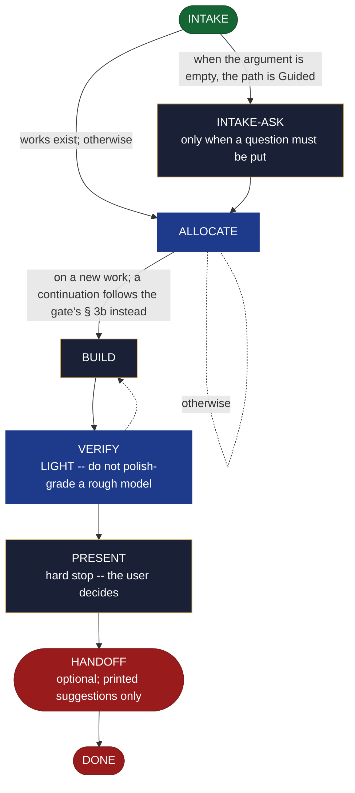

<!-- generated — do not edit; source: canonical/skills/aid-prototype/SKILL.md -->

## Frontmatter

- **`name`** — aid-prototype
- **`description`** — Build a low-fidelity model of a direction. Use when a direction needs a cheap model before committing to a full build.
- **`allowed-tools`** — Read Glob Grep Bash Shell Terminal Write Edit Agent
- **`argument-hint`** — &lt;direction> -- the direction/hypothesis to validate (optionally: fidelity paper|low-fi|runnable-spike)

[Definition: `canonical/skills/aid-prototype/SKILL.md`](https://github.com/AndreVianna/aid-methodology/blob/master/canonical/skills/aid-prototype/SKILL.md)

## Flow

## Source fragments

Every node in the chart above, in chart order, with the exact `canonical/` text it was derived from.

**1 · `INTAKE`** · _entry_

~~~~plaintext title="canonical/skills/aid-prototype/SKILL.md#L31-L43" wrap
## State: INTAKE

1. **Check the direction.** Note whether the argument is empty. Do not ask here.
2. **Capture (thin):** direction/hypothesis; fidelity (`paper` | `low-fi` | `runnable
   spike`, default `low-fi`); the success signal that would validate it; the scope
   boundary (what it does NOT attempt -- keeps it throwaway).
3. **Pick the path:** **Fast** -- a clear direction + success signal -> build now.
   **Guided** -- vague ("prototype something for onboarding") -> scope direction / success
   signal / fidelity first, in INTAKE-ASK.
4. **Classify complexity (model + effort):** simple -> `aid-architect` at **sonnet /
   medium**; complex (a runnable spike, a rich flow) -> **opus / high**.
5. **Check for works.** Run `bash .aid/runtime/scripts/works/enumerate-works.sh`
   (main tree + every git worktree). Note whether any exist. Do not prompt here.
~~~~

[Source: `canonical/skills/aid-prototype/SKILL.md#L31-L43`](https://github.com/AndreVianna/aid-methodology/blob/master/canonical/skills/aid-prototype/SKILL.md#L31-L43) · [full step: `canonical/skills/aid-prototype/SKILL.md#L31-L46`](https://github.com/AndreVianna/aid-methodology/blob/master/canonical/skills/aid-prototype/SKILL.md#L31-L46)

**2 · `INTAKE-ASK`** — only when a question must be put · _step_

~~~~plaintext title="canonical/skills/aid-prototype/SKILL.md#L50-L52" wrap
## State: INTAKE-ASK  (only when a question must be put)

Ask one topic at a time, through the question protocol, in this order and only for what applies:
~~~~

[Source: `canonical/skills/aid-prototype/SKILL.md#L50-L52`](https://github.com/AndreVianna/aid-methodology/blob/master/canonical/skills/aid-prototype/SKILL.md#L50-L52) · [full step: `canonical/skills/aid-prototype/SKILL.md#L50-L60`](https://github.com/AndreVianna/aid-methodology/blob/master/canonical/skills/aid-prototype/SKILL.md#L50-L60)

**3 · `ALLOCATE`** · _loop-back_

~~~~plaintext title="canonical/skills/aid-prototype/SKILL.md#L64-L67" wrap
## State: ALLOCATE

Allocate the work through the gate: the Work Initiation Gate
(`.aid/runtime/templates/work-initiation-gate.md`).
~~~~

[Source: `canonical/skills/aid-prototype/SKILL.md#L64-L67`](https://github.com/AndreVianna/aid-methodology/blob/master/canonical/skills/aid-prototype/SKILL.md#L64-L67) · [full step: `canonical/skills/aid-prototype/SKILL.md#L64-L82`](https://github.com/AndreVianna/aid-methodology/blob/master/canonical/skills/aid-prototype/SKILL.md#L64-L82)

**4 · `BUILD`** · _step_

~~~~plaintext title="canonical/skills/aid-prototype/SKILL.md#L86-L93" wrap
## State: BUILD

Dispatch **`aid-architect`** (clean context, tiered) to build the low-fidelity model of
the direction and capture the validation signal. A "runnable spike" is **throwaway code
written by this same `aid-architect` dispatch** -- deliberately NOT `aid-developer` (whose
job is production code), keeping the throwaway/non-production boundary crisp. All artifacts
stay in the work folder / opt-in worktree and **never touch production modules**. It writes
a validation assessment (see [Deliverable](#deliverable)) into the work folder.
~~~~

[Source: `canonical/skills/aid-prototype/SKILL.md#L86-L93`](https://github.com/AndreVianna/aid-methodology/blob/master/canonical/skills/aid-prototype/SKILL.md#L86-L93) · [full step: `canonical/skills/aid-prototype/SKILL.md#L86-L95`](https://github.com/AndreVianna/aid-methodology/blob/master/canonical/skills/aid-prototype/SKILL.md#L86-L95)

**5 · `VERIFY`** — LIGHT -- do not polish-grade a rough model · _loop-back_

~~~~plaintext title="canonical/skills/aid-prototype/SKILL.md#L99-L106" wrap
## State: VERIFY  (LIGHT -- do not polish-grade a rough model)

A prototype is *deliberately* low-fidelity, so this is a single light clean-context check
(not the full adversarial loop the other collapses run): dispatch **`aid-reviewer`** once to
confirm (a) the **"success signal observed" claim is honest and grounded** in what was
actually built, and (b) the **throwaway scope was respected** -- no production code snuck in,
nothing was committed to real modules. If the check fails, return to BUILD once to correct;
do not loop on polish.
~~~~

[Source: `canonical/skills/aid-prototype/SKILL.md#L99-L106`](https://github.com/AndreVianna/aid-methodology/blob/master/canonical/skills/aid-prototype/SKILL.md#L99-L106) · [full step: `canonical/skills/aid-prototype/SKILL.md#L99-L108`](https://github.com/AndreVianna/aid-methodology/blob/master/canonical/skills/aid-prototype/SKILL.md#L99-L108)

**6 · `PRESENT`** — hard stop -- the user decides · _step_

~~~~plaintext title="canonical/skills/aid-prototype/SKILL.md#L112-L116" wrap
## State: PRESENT  (hard stop -- the user decides)

The hard stop follows the ASK step of `skill-steps.md`. Present the throwaway model + the validation
assessment: **Direction · What was built (fidelity) · Success signal — observed or not ·
What we learned · viable? (a conclusion, not a resolution).** Assert no resolution.
~~~~

[Source: `canonical/skills/aid-prototype/SKILL.md#L112-L116`](https://github.com/AndreVianna/aid-methodology/blob/master/canonical/skills/aid-prototype/SKILL.md#L112-L116) · [full step: `canonical/skills/aid-prototype/SKILL.md#L112-L118`](https://github.com/AndreVianna/aid-methodology/blob/master/canonical/skills/aid-prototype/SKILL.md#L112-L118)

**7 · `HANDOFF`** — optional; printed suggestions only · _exit_ · HALT

~~~~plaintext title="canonical/skills/aid-prototype/SKILL.md#L122-L127" wrap
## State: HANDOFF  (optional; printed suggestions only)

Printed suggestions the user may act on: build the validated thing for real
(`/aid-create*`, or `/aid-design` first if a kept design is wanted), or test it with users
(`/aid-experiment` / `/aid-test`). Never auto-invoked; never a resolution. Ask which one, if
any, the user takes; a picked one is named in one plain line.
~~~~

[Source: `canonical/skills/aid-prototype/SKILL.md#L122-L127`](https://github.com/AndreVianna/aid-methodology/blob/master/canonical/skills/aid-prototype/SKILL.md#L122-L127) · [full step: `canonical/skills/aid-prototype/SKILL.md#L122-L129`](https://github.com/AndreVianna/aid-methodology/blob/master/canonical/skills/aid-prototype/SKILL.md#L122-L129)

**8 · `DONE`** · _exit_ · HALT

~~~~plaintext title="canonical/skills/aid-prototype/SKILL.md#L133-L135" wrap
## State: DONE

Finish through the writer: `bash .aid/runtime/scripts/execute/writeback-state.sh --pipeline --field Lifecycle --value Completed`, which also clears the saved skill and step. Keep the throwaway artifacts + assessment in the work folder as the audit record; nothing is promoted to production.
~~~~

[Source: `canonical/skills/aid-prototype/SKILL.md#L133-L135`](https://github.com/AndreVianna/aid-methodology/blob/master/canonical/skills/aid-prototype/SKILL.md#L133-L135) · [full step: `canonical/skills/aid-prototype/SKILL.md#L133-L137`](https://github.com/AndreVianna/aid-methodology/blob/master/canonical/skills/aid-prototype/SKILL.md#L133-L137)
