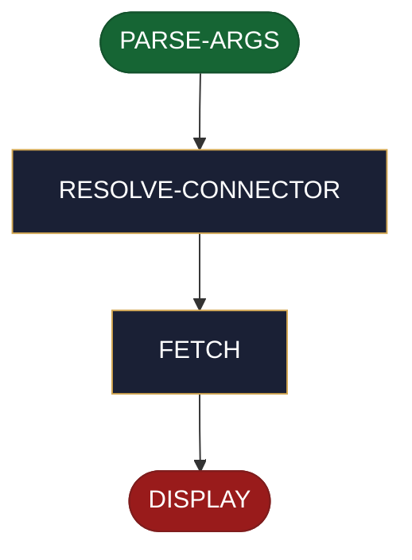

<!-- generated — do not edit; source: canonical/skills/aid-read-ticket/SKILL.md -->

## Frontmatter

- **`name`** — aid-read-ticket
- **`description`** — Read one ticket from the project's issue tracker and show its fields. Use when a ticket is named and you need its current contents, as `aid-read-ticket [<connector>:]<ticket-id>`.
- **`allowed-tools`** — Read Glob Grep AskUserQuestion
- **`argument-hint`** — [&lt;connector>:]&lt;ticket-id>

[Definition: `canonical/skills/aid-read-ticket/SKILL.md`](https://github.com/AndreVianna/aid-methodology/blob/master/canonical/skills/aid-read-ticket/SKILL.md)

## Flow

> **Approximate:** This chart is derived by heuristic; exact transitions may differ from runtime behaviour.

## Source fragments

Every node in the chart above, in chart order, with the exact `canonical/` text it was derived from.

**1 · `PARSE-ARGS`** · _entry_

~~~~plaintext title="canonical/skills/aid-read-ticket/SKILL.md#L62" wrap
### State 1 — PARSE-ARGS
~~~~

[Source: `canonical/skills/aid-read-ticket/SKILL.md#L62`](https://github.com/AndreVianna/aid-methodology/blob/master/canonical/skills/aid-read-ticket/SKILL.md#L62)

**2 · `RESOLVE-CONNECTOR`** · _step_

~~~~plaintext title="canonical/skills/aid-read-ticket/SKILL.md#L71" wrap
### State 2 — RESOLVE-CONNECTOR
~~~~

[Source: `canonical/skills/aid-read-ticket/SKILL.md#L71`](https://github.com/AndreVianna/aid-methodology/blob/master/canonical/skills/aid-read-ticket/SKILL.md#L71)

**3 · `FETCH`** · _step_

~~~~plaintext title="canonical/skills/aid-read-ticket/SKILL.md#L97" wrap
### State 3 — FETCH
~~~~

[Source: `canonical/skills/aid-read-ticket/SKILL.md#L97`](https://github.com/AndreVianna/aid-methodology/blob/master/canonical/skills/aid-read-ticket/SKILL.md#L97)

**4 · `DISPLAY`** · _exit_ · UNSPECIFIED

~~~~plaintext title="canonical/skills/aid-read-ticket/SKILL.md#L111" wrap
### State 4 — DISPLAY
~~~~

[Source: `canonical/skills/aid-read-ticket/SKILL.md#L111`](https://github.com/AndreVianna/aid-methodology/blob/master/canonical/skills/aid-read-ticket/SKILL.md#L111)
