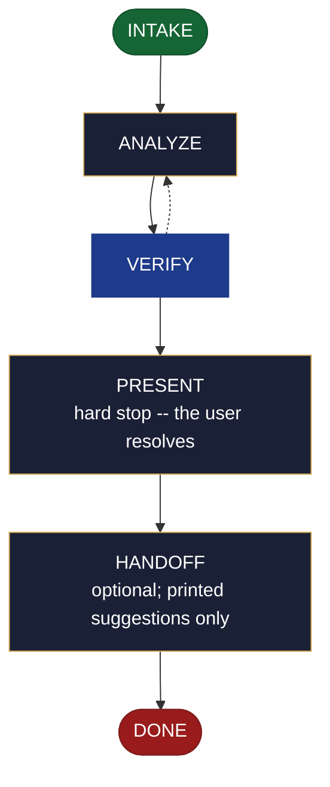

<!-- generated — do not edit; source: canonical/skills/aid-report/SKILL.md -->

## Frontmatter

- **`name`** — aid-report
- **`description`** — Analyse data or usage into an insight report. Use when the user needs the data or usage explained.
- **`allowed-tools`** — Read Glob Grep Bash Shell Terminal Write Edit Agent
- **`argument-hint`** — &lt;subject> -- the data/usage to analyze (a dataset, logs, metrics, an A/B result)

[Definition: `canonical/skills/aid-report/SKILL.md`](https://github.com/AndreVianna/aid-methodology/blob/master/canonical/skills/aid-report/SKILL.md)

## Flow

## Source fragments

Every node in the chart above, in chart order, with the exact `canonical/` text it was derived from.

**1 · `INTAKE`** · _entry_

~~~~plaintext title="canonical/skills/aid-report/SKILL.md#L34-L56" wrap
## State: INTAKE

1. **Require a subject.** Empty argument -> ask one bootstrapping question ("What data
   should I analyze, and what question about it?") and wait.
2. **Pick the path:** **Fast** -- a clear data source + a clear analytical ask ("analyze
   the A/B results in `results.csv`", "error-rate breakdown from these logs") -> analyze
   now. **Guided** -- vague ("analyze our usage") -> scope *which data, which metrics, what
   question* first, then analyze.
3. **Classify complexity (model + effort):** simple (small dataset, one metric) ->
   `aid-researcher` at **sonnet / medium**; standard/complex (large data, A/B significance,
   deep telemetry) -> **opus / high**. Verifier tier >= producer tier.
4. **Allocate the work through the gate.** Run the Work Initiation Gate
   (`.aid/runtime/templates/work-initiation-gate.md`): `bash .aid/runtime/scripts/works/enumerate-works.sh`
   (main tree + every git worktree). Empty -> no prompt. Works exist -> ask the gate's
   new-vs-continuation question with the enumerated list.
   - **New work:** call the gate's `§ 3a` with the user's words, this skill's name (`aid-report`),
     its first step (`INTAKE`), `--path lite`, and a kebab-case slug from the subject. The gate's `§ 3a` step 2 creates and enters the worktree
     (`worktree-lifecycle.sh create <work-id> <name>`),
     **then** allocate (`.aid/works/<work-id>-<slug>/`) the work folder and write its record through
     the writer, before it hands back: "`STATE.yml` was created by the gate;
     skip any instruction to write `initiator`, `active_skill`, `lifecycle` or `phase` by hand;
     set other keys through the writer." This skill drives no `phase`.
   - **Continuation:** On continuation, follow the gate's § 3b: enter the chosen work's worktree and run the skill its record names, at its saved step.
~~~~

[Source: `canonical/skills/aid-report/SKILL.md#L34-L56`](https://github.com/AndreVianna/aid-methodology/blob/master/canonical/skills/aid-report/SKILL.md#L34-L56) · [full step: `canonical/skills/aid-report/SKILL.md#L34-L58`](https://github.com/AndreVianna/aid-methodology/blob/master/canonical/skills/aid-report/SKILL.md#L34-L58)

**2 · `ANALYZE`** · _step_

~~~~plaintext title="canonical/skills/aid-report/SKILL.md#L62-L65" wrap
## State: ANALYZE

Access the data **read-only** and dispatch **`aid-researcher`** (clean context, tiered) to
analyze + consolidate:
~~~~

[Source: `canonical/skills/aid-report/SKILL.md#L62-L65`](https://github.com/AndreVianna/aid-methodology/blob/master/canonical/skills/aid-report/SKILL.md#L62-L65) · [full step: `canonical/skills/aid-report/SKILL.md#L62-L77`](https://github.com/AndreVianna/aid-methodology/blob/master/canonical/skills/aid-report/SKILL.md#L62-L77)

**3 · `VERIFY`** · _loop-back_

~~~~plaintext title="canonical/skills/aid-report/SKILL.md#L81-L91" wrap
## State: VERIFY

1. **Mechanical grounding check** (no dispatch): findings cite the data; external claims a
   URL+date; the **Caveats** and **Conflicts** sections exist.
2. **Adversarial verification** -- clean-context **`aid-reviewer`** checks `REPORT.md`:
   findings supported by the data; **no metric or A/B conclusion stated without its caveat**
   (sampling, significance, denominator, confounders); conflicts surfaced with reasons;
   conclusions not overstated into resolutions. Writes a review-quality ledger to
   `.aid/.temp/review-pending/<work>-verify.md`.
3. **Grade:** `bash .aid/runtime/scripts/grade.sh --explain <ledger>`. Not clean -> loop
   to ANALYZE. Circuit-breaker: 3 cycles -> IMPEDIMENT, and the lifecycle set to `Blocked` through the writer.
~~~~

[Source: `canonical/skills/aid-report/SKILL.md#L81-L91`](https://github.com/AndreVianna/aid-methodology/blob/master/canonical/skills/aid-report/SKILL.md#L81-L91) · [full step: `canonical/skills/aid-report/SKILL.md#L81-L93`](https://github.com/AndreVianna/aid-methodology/blob/master/canonical/skills/aid-report/SKILL.md#L81-L93)

**4 · `PRESENT`** — hard stop -- the user resolves · _step_

~~~~plaintext title="canonical/skills/aid-report/SKILL.md#L97-L101" wrap
## State: PRESENT  (hard stop -- the user resolves)

The hard stop follows the ASK step of `skill-steps.md`. Present `REPORT.md` clearly: findings
(metrics/tables), conclusions (+/-), **caveats & data-quality gaps** (first-class),
conflicts with reasons, and gaps. Assert no resolution.
~~~~

[Source: `canonical/skills/aid-report/SKILL.md#L97-L101`](https://github.com/AndreVianna/aid-methodology/blob/master/canonical/skills/aid-report/SKILL.md#L97-L101) · [full step: `canonical/skills/aid-report/SKILL.md#L97-L103`](https://github.com/AndreVianna/aid-methodology/blob/master/canonical/skills/aid-report/SKILL.md#L97-L103)

**5 · `HANDOFF`** — optional; printed suggestions only · _step_

~~~~plaintext title="canonical/skills/aid-report/SKILL.md#L107-L112" wrap
## State: HANDOFF  (optional; printed suggestions only)

Printed suggestions the user may act on: make it recurring (`/aid-create-dashboard`), record
a decision (`/aid-document-decision`), act on a conclusion (`/aid-create*` / `/aid-update*`),
or comment on a source ticket (`/aid-update-ticket comment [<connector>:]<ticket-id> <text>`).
Never auto-invoked; never a resolution.
~~~~

[Source: `canonical/skills/aid-report/SKILL.md#L107-L112`](https://github.com/AndreVianna/aid-methodology/blob/master/canonical/skills/aid-report/SKILL.md#L107-L112) · [full step: `canonical/skills/aid-report/SKILL.md#L107-L114`](https://github.com/AndreVianna/aid-methodology/blob/master/canonical/skills/aid-report/SKILL.md#L107-L114)

**6 · `DONE`** · _exit_ · HALT

~~~~plaintext title="canonical/skills/aid-report/SKILL.md#L118-L120" wrap
## State: DONE

Finish through the writer: `bash .aid/runtime/scripts/execute/writeback-state.sh --pipeline --field Lifecycle --value Completed`, which also clears the saved skill and step. Keep the work folder (`REPORT.md`, the verify ledger) as the audit record.
~~~~

[Source: `canonical/skills/aid-report/SKILL.md#L118-L120`](https://github.com/AndreVianna/aid-methodology/blob/master/canonical/skills/aid-report/SKILL.md#L118-L120) · [full step: `canonical/skills/aid-report/SKILL.md#L118-L122`](https://github.com/AndreVianna/aid-methodology/blob/master/canonical/skills/aid-report/SKILL.md#L118-L122)
