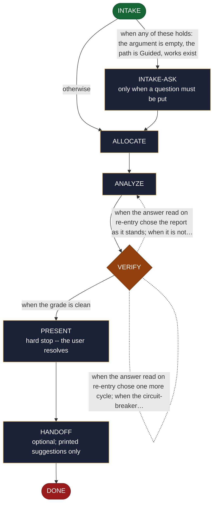

<!-- generated — do not edit; source: canonical/skills/aid-report/SKILL.md -->

## Frontmatter

- **`name`** — aid-report
- **`description`** — Analyse data or usage into an insight report. Use when the user needs the data or usage explained.
- **`allowed-tools`** — Read Glob Grep Bash Shell Terminal Write Edit Agent
- **`argument-hint`** — &lt;subject> -- the data/usage to analyze (a dataset, logs, metrics, an A/B result)

[Definition: `canonical/skills/aid-report/SKILL.md`](https://github.com/AndreVianna/aid-methodology/blob/master/canonical/skills/aid-report/SKILL.md)

## Flow

## Source fragments

Every node in the chart above, in chart order, with the exact `canonical/` text it was derived from.

**1 · `INTAKE`** · _entry_

~~~~plaintext title="canonical/skills/aid-report/SKILL.md#L36-L38" wrap
## State: INTAKE

INTAKE and INTAKE-ASK run before the work record exists, so they save no steps (`skill-steps.md`, § Before a work exists). Their questions are recorded in a design document under `.aid/design/`, not in a work record.
~~~~

[Source: `canonical/skills/aid-report/SKILL.md#L36-L38`](https://github.com/AndreVianna/aid-methodology/blob/master/canonical/skills/aid-report/SKILL.md#L36-L38) · [full step: `canonical/skills/aid-report/SKILL.md#L36-L52`](https://github.com/AndreVianna/aid-methodology/blob/master/canonical/skills/aid-report/SKILL.md#L36-L52)

**2 · `INTAKE-ASK`** — only when a question must be put · _step_

~~~~plaintext title="canonical/skills/aid-report/SKILL.md#L56-L58" wrap
## State: INTAKE-ASK  (only when a question must be put)

Ask one topic at a time, through the question protocol, in this order and only for what applies:
~~~~

[Source: `canonical/skills/aid-report/SKILL.md#L56-L58`](https://github.com/AndreVianna/aid-methodology/blob/master/canonical/skills/aid-report/SKILL.md#L56-L58) · [full step: `canonical/skills/aid-report/SKILL.md#L56-L82`](https://github.com/AndreVianna/aid-methodology/blob/master/canonical/skills/aid-report/SKILL.md#L56-L82)

**3 · `ALLOCATE`** · _step_

~~~~plaintext title="canonical/skills/aid-report/SKILL.md#L86-L89" wrap
## State: ALLOCATE

Allocate the work through the gate: the Work Initiation Gate
(`.aid/runtime/templates/work-initiation-gate.md`).
~~~~

[Source: `canonical/skills/aid-report/SKILL.md#L86-L89`](https://github.com/AndreVianna/aid-methodology/blob/master/canonical/skills/aid-report/SKILL.md#L86-L89) · [full step: `canonical/skills/aid-report/SKILL.md#L86-L103`](https://github.com/AndreVianna/aid-methodology/blob/master/canonical/skills/aid-report/SKILL.md#L86-L103)

**4 · `ANALYZE`** · _step_

~~~~plaintext title="canonical/skills/aid-report/SKILL.md#L107-L110" wrap
## State: ANALYZE

Access the data **read-only** and dispatch **`aid-researcher`** (clean context, tiered) to
analyze + consolidate:
~~~~

[Source: `canonical/skills/aid-report/SKILL.md#L107-L110`](https://github.com/AndreVianna/aid-methodology/blob/master/canonical/skills/aid-report/SKILL.md#L107-L110) · [full step: `canonical/skills/aid-report/SKILL.md#L107-L124`](https://github.com/AndreVianna/aid-methodology/blob/master/canonical/skills/aid-report/SKILL.md#L107-L124)

**5 · `VERIFY`** · _decision_

~~~~plaintext title="canonical/skills/aid-report/SKILL.md#L128-L147" wrap
## State: VERIFY

1. **Mechanical grounding check** (no dispatch): findings cite the data; external claims a
   URL+date; the **Caveats** and **Conflicts** sections exist.
2. **Adversarial verification** -- clean-context **`aid-reviewer`** checks `REPORT.md`:
   findings supported by the data; **no metric or A/B conclusion stated without its caveat**
   (sampling, significance, denominator, confounders); conflicts surfaced with reasons;
   conclusions not overstated into resolutions. Writes a review-quality ledger to
   `.aid/.temp/review-pending/<work>-verify.md`.
3. **Grade:** `bash .aid/runtime/scripts/grade.sh --explain <ledger>`. Not clean -> loop
   to ANALYZE. Circuit-breaker: 3 cycles -> IMPEDIMENT, and the lifecycle set to `Blocked` through the writer. Then
   name the open finding in plain words and ask one question in the form (`Report -- question 1 of 1 --
   importance: high`, **Why I ask**: the verify loop stopped after 3 cycles, **My recommendation**, numbered
   options: one more analysis cycle / present the report as it stands with the open finding noted, and the
   question closing line), recorded with `--ask` before it is shown. The work stays `Blocked` and this run
   ends on the question. Its answer is applied when the user resumes the work, not in this run: the resumed
   run shows the open question first, records the reply with `--answer`, and sets the lifecycle back to
   `Running` through the writer. VERIFY is entered again, reads that answer before anything else, and
   dispatches nothing. One more cycle goes to ANALYZE, the other option to PRESENT. A skipped question
   leaves the work `Blocked`.
~~~~

[Source: `canonical/skills/aid-report/SKILL.md#L128-L147`](https://github.com/AndreVianna/aid-methodology/blob/master/canonical/skills/aid-report/SKILL.md#L128-L147) · [full step: `canonical/skills/aid-report/SKILL.md#L128-L149`](https://github.com/AndreVianna/aid-methodology/blob/master/canonical/skills/aid-report/SKILL.md#L128-L149)

**6 · `PRESENT`** — hard stop -- the user resolves · _step_

~~~~plaintext title="canonical/skills/aid-report/SKILL.md#L153-L159" wrap
## State: PRESENT  (hard stop -- the user resolves)

The hard stop follows the ASK step of `skill-steps.md`. Present `REPORT.md` clearly: findings
(metrics/tables), conclusions (+/-), **caveats & data-quality gaps** (first-class),
conflicts with reasons, and gaps. Assert no resolution. The turn ends with the HANDOFF question below,
in the form and recorded with `--ask` before the message is sent, never with an open line such as
"do you want to follow up on this report?".
~~~~

[Source: `canonical/skills/aid-report/SKILL.md#L153-L159`](https://github.com/AndreVianna/aid-methodology/blob/master/canonical/skills/aid-report/SKILL.md#L153-L159) · [full step: `canonical/skills/aid-report/SKILL.md#L153-L161`](https://github.com/AndreVianna/aid-methodology/blob/master/canonical/skills/aid-report/SKILL.md#L153-L161)

**7 · `HANDOFF`** — optional; printed suggestions only · _step_

~~~~plaintext title="canonical/skills/aid-report/SKILL.md#L165-L176" wrap
## State: HANDOFF  (optional; printed suggestions only)

Printed suggestions the user may act on: make it recurring (`/aid-create-dashboard`), record
a decision (`/aid-document-decision`), act on a conclusion (`/aid-create*` / `/aid-update*`),
or comment on a source ticket (`/aid-update-ticket comment [<connector>:]<ticket-id> <text>`).
Never auto-invoked; never a resolution. Ask which one, if any, the user takes, as one question in the
form of `.aid/runtime/templates/question-protocol.md` (`Report -- question 1 of 1 -- importance: low`,
**Why I ask**, **My recommendation**, numbered options with the recommended one first, and the closing
line). Give the recommendation's reason: when only a report was requested, keeping it one-time meets
that request without committing the user to ongoing work. Record it with `writeback-state.sh --ask --category Report --impact Low --context '<the question>' --suggested '<the recommendation>' --asked-by aid-report` before it is shown, and the reply with
`--answer --id Q<n> --state <Answered|Skipped> --value '<the answer>'`; a picked suggestion is named in
one plain line.
~~~~

[Source: `canonical/skills/aid-report/SKILL.md#L165-L176`](https://github.com/AndreVianna/aid-methodology/blob/master/canonical/skills/aid-report/SKILL.md#L165-L176) · [full step: `canonical/skills/aid-report/SKILL.md#L165-L178`](https://github.com/AndreVianna/aid-methodology/blob/master/canonical/skills/aid-report/SKILL.md#L165-L178)

**8 · `DONE`** · _exit_ · HALT

~~~~plaintext title="canonical/skills/aid-report/SKILL.md#L182-L184" wrap
## State: DONE

Finish through the writer: `bash .aid/runtime/scripts/execute/writeback-state.sh --pipeline --field Lifecycle --value Completed`, which also clears the saved skill and step. Keep the work folder (`REPORT.md`, the verify ledger) as the audit record.
~~~~

[Source: `canonical/skills/aid-report/SKILL.md#L182-L184`](https://github.com/AndreVianna/aid-methodology/blob/master/canonical/skills/aid-report/SKILL.md#L182-L184) · [full step: `canonical/skills/aid-report/SKILL.md#L182-L186`](https://github.com/AndreVianna/aid-methodology/blob/master/canonical/skills/aid-report/SKILL.md#L182-L186)
