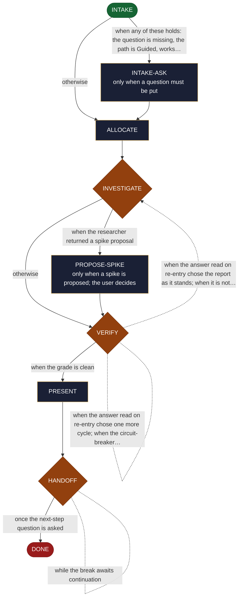

<!-- generated — do not edit; source: canonical/skills/aid-research/SKILL.md -->

## Frontmatter

- **`name`** — aid-research
- **`description`** — Investigate an open technical question and weigh its options. Use when options must be weighed before a choice is made.
- **`allowed-tools`** — Read Glob Grep Bash Shell Terminal Write Edit Agent
- **`argument-hint`** — &lt;question> -- an open technical question to investigate

[Definition: `canonical/skills/aid-research/SKILL.md`](https://github.com/AndreVianna/aid-methodology/blob/master/canonical/skills/aid-research/SKILL.md)

## Flow

## Source fragments

Every node in the chart above, in chart order, with the exact `canonical/` text it was derived from.

**1 · `INTAKE`** · _entry_

~~~~plaintext title="canonical/skills/aid-research/SKILL.md#L39-L41" wrap
## State: INTAKE

INTAKE and INTAKE-ASK run before the work record exists, so they save no steps (`skill-steps.md`, § Before a work exists). Their questions are recorded in a design document under `.aid/design/`, not in a work record.
~~~~

[Source: `canonical/skills/aid-research/SKILL.md#L39-L41`](https://github.com/AndreVianna/aid-methodology/blob/master/canonical/skills/aid-research/SKILL.md#L39-L41) · [full step: `canonical/skills/aid-research/SKILL.md#L39-L59`](https://github.com/AndreVianna/aid-methodology/blob/master/canonical/skills/aid-research/SKILL.md#L39-L59)

**2 · `INTAKE-ASK`** — only when a question must be put · _step_

~~~~plaintext title="canonical/skills/aid-research/SKILL.md#L63-L65" wrap
## State: INTAKE-ASK  (only when a question must be put)

Ask one topic at a time, through the question protocol, in this order and only for what applies:
~~~~

[Source: `canonical/skills/aid-research/SKILL.md#L63-L65`](https://github.com/AndreVianna/aid-methodology/blob/master/canonical/skills/aid-research/SKILL.md#L63-L65) · [full step: `canonical/skills/aid-research/SKILL.md#L63-L80`](https://github.com/AndreVianna/aid-methodology/blob/master/canonical/skills/aid-research/SKILL.md#L63-L80)

**3 · `ALLOCATE`** · _step_

~~~~plaintext title="canonical/skills/aid-research/SKILL.md#L84-L87" wrap
## State: ALLOCATE

Allocate the work through the gate: the Work Initiation Gate
(`.aid/runtime/templates/work-initiation-gate.md`).
~~~~

[Source: `canonical/skills/aid-research/SKILL.md#L84-L87`](https://github.com/AndreVianna/aid-methodology/blob/master/canonical/skills/aid-research/SKILL.md#L84-L87) · [full step: `canonical/skills/aid-research/SKILL.md#L84-L101`](https://github.com/AndreVianna/aid-methodology/blob/master/canonical/skills/aid-research/SKILL.md#L84-L101)

**4 · `INVESTIGATE`** · _decision_

~~~~plaintext title="canonical/skills/aid-research/SKILL.md#L105-L108" wrap
## State: INVESTIGATE

Dispatch **`aid-researcher`** (clean context, model+effort from INTAKE Step 3) to gather
and curate the evidence:
~~~~

[Source: `canonical/skills/aid-research/SKILL.md#L105-L108`](https://github.com/AndreVianna/aid-methodology/blob/master/canonical/skills/aid-research/SKILL.md#L105-L108) · [full step: `canonical/skills/aid-research/SKILL.md#L105-L121`](https://github.com/AndreVianna/aid-methodology/blob/master/canonical/skills/aid-research/SKILL.md#L105-L121)

**5 · `PROPOSE-SPIKE`** — only when a spike is proposed; the user decides · _step_

~~~~plaintext title="canonical/skills/aid-research/SKILL.md#L125-L134" wrap
## State: PROPOSE-SPIKE  (only when a spike is proposed; the user decides)

Present *what* the spike would build, *where* (isolated in the work folder / opt-in worktree,
never touching production), and *what it would learn*. Then ask the user to authorize or decline it
as one approval question in the form of `.aid/runtime/templates/question-protocol.md`
(`{subject} -- question {n} of {m} -- importance: medium`, **Why I ask**: a spike writes code, so it needs your
go-ahead, **My recommendation**, and the closing line `Or answer in your own words, or ask me to explain.`).
Once the user answers: on **authorization** -> re-dispatch `aid-researcher` to write the
throwaway spike (isolated) and fold the finding into `RESEARCH.md`; on **decline** -> proceed
analytically and state the resulting limit in the Gaps section.
~~~~

[Source: `canonical/skills/aid-research/SKILL.md#L125-L134`](https://github.com/AndreVianna/aid-methodology/blob/master/canonical/skills/aid-research/SKILL.md#L125-L134) · [full step: `canonical/skills/aid-research/SKILL.md#L125-L139`](https://github.com/AndreVianna/aid-methodology/blob/master/canonical/skills/aid-research/SKILL.md#L125-L139)

**6 · `VERIFY`** — who reviews the researcher · _decision_

~~~~plaintext title="canonical/skills/aid-research/SKILL.md#L143-L158" wrap
## State: VERIFY  (who reviews the researcher)

1. **Mechanical grounding check** (no dispatch): every project claim carries a KB/source
   cite; every external claim a URL+date; the **Conflicts** and **Gaps** sections exist
   (empty-but-present is allowed; silently-omitted is not).
2. **Adversarial verification** -- dispatch a clean-context **`aid-reviewer`** to check
   `RESEARCH.md`: claims grounded and correctly attributed; conclusions evidence-backed
   and **not overstated into resolutions**; every KB<->web conflict surfaced with its
   reason; no material angle of the question left silently unaddressed. It writes a
   review-quality 7-column ledger (`reviewer-ledger-schema.md`) to
   `.aid/.temp/review-pending/<work>-verify.md`.
3. **Grade the response:** `bash .aid/runtime/scripts/grade.sh --explain <ledger>`. Not
   clean -> loop back to INVESTIGATE for the researcher to revise. **Circuit-breaker: 3
   cycles** -> write `.aid/works/{work}/IMPEDIMENT-research.md`, set the lifecycle to `Blocked` through the writer,
   and name the open finding in plain words. Then ask the one question that unblocks the work, in the
   form of `.aid/runtime/templates/question-protocol.md`, never as a bare "your call":
~~~~

[Source: `canonical/skills/aid-research/SKILL.md#L143-L158`](https://github.com/AndreVianna/aid-methodology/blob/master/canonical/skills/aid-research/SKILL.md#L143-L158) · [full step: `canonical/skills/aid-research/SKILL.md#L143-L175`](https://github.com/AndreVianna/aid-methodology/blob/master/canonical/skills/aid-research/SKILL.md#L143-L175)

**7 · `PRESENT`** · _step_

~~~~plaintext title="canonical/skills/aid-research/SKILL.md#L179-L186" wrap
## State: PRESENT

Present `RESEARCH.md` **clearly and simply**:
the in-depth answer, conclusions (positive **and** negative), conflicts/contradictions
**with their reasons**, and gaps. Tell the user explicitly that the choice is theirs; do not
resolve it for them. Negatives and gaps are first-class, never buried under positives.
Continue to HANDOFF below; its required
break, when due, takes precedence over ending this turn with a next-step question.
~~~~

[Source: `canonical/skills/aid-research/SKILL.md#L179-L186`](https://github.com/AndreVianna/aid-methodology/blob/master/canonical/skills/aid-research/SKILL.md#L179-L186) · [full step: `canonical/skills/aid-research/SKILL.md#L179-L188`](https://github.com/AndreVianna/aid-methodology/blob/master/canonical/skills/aid-research/SKILL.md#L179-L188)

**8 · `HANDOFF`** — optional; printed suggestions only · _decision_

~~~~plaintext title="canonical/skills/aid-research/SKILL.md#L192-L209" wrap
## State: HANDOFF  (optional; printed suggestions only)

Offer the natural next steps as **printed suggestions**, each requiring the user to act:
record an ADR (`/aid-document-decision` -> once landed, `/aid-create-document`), update the
KB (`/aid-update-kb`), act on a conclusion (`/aid-create*` / `/aid-update*`), or comment on
a source ticket (`/aid-update-ticket comment [<connector>:]<ticket-id> <text>`). Never
auto-invoked; never a resolution. On entry, read the saved detail: after a break was offered,
the user's continuation proceeds to the next-step question without repeating the report or break.
Otherwise check whether the preceding question group is complete or the subject changes. If so,
save HANDOFF with detail that the report was shown, the break is offered, and continuation asks
the next-step question; pause the lifecycle for that break and end the turn with the protocol's
break offer. The break has no question record. On continuation restore Running, then record and
ask the next-step question. Do not rename a group to bypass the break. Otherwise retain the
current subject and counter. Ask which step, if any, the user takes, in the form of
`.aid/runtime/templates/question-protocol.md`, using its subject grouping and break rules rather than
resetting the group for this step. Record it with
`writeback-state.sh --ask --category '<group subject>' --impact Low --context '<the question>' --suggested '<the recommendation>' --asked-by aid-research` before it is shown, and the reply with
`--answer --id Q<n> --state <Answered|Skipped> --value '<the answer>'`; a picked one is named in one plain line.
~~~~

[Source: `canonical/skills/aid-research/SKILL.md#L192-L209`](https://github.com/AndreVianna/aid-methodology/blob/master/canonical/skills/aid-research/SKILL.md#L192-L209) · [full step: `canonical/skills/aid-research/SKILL.md#L192-L211`](https://github.com/AndreVianna/aid-methodology/blob/master/canonical/skills/aid-research/SKILL.md#L192-L211)

**9 · `DONE`** · _exit_ · HALT

~~~~plaintext title="canonical/skills/aid-research/SKILL.md#L215-L217" wrap
## State: DONE

Finish through the writer: `bash .aid/runtime/scripts/execute/writeback-state.sh --pipeline --field Lifecycle --value Completed`, which also clears the saved skill and step. Keep the work folder (`RESEARCH.md`, any spike scratch, the verify ledger) as the audit record.
~~~~

[Source: `canonical/skills/aid-research/SKILL.md#L215-L217`](https://github.com/AndreVianna/aid-methodology/blob/master/canonical/skills/aid-research/SKILL.md#L215-L217) · [full step: `canonical/skills/aid-research/SKILL.md#L215-L219`](https://github.com/AndreVianna/aid-methodology/blob/master/canonical/skills/aid-research/SKILL.md#L215-L219)
