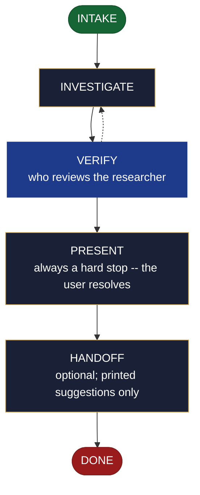

<!-- generated — do not edit; source: canonical/skills/aid-research/SKILL.md -->

## Frontmatter

- **`name`** — aid-research
- **`description`** — Investigate an open technical question and weigh its options. Use when options must be weighed before a choice is made.
- **`allowed-tools`** — Read Glob Grep Bash Shell Terminal Write Edit Agent
- **`argument-hint`** — &lt;question> -- an open technical question to investigate

[Definition: `canonical/skills/aid-research/SKILL.md`](https://github.com/AndreVianna/aid-methodology/blob/master/canonical/skills/aid-research/SKILL.md)

## Flow

## Source fragments

Every node in the chart above, in chart order, with the exact `canonical/` text it was derived from.

**1 · `INTAKE`** · _entry_

~~~~plaintext title="canonical/skills/aid-research/SKILL.md#L36-L62" wrap
## State: INTAKE

1. **Require a question.** If the argument is empty, ask one bootstrapping question ("What
   do you want investigated?") and wait.
2. **Pick the path (question scope):**
   - **Fast path** -- a concrete, well-scoped question with clear evaluation criteria
     ("Is lib X compatible with our Node 24 build?", "Postgres vs SQLite for use-case Y
     against criteria A/B/C") -> investigate immediately.
   - **Guided path** -- vague / broad / underspecified ("research our DB options") -> ask
     2-3 scoping questions first (narrow it), then investigate.
3. **Classify complexity (sets model + effort):** simple (bounded question, a few docs,
   <=1 web source) -> `aid-researcher` at **sonnet / medium**; standard/complex (broad
   options analysis, deep traversal, many web sources, a spike) -> **opus / high**.
   Verifier tier is always >= producer tier.
4. **Allocate the work through the gate.** Run the Work Initiation Gate
   (`.aid/runtime/templates/work-initiation-gate.md`): `bash .aid/runtime/scripts/works/enumerate-works.sh`
   (main tree + every git worktree). Empty -> no prompt. Works exist -> ask the gate's
   new-vs-continuation question with the enumerated list.
   - **New work:** call the gate's `§ 3a` with the user's words, this skill's name (`aid-research`),
     its first step (`INTAKE`), `--path lite`, and a kebab-case slug from the question. The gate's `§ 3a` step 2 creates and enters the worktree
     (`worktree-lifecycle.sh create <work-id> <name>`),
     **then** allocate (`.aid/works/<work-id>-<slug>/`) the work folder and write its record through
     the writer, before it hands back: "`STATE.yml` was created by the gate;
     skip any instruction to write `initiator`, `active_skill`, `lifecycle` or `phase` by hand;
     set other keys through the writer." This skill drives no `phase`. Associate a git worktree only
     if a spike is later authorized (INVESTIGATE).
   - **Continuation:** On continuation, follow the gate's § 3b: enter the chosen work's worktree and run the skill its record names, at its saved step.
~~~~

[Source: `canonical/skills/aid-research/SKILL.md#L36-L62`](https://github.com/AndreVianna/aid-methodology/blob/master/canonical/skills/aid-research/SKILL.md#L36-L62) · [full step: `canonical/skills/aid-research/SKILL.md#L36-L64`](https://github.com/AndreVianna/aid-methodology/blob/master/canonical/skills/aid-research/SKILL.md#L36-L64)

**2 · `INVESTIGATE`** · _step_

~~~~plaintext title="canonical/skills/aid-research/SKILL.md#L68-L71" wrap
## State: INVESTIGATE

Dispatch **`aid-researcher`** (clean context, model+effort from INTAKE Step 3) to gather
and curate the evidence:
~~~~

[Source: `canonical/skills/aid-research/SKILL.md#L68-L71`](https://github.com/AndreVianna/aid-methodology/blob/master/canonical/skills/aid-research/SKILL.md#L68-L71) · [full step: `canonical/skills/aid-research/SKILL.md#L68-L88`](https://github.com/AndreVianna/aid-methodology/blob/master/canonical/skills/aid-research/SKILL.md#L68-L88)

**3 · `VERIFY`** — who reviews the researcher · _loop-back_

~~~~plaintext title="canonical/skills/aid-research/SKILL.md#L92-L106" wrap
## State: VERIFY  (who reviews the researcher)

1. **Mechanical grounding check** (no dispatch): every project claim carries a KB/source
   cite; every external claim a URL+date; the **Conflicts** and **Gaps** sections exist
   (empty-but-present is allowed; silently-omitted is not).
2. **Adversarial verification** -- dispatch a clean-context **`aid-reviewer`** to check
   `RESEARCH.md`: claims grounded and correctly attributed; conclusions evidence-backed
   and **not overstated into resolutions**; every KB<->web conflict surfaced with its
   reason; no material angle of the question left silently unaddressed. It writes a
   review-quality 7-column ledger (`reviewer-ledger-schema.md`) to
   `.aid/.temp/review-pending/<work>-verify.md`.
3. **Grade the response:** `bash .aid/runtime/scripts/grade.sh --explain <ledger>`. Not
   clean -> loop back to INVESTIGATE for the researcher to revise. **Circuit-breaker: 3
   cycles** -> write `.aid/works/{work}/IMPEDIMENT-research.md`, and set the lifecycle to `Blocked` through the writer,
   surface it.
~~~~

[Source: `canonical/skills/aid-research/SKILL.md#L92-L106`](https://github.com/AndreVianna/aid-methodology/blob/master/canonical/skills/aid-research/SKILL.md#L92-L106) · [full step: `canonical/skills/aid-research/SKILL.md#L92-L110`](https://github.com/AndreVianna/aid-methodology/blob/master/canonical/skills/aid-research/SKILL.md#L92-L110)

**4 · `PRESENT`** — always a hard stop -- the user resolves · _step_

~~~~plaintext title="canonical/skills/aid-research/SKILL.md#L114-L119" wrap
## State: PRESENT  (always a hard stop -- the user resolves)

The hard stop follows the ASK step of `skill-steps.md`. Present `RESEARCH.md` **clearly and simply**:
the in-depth answer, conclusions (positive **and** negative), conflicts/contradictions
**with their reasons**, and gaps. Assert no resolution -- the user decides. Negatives and
gaps are first-class, never buried under positives.
~~~~

[Source: `canonical/skills/aid-research/SKILL.md#L114-L119`](https://github.com/AndreVianna/aid-methodology/blob/master/canonical/skills/aid-research/SKILL.md#L114-L119) · [full step: `canonical/skills/aid-research/SKILL.md#L114-L121`](https://github.com/AndreVianna/aid-methodology/blob/master/canonical/skills/aid-research/SKILL.md#L114-L121)

**5 · `HANDOFF`** — optional; printed suggestions only · _step_

~~~~plaintext title="canonical/skills/aid-research/SKILL.md#L125-L131" wrap
## State: HANDOFF  (optional; printed suggestions only)

Offer the natural next steps as **printed suggestions**, each requiring the user to act:
record an ADR (`/aid-document-decision` -> once landed, `/aid-create-document`), update the
KB (`/aid-update-kb`), act on a conclusion (`/aid-create*` / `/aid-update*`), or comment on
a source ticket (`/aid-update-ticket comment [<connector>:]<ticket-id> <text>`). Never
auto-invoked; never a resolution.
~~~~

[Source: `canonical/skills/aid-research/SKILL.md#L125-L131`](https://github.com/AndreVianna/aid-methodology/blob/master/canonical/skills/aid-research/SKILL.md#L125-L131) · [full step: `canonical/skills/aid-research/SKILL.md#L125-L133`](https://github.com/AndreVianna/aid-methodology/blob/master/canonical/skills/aid-research/SKILL.md#L125-L133)

**6 · `DONE`** · _exit_ · HALT

~~~~plaintext title="canonical/skills/aid-research/SKILL.md#L137-L139" wrap
## State: DONE

Finish through the writer: `bash .aid/runtime/scripts/execute/writeback-state.sh --pipeline --field Lifecycle --value Completed`, which also clears the saved skill and step. Keep the work folder (`RESEARCH.md`, any spike scratch, the verify ledger) as the audit record.
~~~~

[Source: `canonical/skills/aid-research/SKILL.md#L137-L139`](https://github.com/AndreVianna/aid-methodology/blob/master/canonical/skills/aid-research/SKILL.md#L137-L139) · [full step: `canonical/skills/aid-research/SKILL.md#L137-L141`](https://github.com/AndreVianna/aid-methodology/blob/master/canonical/skills/aid-research/SKILL.md#L137-L141)
