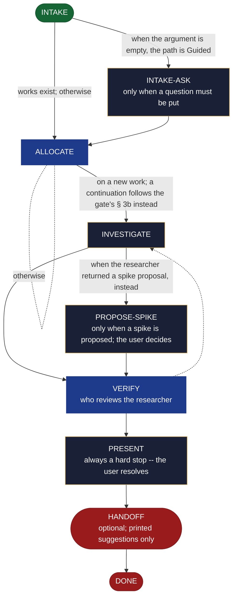

<!-- generated — do not edit; source: canonical/skills/aid-research/SKILL.md -->

## Frontmatter

- **`name`** — aid-research
- **`description`** — Investigate an open technical question and weigh its options. Use when options must be weighed before a choice is made.
- **`allowed-tools`** — Read Glob Grep Bash Shell Terminal Write Edit Agent
- **`argument-hint`** — &lt;question> -- an open technical question to investigate

[Definition: `canonical/skills/aid-research/SKILL.md`](https://github.com/AndreVianna/aid-methodology/blob/master/canonical/skills/aid-research/SKILL.md)

## Flow

## Source fragments

Every node in the chart above, in chart order, with the exact `canonical/` text it was derived from.

**1 · `INTAKE`** · _entry_

~~~~plaintext title="canonical/skills/aid-research/SKILL.md#L36-L50" wrap
## State: INTAKE

1. **Check the question.** Note whether the argument is empty. Do not ask here.
2. **Pick the path (question scope):**
   - **Fast path** -- a concrete, well-scoped question with clear evaluation criteria
     ("Is lib X compatible with our Node 24 build?", "Postgres vs SQLite for use-case Y
     against criteria A/B/C") -> investigate immediately.
   - **Guided path** -- vague / broad / underspecified ("research our DB options") -> narrow
     it first in INTAKE-ASK (2-3 scoping questions), then investigate.
3. **Classify complexity (sets model + effort):** simple (bounded question, a few docs,
   <=1 web source) -> `aid-researcher` at **sonnet / medium**; standard/complex (broad
   options analysis, deep traversal, many web sources, a spike) -> **opus / high**.
   Verifier tier is always >= producer tier.
4. **Check for works.** Run `bash .aid/runtime/scripts/works/enumerate-works.sh`
   (main tree + every git worktree). Note whether any exist. Do not prompt here.
~~~~

[Source: `canonical/skills/aid-research/SKILL.md#L36-L50`](https://github.com/AndreVianna/aid-methodology/blob/master/canonical/skills/aid-research/SKILL.md#L36-L50) · [full step: `canonical/skills/aid-research/SKILL.md#L36-L53`](https://github.com/AndreVianna/aid-methodology/blob/master/canonical/skills/aid-research/SKILL.md#L36-L53)

**2 · `INTAKE-ASK`** — only when a question must be put · _step_

~~~~plaintext title="canonical/skills/aid-research/SKILL.md#L57-L59" wrap
## State: INTAKE-ASK  (only when a question must be put)

Ask one topic at a time, through the question protocol, in this order and only for what applies:
~~~~

[Source: `canonical/skills/aid-research/SKILL.md#L57-L59`](https://github.com/AndreVianna/aid-methodology/blob/master/canonical/skills/aid-research/SKILL.md#L57-L59) · [full step: `canonical/skills/aid-research/SKILL.md#L57-L66`](https://github.com/AndreVianna/aid-methodology/blob/master/canonical/skills/aid-research/SKILL.md#L57-L66)

**3 · `ALLOCATE`** · _loop-back_

~~~~plaintext title="canonical/skills/aid-research/SKILL.md#L70-L73" wrap
## State: ALLOCATE

Allocate the work through the gate: the Work Initiation Gate
(`.aid/runtime/templates/work-initiation-gate.md`).
~~~~

[Source: `canonical/skills/aid-research/SKILL.md#L70-L73`](https://github.com/AndreVianna/aid-methodology/blob/master/canonical/skills/aid-research/SKILL.md#L70-L73) · [full step: `canonical/skills/aid-research/SKILL.md#L70-L86`](https://github.com/AndreVianna/aid-methodology/blob/master/canonical/skills/aid-research/SKILL.md#L70-L86)

**4 · `INVESTIGATE`** · _step_

~~~~plaintext title="canonical/skills/aid-research/SKILL.md#L90-L93" wrap
## State: INVESTIGATE

Dispatch **`aid-researcher`** (clean context, model+effort from INTAKE Step 3) to gather
and curate the evidence:
~~~~

[Source: `canonical/skills/aid-research/SKILL.md#L90-L93`](https://github.com/AndreVianna/aid-methodology/blob/master/canonical/skills/aid-research/SKILL.md#L90-L93) · [full step: `canonical/skills/aid-research/SKILL.md#L90-L107`](https://github.com/AndreVianna/aid-methodology/blob/master/canonical/skills/aid-research/SKILL.md#L90-L107)

**5 · `PROPOSE-SPIKE`** — only when a spike is proposed; the user decides · _step_

~~~~plaintext title="canonical/skills/aid-research/SKILL.md#L111-L117" wrap
## State: PROPOSE-SPIKE  (only when a spike is proposed; the user decides)

Present *what* the spike would build, *where* (isolated in the work folder / opt-in worktree,
never touching production), and *what it would learn*. Ask the user to authorize or decline it.
Once the user answers: on **authorization** -> re-dispatch `aid-researcher` to write the
throwaway spike (isolated) and fold the finding into `RESEARCH.md`; on **decline** -> proceed
analytically and state the resulting limit in the Gaps section.
~~~~

[Source: `canonical/skills/aid-research/SKILL.md#L111-L117`](https://github.com/AndreVianna/aid-methodology/blob/master/canonical/skills/aid-research/SKILL.md#L111-L117) · [full step: `canonical/skills/aid-research/SKILL.md#L111-L119`](https://github.com/AndreVianna/aid-methodology/blob/master/canonical/skills/aid-research/SKILL.md#L111-L119)

**6 · `VERIFY`** — who reviews the researcher · _loop-back_

~~~~plaintext title="canonical/skills/aid-research/SKILL.md#L123-L137" wrap
## State: VERIFY  (who reviews the researcher)

1. **Mechanical grounding check** (no dispatch): every project claim carries a KB/source
   cite; every external claim a URL+date; the **Conflicts** and **Gaps** sections exist
   (empty-but-present is allowed; silently-omitted is not).
2. **Adversarial verification** -- dispatch a clean-context **`aid-reviewer`** to check
   `RESEARCH.md`: claims grounded and correctly attributed; conclusions evidence-backed
   and **not overstated into resolutions**; every KB<->web conflict surfaced with its
   reason; no material angle of the question left silently unaddressed. It writes a
   review-quality 7-column ledger (`reviewer-ledger-schema.md`) to
   `.aid/.temp/review-pending/<work>-verify.md`.
3. **Grade the response:** `bash .aid/runtime/scripts/grade.sh --explain <ledger>`. Not
   clean -> loop back to INVESTIGATE for the researcher to revise. **Circuit-breaker: 3
   cycles** -> write `.aid/works/{work}/IMPEDIMENT-research.md`, and set the lifecycle to `Blocked` through the writer,
   surface it.
~~~~

[Source: `canonical/skills/aid-research/SKILL.md#L123-L137`](https://github.com/AndreVianna/aid-methodology/blob/master/canonical/skills/aid-research/SKILL.md#L123-L137) · [full step: `canonical/skills/aid-research/SKILL.md#L123-L141`](https://github.com/AndreVianna/aid-methodology/blob/master/canonical/skills/aid-research/SKILL.md#L123-L141)

**7 · `PRESENT`** — always a hard stop -- the user resolves · _step_

~~~~plaintext title="canonical/skills/aid-research/SKILL.md#L145-L150" wrap
## State: PRESENT  (always a hard stop -- the user resolves)

The hard stop follows the ASK step of `skill-steps.md`. Present `RESEARCH.md` **clearly and simply**:
the in-depth answer, conclusions (positive **and** negative), conflicts/contradictions
**with their reasons**, and gaps. Assert no resolution -- the user decides. Negatives and
gaps are first-class, never buried under positives.
~~~~

[Source: `canonical/skills/aid-research/SKILL.md#L145-L150`](https://github.com/AndreVianna/aid-methodology/blob/master/canonical/skills/aid-research/SKILL.md#L145-L150) · [full step: `canonical/skills/aid-research/SKILL.md#L145-L152`](https://github.com/AndreVianna/aid-methodology/blob/master/canonical/skills/aid-research/SKILL.md#L145-L152)

**8 · `HANDOFF`** — optional; printed suggestions only · _exit_ · ASK

~~~~plaintext title="canonical/skills/aid-research/SKILL.md#L156-L163" wrap
## State: HANDOFF  (optional; printed suggestions only)

Offer the natural next steps as **printed suggestions**, each requiring the user to act:
record an ADR (`/aid-document-decision` -> once landed, `/aid-create-document`), update the
KB (`/aid-update-kb`), act on a conclusion (`/aid-create*` / `/aid-update*`), or comment on
a source ticket (`/aid-update-ticket comment [<connector>:]<ticket-id> <text>`). Never
auto-invoked; never a resolution. Ask which one, if any, the user takes; a picked one is named
in one plain line.
~~~~

[Source: `canonical/skills/aid-research/SKILL.md#L156-L163`](https://github.com/AndreVianna/aid-methodology/blob/master/canonical/skills/aid-research/SKILL.md#L156-L163) · [full step: `canonical/skills/aid-research/SKILL.md#L156-L165`](https://github.com/AndreVianna/aid-methodology/blob/master/canonical/skills/aid-research/SKILL.md#L156-L165)

**9 · `DONE`** · _exit_ · HALT

~~~~plaintext title="canonical/skills/aid-research/SKILL.md#L169-L171" wrap
## State: DONE

Finish through the writer: `bash .aid/runtime/scripts/execute/writeback-state.sh --pipeline --field Lifecycle --value Completed`, which also clears the saved skill and step. Keep the work folder (`RESEARCH.md`, any spike scratch, the verify ledger) as the audit record.
~~~~

[Source: `canonical/skills/aid-research/SKILL.md#L169-L171`](https://github.com/AndreVianna/aid-methodology/blob/master/canonical/skills/aid-research/SKILL.md#L169-L171) · [full step: `canonical/skills/aid-research/SKILL.md#L169-L173`](https://github.com/AndreVianna/aid-methodology/blob/master/canonical/skills/aid-research/SKILL.md#L169-L173)
