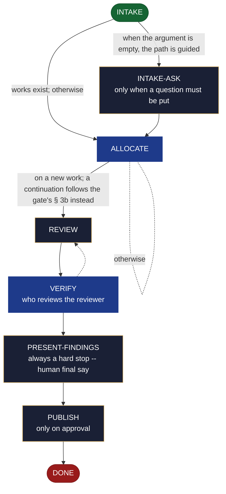

<!-- generated — do not edit; source: canonical/skills/aid-review/SKILL.md -->

## Frontmatter

- **`name`** — aid-review
- **`description`** — Review code, a change or a design against criteria. Use when a review is asked for.
- **`allowed-tools`** — Read Glob Grep Bash Shell Terminal Write Edit Agent
- **`argument-hint`** — [target] -- what to review (a file/dir, PR link, ticket id, work-NNN, 'my changes', or a described target)

[Definition: `canonical/skills/aid-review/SKILL.md`](https://github.com/AndreVianna/aid-methodology/blob/master/canonical/skills/aid-review/SKILL.md)

## Flow

## Source fragments

Every node in the chart above, in chart order, with the exact `canonical/` text it was derived from.

**1 · `INTAKE`** · _entry_

~~~~plaintext title="canonical/skills/aid-review/SKILL.md#L36-L38" wrap
## State: INTAKE

Purpose: resolve the target + criteria, pick the path, note the works.
~~~~

[Source: `canonical/skills/aid-review/SKILL.md#L36-L38`](https://github.com/AndreVianna/aid-methodology/blob/master/canonical/skills/aid-review/SKILL.md#L36-L38) · [full step: `canonical/skills/aid-review/SKILL.md#L36-L92`](https://github.com/AndreVianna/aid-methodology/blob/master/canonical/skills/aid-review/SKILL.md#L36-L92)

**2 · `INTAKE-ASK`** — only when a question must be put · _step_

~~~~plaintext title="canonical/skills/aid-review/SKILL.md#L96-L98" wrap
## State: INTAKE-ASK  (only when a question must be put)

Ask one topic at a time, through the question protocol, in this order and only for what applies:
~~~~

[Source: `canonical/skills/aid-review/SKILL.md#L96-L98`](https://github.com/AndreVianna/aid-methodology/blob/master/canonical/skills/aid-review/SKILL.md#L96-L98) · [full step: `canonical/skills/aid-review/SKILL.md#L96-L105`](https://github.com/AndreVianna/aid-methodology/blob/master/canonical/skills/aid-review/SKILL.md#L96-L105)

**3 · `ALLOCATE`** · _loop-back_

~~~~plaintext title="canonical/skills/aid-review/SKILL.md#L109-L111" wrap
## State: ALLOCATE

Allocate through the Work Initiation Gate (`.aid/runtime/templates/work-initiation-gate.md`).
~~~~

[Source: `canonical/skills/aid-review/SKILL.md#L109-L111`](https://github.com/AndreVianna/aid-methodology/blob/master/canonical/skills/aid-review/SKILL.md#L109-L111) · [full step: `canonical/skills/aid-review/SKILL.md#L109-L124`](https://github.com/AndreVianna/aid-methodology/blob/master/canonical/skills/aid-review/SKILL.md#L109-L124)

**4 · `REVIEW`** · _step_

~~~~plaintext title="canonical/skills/aid-review/SKILL.md#L128-L130" wrap
## State: REVIEW

Purpose: gather evidence and produce the grounded findings ledger.
~~~~

[Source: `canonical/skills/aid-review/SKILL.md#L128-L130`](https://github.com/AndreVianna/aid-methodology/blob/master/canonical/skills/aid-review/SKILL.md#L128-L130) · [full step: `canonical/skills/aid-review/SKILL.md#L128-L149`](https://github.com/AndreVianna/aid-methodology/blob/master/canonical/skills/aid-review/SKILL.md#L128-L149)

**5 · `VERIFY`** — who reviews the reviewer · _loop-back_

~~~~plaintext title="canonical/skills/aid-review/SKILL.md#L153-L155" wrap
## State: VERIFY  (who reviews the reviewer)

Purpose: ensure the review is grounded, correct, and complete before the human sees it.
~~~~

[Source: `canonical/skills/aid-review/SKILL.md#L153-L155`](https://github.com/AndreVianna/aid-methodology/blob/master/canonical/skills/aid-review/SKILL.md#L153-L155) · [full step: `canonical/skills/aid-review/SKILL.md#L153-L173`](https://github.com/AndreVianna/aid-methodology/blob/master/canonical/skills/aid-review/SKILL.md#L153-L173)

**6 · `PRESENT-FINDINGS`** — always a hard stop -- human final say · _step_

~~~~plaintext title="canonical/skills/aid-review/SKILL.md#L177-L179" wrap
## State: PRESENT-FINDINGS  (always a hard stop -- human final say)

The hard stop follows the ASK step of `skill-steps.md`. Present:
~~~~

[Source: `canonical/skills/aid-review/SKILL.md#L177-L179`](https://github.com/AndreVianna/aid-methodology/blob/master/canonical/skills/aid-review/SKILL.md#L177-L179) · [full step: `canonical/skills/aid-review/SKILL.md#L177-L190`](https://github.com/AndreVianna/aid-methodology/blob/master/canonical/skills/aid-review/SKILL.md#L177-L190)

**7 · `PUBLISH`** — only on approval · _step_

~~~~plaintext title="canonical/skills/aid-review/SKILL.md#L194-L204" wrap
## State: PUBLISH  (only on approval)

If the user did not approve publishing, nothing is posted: the step goes on to DONE. Otherwise
deliver by the method appropriate to the target, chosen by judgment (not a hardcoded
enum): a PR comment via `gh`; a ticket comment via `/aid-update-ticket comment
[<connector>:]<ticket-id> <text>` (still user-authorized -- the approval just given at
PRESENT-FINDINGS is what authorizes this call, and the skill previews the exact payload again
at its own CONFIRM before posting); a findings report in the work folder (+ optional
inline-comment suggestions) for code; inline notes for a document. **Graceful fallback:** no PR /
no catalogued connector / unknown target -> present the exact text for the human to paste.
Publishing is optional and never blocks DONE.
~~~~

[Source: `canonical/skills/aid-review/SKILL.md#L194-L204`](https://github.com/AndreVianna/aid-methodology/blob/master/canonical/skills/aid-review/SKILL.md#L194-L204) · [full step: `canonical/skills/aid-review/SKILL.md#L194-L206`](https://github.com/AndreVianna/aid-methodology/blob/master/canonical/skills/aid-review/SKILL.md#L194-L206)

**8 · `DONE`** · _exit_ · HALT

~~~~plaintext title="canonical/skills/aid-review/SKILL.md#L210-L212" wrap
## State: DONE

Finish through the writer: `bash .aid/runtime/scripts/execute/writeback-state.sh --pipeline --field Lifecycle --value Completed`, which also clears the saved skill and step. Leave the findings ledger on disk (`.aid/.temp/review-pending/<work>-review.md`) so a follow-up `/aid-fix` can consume it. Keep the work folder as the audit record.
~~~~

[Source: `canonical/skills/aid-review/SKILL.md#L210-L212`](https://github.com/AndreVianna/aid-methodology/blob/master/canonical/skills/aid-review/SKILL.md#L210-L212) · [full step: `canonical/skills/aid-review/SKILL.md#L210-L214`](https://github.com/AndreVianna/aid-methodology/blob/master/canonical/skills/aid-review/SKILL.md#L210-L214)
