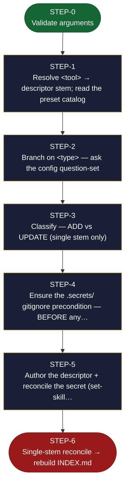

<!-- generated — do not edit; source: canonical/skills/aid-set-connector/SKILL.md -->

## Frontmatter

- **`name`** — aid-set-connector
- **`description`** — Add or change a connector to a tracker or tool. Use when you are connecting a tracker or tool to the project.
- **`allowed-tools`** — Read Glob Grep Bash Shell Terminal Write Edit AskUserQuestion
- **`argument-hint`** — &lt;tool> &lt;type> [--rotate-secret]  -- e.g. aid-set-connector Jira mcp   (type: mcp|api|ssh|cli)

[Definition: `canonical/skills/aid-set-connector/SKILL.md`](https://github.com/AndreVianna/aid-methodology/blob/master/canonical/skills/aid-set-connector/SKILL.md)

## Flow

> **Approximate:** This chart is derived by heuristic; exact transitions may differ from runtime behaviour.

## Source fragments

Every node in the chart above, in chart order, with the exact `canonical/` text it was derived from.

**1 · `STEP-0`** — Validate arguments · _entry_

~~~~plaintext title="canonical/skills/aid-set-connector/SKILL.md#L36" wrap
### Step 0: Validate arguments
~~~~

[Source: `canonical/skills/aid-set-connector/SKILL.md#L36`](https://github.com/AndreVianna/aid-methodology/blob/master/canonical/skills/aid-set-connector/SKILL.md#L36)

**2 · `STEP-1`** — Resolve &lt;tool> → descriptor stem; read the preset catalog · _step_

~~~~plaintext title="canonical/skills/aid-set-connector/SKILL.md#L62" wrap
## Step 1: Resolve `<tool>` → descriptor stem; read the preset catalog
~~~~

[Source: `canonical/skills/aid-set-connector/SKILL.md#L62`](https://github.com/AndreVianna/aid-methodology/blob/master/canonical/skills/aid-set-connector/SKILL.md#L62)

**3 · `STEP-2`** — Branch on &lt;type> — ask the config question-set · _step_

~~~~plaintext title="canonical/skills/aid-set-connector/SKILL.md#L87" wrap
## Step 2: Branch on `<type>` — ask the config question-set
~~~~

[Source: `canonical/skills/aid-set-connector/SKILL.md#L87`](https://github.com/AndreVianna/aid-methodology/blob/master/canonical/skills/aid-set-connector/SKILL.md#L87)

**4 · `STEP-3`** — Classify — ADD vs UPDATE (single stem only) · _step_

~~~~plaintext title="canonical/skills/aid-set-connector/SKILL.md#L108" wrap
## Step 3: Classify — ADD vs UPDATE (single stem only)
~~~~

[Source: `canonical/skills/aid-set-connector/SKILL.md#L108`](https://github.com/AndreVianna/aid-methodology/blob/master/canonical/skills/aid-set-connector/SKILL.md#L108)

**5 · `STEP-4`** — Ensure the .secrets/ gitignore precondition — BEFORE any… · _step_

~~~~plaintext title="canonical/skills/aid-set-connector/SKILL.md#L130" wrap
## Step 4: Ensure the `.secrets/` gitignore precondition — BEFORE any write under `.aid/connectors/`
~~~~

[Source: `canonical/skills/aid-set-connector/SKILL.md#L130`](https://github.com/AndreVianna/aid-methodology/blob/master/canonical/skills/aid-set-connector/SKILL.md#L130)

**6 · `STEP-5`** — Author the descriptor + reconcile the secret (set-skill… · _step_

~~~~plaintext title="canonical/skills/aid-set-connector/SKILL.md#L152" wrap
## Step 5: Author the descriptor + reconcile the secret (set-skill logic)
~~~~

[Source: `canonical/skills/aid-set-connector/SKILL.md#L152`](https://github.com/AndreVianna/aid-methodology/blob/master/canonical/skills/aid-set-connector/SKILL.md#L152)

**7 · `STEP-6`** — Single-stem reconcile → rebuild INDEX.md · _exit_ · UNSPECIFIED

~~~~plaintext title="canonical/skills/aid-set-connector/SKILL.md#L196" wrap
## Step 6: Single-stem reconcile → rebuild `INDEX.md`
~~~~

[Source: `canonical/skills/aid-set-connector/SKILL.md#L196`](https://github.com/AndreVianna/aid-methodology/blob/master/canonical/skills/aid-set-connector/SKILL.md#L196)
