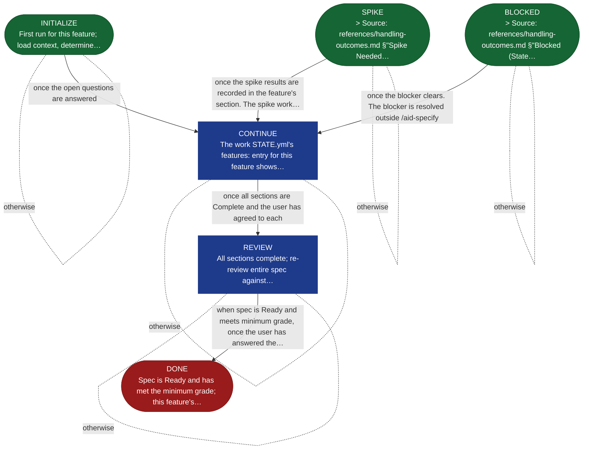

<!-- generated — do not edit; source: canonical/skills/aid-specify/SKILL.md -->

## Frontmatter

- **`name`** — aid-specify
- **`description`** — Write a feature's technical specification. Use when the features are defined and each one needs a specification.
- **`allowed-tools`** — Read Glob Grep Bash Shell Terminal Write Edit
- **`argument-hint`** — work-001/feature-001 (required)  [--reset] clear technical spec for this feature

[Definition: `canonical/skills/aid-specify/SKILL.md`](https://github.com/AndreVianna/aid-methodology/blob/master/canonical/skills/aid-specify/SKILL.md)

## Flow

## Source fragments

Every node in the chart above, in chart order, with the exact `canonical/` text it was derived from.

**1 · `INITIALIZE`** — First run for this feature; load context, determine… · _entry_

~~~~plaintext title="canonical/skills/aid-specify/SKILL.md#L224" wrap
| INITIALIZE | `references/state-initialize.md` | `aid-architect` | ASK → CONTINUE |
~~~~

[Source: `canonical/skills/aid-specify/SKILL.md#L224`](https://github.com/AndreVianna/aid-methodology/blob/master/canonical/skills/aid-specify/SKILL.md#L224) · [full step: `canonical/skills/aid-specify/references/state-initialize.md#L1-L144`](https://github.com/AndreVianna/aid-methodology/blob/master/canonical/skills/aid-specify/references/state-initialize.md#L1-L144)

**2 · `CONTINUE`** — The work STATE.yml's features: entry for this feature shows… · _loop-back_

~~~~plaintext title="canonical/skills/aid-specify/SKILL.md#L225" wrap
| CONTINUE | `references/state-continue.md` | `aid-architect` | ASK → REVIEW |
~~~~

[Source: `canonical/skills/aid-specify/SKILL.md#L225`](https://github.com/AndreVianna/aid-methodology/blob/master/canonical/skills/aid-specify/SKILL.md#L225) · [full step: `canonical/skills/aid-specify/references/state-continue.md#L1-L115`](https://github.com/AndreVianna/aid-methodology/blob/master/canonical/skills/aid-specify/references/state-continue.md#L1-L115)

**3 · `SPIKE`** — > Source: references/handling-outcomes.md §"Spike Needed… · _entry_

~~~~plaintext title="canonical/skills/aid-specify/SKILL.md#L226" wrap
| SPIKE | `references/state-spike.md` | `inline` | WAIT → CONTINUE |
~~~~

[Source: `canonical/skills/aid-specify/SKILL.md#L226`](https://github.com/AndreVianna/aid-methodology/blob/master/canonical/skills/aid-specify/SKILL.md#L226) · [full step: `canonical/skills/aid-specify/references/state-spike.md#L1-L20`](https://github.com/AndreVianna/aid-methodology/blob/master/canonical/skills/aid-specify/references/state-spike.md#L1-L20)

**4 · `BLOCKED`** — > Source: references/handling-outcomes.md §"Blocked (State… · _entry_

~~~~plaintext title="canonical/skills/aid-specify/SKILL.md#L227" wrap
| BLOCKED | `references/state-blocked.md` | `inline` | WAIT → CONTINUE |
~~~~

[Source: `canonical/skills/aid-specify/SKILL.md#L227`](https://github.com/AndreVianna/aid-methodology/blob/master/canonical/skills/aid-specify/SKILL.md#L227) · [full step: `canonical/skills/aid-specify/references/state-blocked.md#L1-L17`](https://github.com/AndreVianna/aid-methodology/blob/master/canonical/skills/aid-specify/references/state-blocked.md#L1-L17)

**5 · `REVIEW`** — All sections complete; re-review entire spec against… · _loop-back_

~~~~plaintext title="canonical/skills/aid-specify/SKILL.md#L228" wrap
| REVIEW | `references/state-review.md` | `aid-reviewer` | ASK → DONE |
~~~~

[Source: `canonical/skills/aid-specify/SKILL.md#L228`](https://github.com/AndreVianna/aid-methodology/blob/master/canonical/skills/aid-specify/SKILL.md#L228) · [full step: `canonical/skills/aid-specify/references/state-review.md#L1-L91`](https://github.com/AndreVianna/aid-methodology/blob/master/canonical/skills/aid-specify/references/state-review.md#L1-L91)

**6 · `DONE`** — Spec is Ready and has met the minimum grade; this feature's… · _exit_ · HALT

~~~~plaintext title="canonical/skills/aid-specify/SKILL.md#L229" wrap
| DONE | `references/state-done.md` | `inline` | HALT |
~~~~

[Source: `canonical/skills/aid-specify/SKILL.md#L229`](https://github.com/AndreVianna/aid-methodology/blob/master/canonical/skills/aid-specify/SKILL.md#L229) · [full step: `canonical/skills/aid-specify/references/state-done.md#L1-L20`](https://github.com/AndreVianna/aid-methodology/blob/master/canonical/skills/aid-specify/references/state-done.md#L1-L20)
