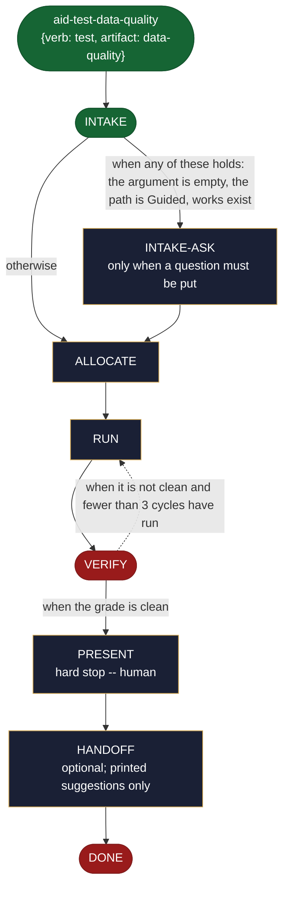

<!-- generated — do not edit; source: canonical/skills/aid-test-data-quality/SKILL.md -->

## Frontmatter

- **`name`** — aid-test-data-quality
- **`description`** — Run data-quality checks against thresholds and report -- schema, freshness, completeness, uniqueness. Use this skill when you need to know whether a dataset or pipeline is currently trustworthy. Read-only; it resolves nothing, and findings hand off to `/aid-fix`. A thin kind-sibling of `/aid-test`, which defines its full behavior.
- **`allowed-tools`** — Read Glob Grep Bash Shell Terminal Write Edit Agent
- **`argument-hint`** — &lt;dataset/pipeline + checks> -- the target and which checks (schema/freshness/completeness/uniqueness)

[Definition: `canonical/skills/aid-test-data-quality/SKILL.md`](https://github.com/AndreVianna/aid-methodology/blob/master/canonical/skills/aid-test-data-quality/SKILL.md)

## Flow

## Source fragments

Every node in the chart above, in chart order, with the exact `canonical/` text it was derived from.

**1 · `aid-test-data-quality`** — {verb: test, artifact: data-quality} · _entry_

~~~~plaintext title="canonical/skills/aid-test-data-quality/SKILL.md#L16" wrap
(`alias_of: null`, `{verb: test, artifact: data-quality}`), `repurpose: true`
~~~~

[Source: `canonical/skills/aid-test-data-quality/SKILL.md#L16`](https://github.com/AndreVianna/aid-methodology/blob/master/canonical/skills/aid-test-data-quality/SKILL.md#L16)

**2 · `INTAKE`** · _entry_

~~~~plaintext title="canonical/skills/aid-test/SKILL.md#L36-L38" wrap
## State: INTAKE

INTAKE and INTAKE-ASK run before the work record exists, so they save no steps (`skill-steps.md`, § Before a work exists).
~~~~

[Source: `canonical/skills/aid-test/SKILL.md#L36-L38`](https://github.com/AndreVianna/aid-methodology/blob/master/canonical/skills/aid-test/SKILL.md#L36-L38) · [full step: `canonical/skills/aid-test/SKILL.md#L36-L54`](https://github.com/AndreVianna/aid-methodology/blob/master/canonical/skills/aid-test/SKILL.md#L36-L54)

**3 · `INTAKE-ASK`** — only when a question must be put · _step_

~~~~plaintext title="canonical/skills/aid-test/SKILL.md#L58-L60" wrap
## State: INTAKE-ASK  (only when a question must be put)

Ask one topic at a time, through the question protocol, in this order and only for what applies:
~~~~

[Source: `canonical/skills/aid-test/SKILL.md#L58-L60`](https://github.com/AndreVianna/aid-methodology/blob/master/canonical/skills/aid-test/SKILL.md#L58-L60) · [full step: `canonical/skills/aid-test/SKILL.md#L58-L67`](https://github.com/AndreVianna/aid-methodology/blob/master/canonical/skills/aid-test/SKILL.md#L58-L67)

**4 · `ALLOCATE`** · _step_

~~~~plaintext title="canonical/skills/aid-test/SKILL.md#L71-L74" wrap
## State: ALLOCATE

Allocate the work through the gate: the Work Initiation Gate
(`.aid/runtime/templates/work-initiation-gate.md`).
~~~~

[Source: `canonical/skills/aid-test/SKILL.md#L71-L74`](https://github.com/AndreVianna/aid-methodology/blob/master/canonical/skills/aid-test/SKILL.md#L71-L74) · [full step: `canonical/skills/aid-test/SKILL.md#L71-L87`](https://github.com/AndreVianna/aid-methodology/blob/master/canonical/skills/aid-test/SKILL.md#L71-L87)

**5 · `RUN`** · _step_

~~~~plaintext title="canonical/skills/aid-test/SKILL.md#L91-L101" wrap
## State: RUN

Execute the verification **read-only** (Bash: the test runner, scanner, benchmark, or
data-quality check per the kind; never mutate the source), capturing raw output. Then
dispatch **`aid-reviewer`** (clean context, tiered) to **consolidate** the raw results into
the global 7-column findings ledger (`reviewer-ledger-schema.md`) at
`.aid/.temp/review-pending/<work>-test.md`, applying the kind's guidance -- security:
SAST/DAST/fuzz/audit findings + severity; performance: measured-vs-threshold with the
workload/environment noted; data-quality: per-check pass/fail with thresholds; functional:
pass/fail + failures; model-eval: metric vs threshold. Every finding cites its evidence
(the run output + a `file:line` where applicable).
~~~~

[Source: `canonical/skills/aid-test/SKILL.md#L91-L101`](https://github.com/AndreVianna/aid-methodology/blob/master/canonical/skills/aid-test/SKILL.md#L91-L101) · [full step: `canonical/skills/aid-test/SKILL.md#L91-L103`](https://github.com/AndreVianna/aid-methodology/blob/master/canonical/skills/aid-test/SKILL.md#L91-L103)

**6 · `VERIFY`** · _exit_ · HALT

~~~~plaintext title="canonical/skills/aid-test/SKILL.md#L107-L116" wrap
## State: VERIFY

1. **Mechanical grounding check** (no dispatch): every finding cites run output / a
   `file:line`; a metric/threshold finding states its threshold + measured value.
2. **Adversarial verification** -- a clean-context **`aid-reviewer`** checks the ledger:
   findings real and grounded in the run output, correctly severity-tagged, no
   over/under-statement, and the run actually exercised the stated scope. Writes a
   review-quality ledger to `.aid/.temp/review-pending/<work>-verify.md`.
3. **Grade:** `bash .aid/runtime/scripts/grade.sh --explain <ledger>`. Not clean -> loop
   to RUN/consolidate. Circuit-breaker: 3 cycles -> IMPEDIMENT, and the lifecycle set to `Blocked` through the writer.
~~~~

[Source: `canonical/skills/aid-test/SKILL.md#L107-L116`](https://github.com/AndreVianna/aid-methodology/blob/master/canonical/skills/aid-test/SKILL.md#L107-L116) · [full step: `canonical/skills/aid-test/SKILL.md#L107-L118`](https://github.com/AndreVianna/aid-methodology/blob/master/canonical/skills/aid-test/SKILL.md#L107-L118)

**7 · `PRESENT`** — hard stop -- human · _step_

~~~~plaintext title="canonical/skills/aid-test/SKILL.md#L122-L126" wrap
## State: PRESENT  (hard stop -- human)

The hard stop follows the ASK step of `skill-steps.md`. Present the consolidated findings, severity-ranked,
each with its evidence; state pass/fail against any threshold; and a printed suggestion:
"N issues found -- run `/aid-fix` to address them." Assert no resolution.
~~~~

[Source: `canonical/skills/aid-test/SKILL.md#L122-L126`](https://github.com/AndreVianna/aid-methodology/blob/master/canonical/skills/aid-test/SKILL.md#L122-L126) · [full step: `canonical/skills/aid-test/SKILL.md#L122-L128`](https://github.com/AndreVianna/aid-methodology/blob/master/canonical/skills/aid-test/SKILL.md#L122-L128)

**8 · `HANDOFF`** — optional; printed suggestions only · _step_

~~~~plaintext title="canonical/skills/aid-test/SKILL.md#L132-L136" wrap
## State: HANDOFF  (optional; printed suggestions only)

Printed suggestions: `/aid-fix` (address findings), `/aid-create-test` (add regression tests
for a bug found), `/aid-update*` (if a fix is a real change). Never auto-invoked. Ask which one,
if any, the user takes; a picked one is named in one plain line.
~~~~

[Source: `canonical/skills/aid-test/SKILL.md#L132-L136`](https://github.com/AndreVianna/aid-methodology/blob/master/canonical/skills/aid-test/SKILL.md#L132-L136) · [full step: `canonical/skills/aid-test/SKILL.md#L132-L138`](https://github.com/AndreVianna/aid-methodology/blob/master/canonical/skills/aid-test/SKILL.md#L132-L138)

**9 · `DONE`** · _exit_ · HALT

~~~~plaintext title="canonical/skills/aid-test/SKILL.md#L142-L144" wrap
## State: DONE

Finish through the writer: `bash .aid/runtime/scripts/execute/writeback-state.sh --pipeline --field Lifecycle --value Completed`, which also clears the saved skill and step. Leave the findings ledger on disk for `/aid-fix`. Keep the work folder as the audit record.
~~~~

[Source: `canonical/skills/aid-test/SKILL.md#L142-L144`](https://github.com/AndreVianna/aid-methodology/blob/master/canonical/skills/aid-test/SKILL.md#L142-L144) · [full step: `canonical/skills/aid-test/SKILL.md#L142-L146`](https://github.com/AndreVianna/aid-methodology/blob/master/canonical/skills/aid-test/SKILL.md#L142-L146)
