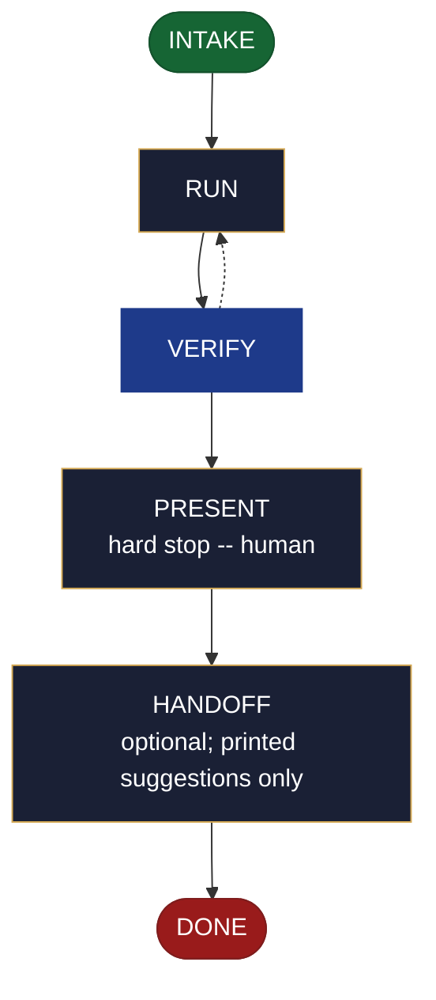

<!-- generated — do not edit; source: canonical/skills/aid-test/SKILL.md -->

## Frontmatter

- **`name`** — aid-test
- **`description`** — Run tests or checks and report the findings. Use when something must be verified.
- **`allowed-tools`** — Read Glob Grep Bash Shell Terminal Write Edit Agent
- **`argument-hint`** — &lt;target> -- what to test/verify (a suite/module, or a kind: security, performance, data-quality, model-eval)

[Definition: `canonical/skills/aid-test/SKILL.md`](https://github.com/AndreVianna/aid-methodology/blob/master/canonical/skills/aid-test/SKILL.md)

## Flow

## Source fragments

Every node in the chart above, in chart order, with the exact `canonical/` text it was derived from.

**1 · `INTAKE`** · _entry_

~~~~plaintext title="canonical/skills/aid-test/SKILL.md#L34-L60" wrap
## State: INTAKE

1. **Require a target.** Empty argument -> ask one bootstrapping question ("What should I
   test or verify?") and wait.
2. **Determine the verification kind** from the request (or the kind a sibling bound):
   functional (unit/integration/e2e), **security** (SAST/DAST/fuzz/dependency-audit),
   **performance** (workload/threshold/environment), **data-quality** (schema/freshness/
   completeness/uniqueness), or **model-eval** (run the eval harness, assert metric vs
   threshold). The framework is inferred from the KB (`test-landscape.md`).
3. **Pick the path:** **Fast** -- a clear target + kind ("run the security scan on the auth
   module", "benchmark the /orders endpoint vs the p99 SLO") -> run now. **Guided** -- vague
   -> scope target / kind / threshold first.
4. **Classify complexity (model + effort):** simple run -> `aid-reviewer` at **sonnet /
   medium**; deep security/perf analysis -> **opus / high**. Verifier tier >= producer.
5. **Allocate the work through the gate.** Run the Work Initiation Gate
   (`.aid/runtime/templates/work-initiation-gate.md`): `bash .aid/runtime/scripts/works/enumerate-works.sh`
   (main tree + every git worktree). Empty -> no prompt. Works exist -> ask the gate's
   new-vs-continuation question with the enumerated list.
   - **New work:** call the gate's `§ 3a` with the user's words, this skill's name (`aid-test`), its
     first step (`INTAKE`), `--path lite`, and a kebab-case slug from the target. The gate's `§ 3a` step 2 creates and enters the worktree (`worktree-lifecycle.sh create <work-id> <name>`),
     **then** allocate (`.aid/works/<work-id>-<slug>/`) the work folder and write its record through
     the writer, before it hands back: "`STATE.yml` was created by the gate;
     skip any instruction to write `initiator`, `active_skill`, `lifecycle` or `phase` by hand;
     set other keys through the writer." This skill drives no `phase`. When `/aid-orchestrate`
     passed an `intent:` block, write it into that STATE.yml as the engine's INTAKE Step 5 does
     (`.aid/runtime/templates/shortcut-engine.md`); a typed `/aid-test` writes none.
   - **Continuation:** On continuation, follow the gate's § 3b: enter the chosen work's worktree and run the skill its record names, at its saved step.
~~~~

[Source: `canonical/skills/aid-test/SKILL.md#L34-L60`](https://github.com/AndreVianna/aid-methodology/blob/master/canonical/skills/aid-test/SKILL.md#L34-L60) · [full step: `canonical/skills/aid-test/SKILL.md#L34-L62`](https://github.com/AndreVianna/aid-methodology/blob/master/canonical/skills/aid-test/SKILL.md#L34-L62)

**2 · `RUN`** · _step_

~~~~plaintext title="canonical/skills/aid-test/SKILL.md#L66-L76" wrap
## State: RUN

Execute the verification **read-only** (Bash: the test runner, scanner, benchmark, or
data-quality check per the kind; never mutate the source), capturing raw output. Then
dispatch **`aid-reviewer`** (clean context, tiered) to **consolidate** the raw results into
the global 7-column findings ledger (`reviewer-ledger-schema.md`) at
`.aid/.temp/review-pending/<work>-test.md`, applying the kind's guidance -- security:
SAST/DAST/fuzz/audit findings + severity; performance: measured-vs-threshold with the
workload/environment noted; data-quality: per-check pass/fail with thresholds; functional:
pass/fail + failures; model-eval: metric vs threshold. Every finding cites its evidence
(the run output + a `file:line` where applicable).
~~~~

[Source: `canonical/skills/aid-test/SKILL.md#L66-L76`](https://github.com/AndreVianna/aid-methodology/blob/master/canonical/skills/aid-test/SKILL.md#L66-L76) · [full step: `canonical/skills/aid-test/SKILL.md#L66-L78`](https://github.com/AndreVianna/aid-methodology/blob/master/canonical/skills/aid-test/SKILL.md#L66-L78)

**3 · `VERIFY`** · _loop-back_

~~~~plaintext title="canonical/skills/aid-test/SKILL.md#L82-L91" wrap
## State: VERIFY

1. **Mechanical grounding check** (no dispatch): every finding cites run output / a
   `file:line`; a metric/threshold finding states its threshold + measured value.
2. **Adversarial verification** -- a clean-context **`aid-reviewer`** checks the ledger:
   findings real and grounded in the run output, correctly severity-tagged, no
   over/under-statement, and the run actually exercised the stated scope. Writes a
   review-quality ledger to `.aid/.temp/review-pending/<work>-verify.md`.
3. **Grade:** `bash .aid/runtime/scripts/grade.sh --explain <ledger>`. Not clean -> loop
   to RUN/consolidate. Circuit-breaker: 3 cycles -> IMPEDIMENT, and the lifecycle set to `Blocked` through the writer.
~~~~

[Source: `canonical/skills/aid-test/SKILL.md#L82-L91`](https://github.com/AndreVianna/aid-methodology/blob/master/canonical/skills/aid-test/SKILL.md#L82-L91) · [full step: `canonical/skills/aid-test/SKILL.md#L82-L93`](https://github.com/AndreVianna/aid-methodology/blob/master/canonical/skills/aid-test/SKILL.md#L82-L93)

**4 · `PRESENT`** — hard stop -- human · _step_

~~~~plaintext title="canonical/skills/aid-test/SKILL.md#L97-L101" wrap
## State: PRESENT  (hard stop -- human)

The hard stop follows the ASK step of `skill-steps.md`. Present the consolidated findings, severity-ranked,
each with its evidence; state pass/fail against any threshold; and a printed suggestion:
"N issues found -- run `/aid-fix` to address them." Assert no resolution.
~~~~

[Source: `canonical/skills/aid-test/SKILL.md#L97-L101`](https://github.com/AndreVianna/aid-methodology/blob/master/canonical/skills/aid-test/SKILL.md#L97-L101) · [full step: `canonical/skills/aid-test/SKILL.md#L97-L103`](https://github.com/AndreVianna/aid-methodology/blob/master/canonical/skills/aid-test/SKILL.md#L97-L103)

**5 · `HANDOFF`** — optional; printed suggestions only · _step_

~~~~plaintext title="canonical/skills/aid-test/SKILL.md#L107-L110" wrap
## State: HANDOFF  (optional; printed suggestions only)

Printed suggestions: `/aid-fix` (address findings), `/aid-create-test` (add regression tests
for a bug found), `/aid-update*` (if a fix is a real change). Never auto-invoked.
~~~~

[Source: `canonical/skills/aid-test/SKILL.md#L107-L110`](https://github.com/AndreVianna/aid-methodology/blob/master/canonical/skills/aid-test/SKILL.md#L107-L110) · [full step: `canonical/skills/aid-test/SKILL.md#L107-L112`](https://github.com/AndreVianna/aid-methodology/blob/master/canonical/skills/aid-test/SKILL.md#L107-L112)

**6 · `DONE`** · _exit_ · HALT

~~~~plaintext title="canonical/skills/aid-test/SKILL.md#L116-L118" wrap
## State: DONE

Finish through the writer: `bash .aid/runtime/scripts/execute/writeback-state.sh --pipeline --field Lifecycle --value Completed`, which also clears the saved skill and step. Leave the findings ledger on disk for `/aid-fix`. Keep the work folder as the audit record.
~~~~

[Source: `canonical/skills/aid-test/SKILL.md#L116-L118`](https://github.com/AndreVianna/aid-methodology/blob/master/canonical/skills/aid-test/SKILL.md#L116-L118) · [full step: `canonical/skills/aid-test/SKILL.md#L116-L120`](https://github.com/AndreVianna/aid-methodology/blob/master/canonical/skills/aid-test/SKILL.md#L116-L120)
