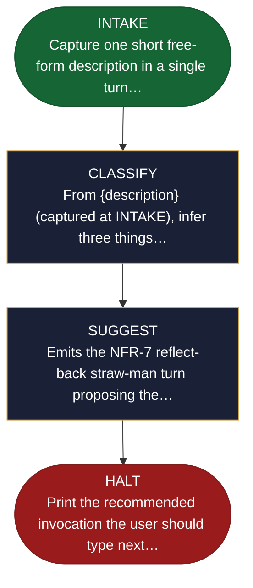

<!-- generated — do not edit; source: canonical/skills/aid-triage/SKILL.md -->

## Frontmatter

- **`name`** — aid-triage
- **`description`** — Suggest which AID entry point fits the work you describe; suggests only and writes nothing. Use when you know what you want to change but not which skill to run.
- **`allowed-tools`** — Read Glob Grep
- **`argument-hint`** — [description]  -- what you want to do; I'll point you at the right entry

[Definition: `canonical/skills/aid-triage/SKILL.md`](https://github.com/AndreVianna/aid-methodology/blob/master/canonical/skills/aid-triage/SKILL.md)

## Flow

## Source fragments

Every node in the chart above, in chart order, with the exact `canonical/` text it was derived from.

**1 · `INTAKE`** — Capture one short free-form description in a single turn… · _entry_

~~~~plaintext title="canonical/skills/aid-triage/SKILL.md#L71" wrap
| INTAKE | inline (below) | inline | CHAIN -> CLASSIFY |
~~~~

[Source: `canonical/skills/aid-triage/SKILL.md#L71`](https://github.com/AndreVianna/aid-methodology/blob/master/canonical/skills/aid-triage/SKILL.md#L71) · [full step: `canonical/skills/aid-triage/SKILL.md#L78-L99`](https://github.com/AndreVianna/aid-methodology/blob/master/canonical/skills/aid-triage/SKILL.md#L78-L99)

**2 · `CLASSIFY`** — From {description} (captured at INTAKE), infer three things… · _step_

~~~~plaintext title="canonical/skills/aid-triage/SKILL.md#L72" wrap
| CLASSIFY | `references/state-classify.md` | inline | CHAIN -> SUGGEST |
~~~~

[Source: `canonical/skills/aid-triage/SKILL.md#L72`](https://github.com/AndreVianna/aid-methodology/blob/master/canonical/skills/aid-triage/SKILL.md#L72) · [full step: `canonical/skills/aid-triage/references/state-classify.md#L1-L143`](https://github.com/AndreVianna/aid-methodology/blob/master/canonical/skills/aid-triage/references/state-classify.md#L1-L143)

**3 · `SUGGEST`** — Emits the NFR-7 reflect-back straw-man turn proposing the… · _step_

~~~~plaintext title="canonical/skills/aid-triage/SKILL.md#L73" wrap
| SUGGEST | `references/state-suggest.md` | inline | CHAIN -> HALT |
~~~~

[Source: `canonical/skills/aid-triage/SKILL.md#L73`](https://github.com/AndreVianna/aid-methodology/blob/master/canonical/skills/aid-triage/SKILL.md#L73) · [full step: `canonical/skills/aid-triage/references/state-suggest.md#L1-L98`](https://github.com/AndreVianna/aid-methodology/blob/master/canonical/skills/aid-triage/references/state-suggest.md#L1-L98)

**4 · `HALT`** — Print the recommended invocation the user should type next… · _exit_ · HALT

~~~~plaintext title="canonical/skills/aid-triage/SKILL.md#L74" wrap
| HALT | inline (below) | inline | -> halt |
~~~~

[Source: `canonical/skills/aid-triage/SKILL.md#L74`](https://github.com/AndreVianna/aid-methodology/blob/master/canonical/skills/aid-triage/SKILL.md#L74) · [full step: `canonical/skills/aid-triage/SKILL.md#L103-L127`](https://github.com/AndreVianna/aid-methodology/blob/master/canonical/skills/aid-triage/SKILL.md#L103-L127)
